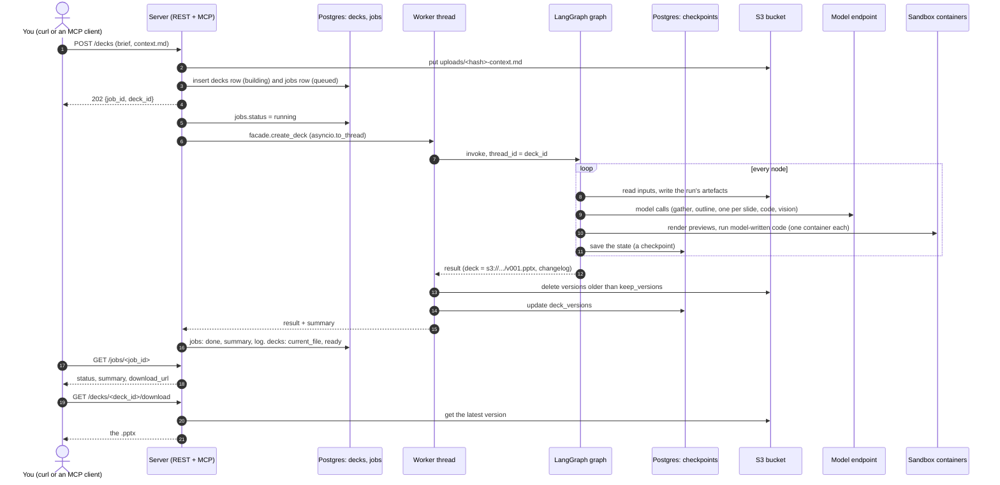
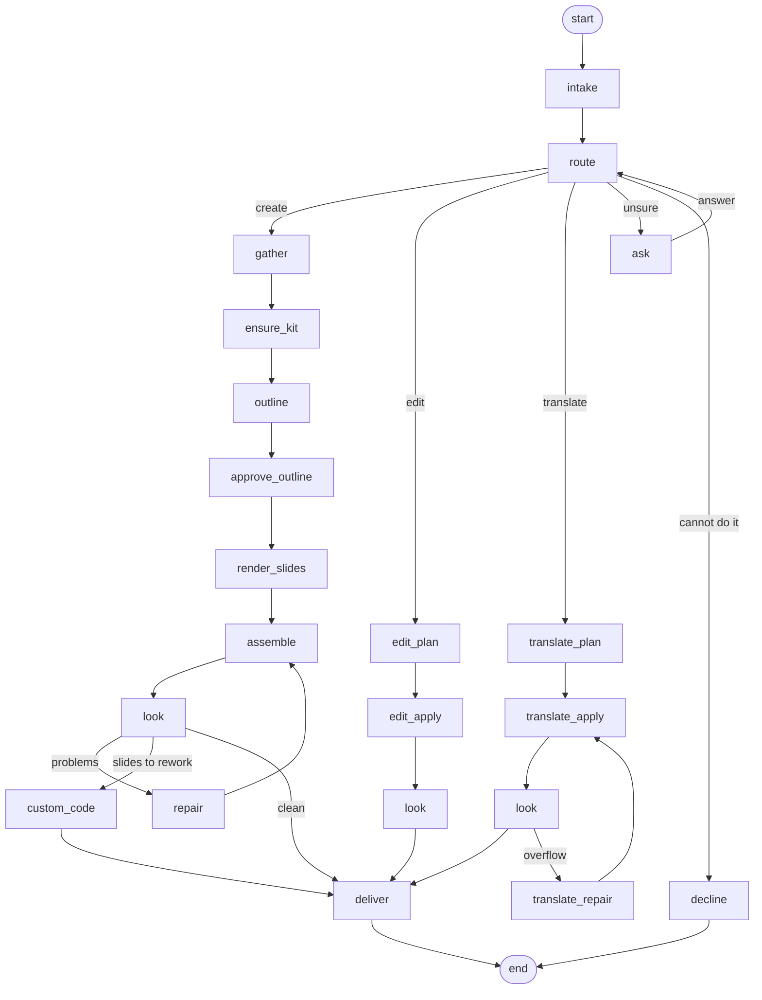
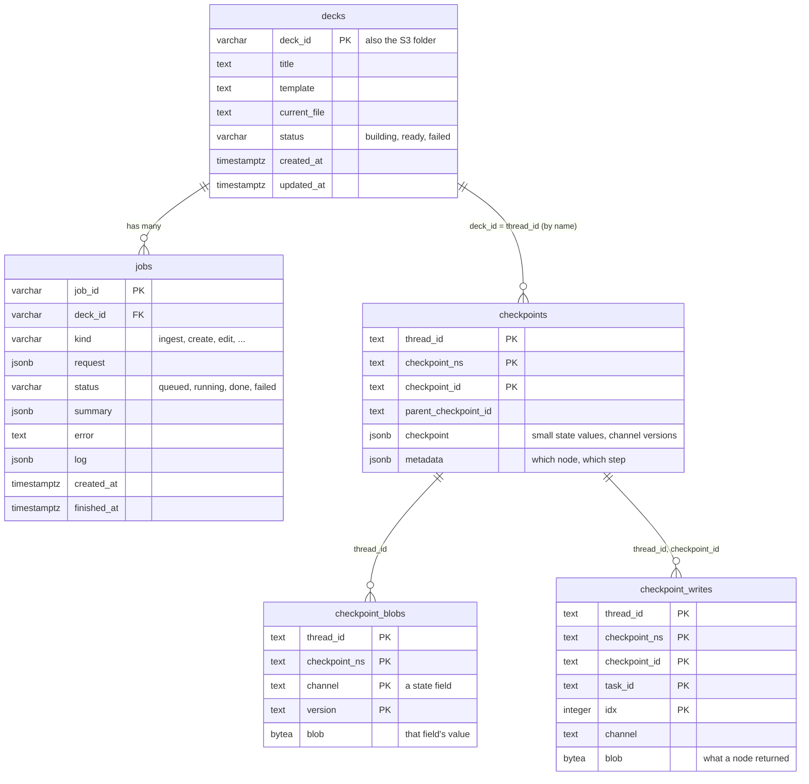

# deckops-agent

Builds and edits PowerPoint decks in your own corporate template, from whatever context you
give it - a document, some notes, a request typed into a chat.

```
"a deck explaining this, for engineers" + notes.md   → create
"make slide 3 less wordy"                            → edit
"slide 4 looks repetitive, change the layout"        → edit, onto another of the template's layouts
"translate it into French"                           → translate
"restyle this onto the new template"                 → declined, with the nearest thing offered
```

How it works, in one paragraph: a template is **ingested** once - its reusable layouts are found,
labelled and tested, and stored as a **kit**. A deck request goes through a LangGraph graph: the
facts the deck may state are gathered from your context and checked against it, an outline is
written, each slide is placed into one of the template's layouts, and the deck is built by a
deterministic engine (no model ever writes XML or coordinates), then checked for text that does
not fit, overlaps, and - optionally - looked at by a vision model. To stop a deck repeating the
template's few layouts, each layout is used at most twice; slides over that are reworked by
model-written code into diagrams, run in a locked-down container. Every turn is checkpointed in
Postgres, so a conversation can carry on later, from another process; every file lives in S3.

## The pieces

| | What | Why |
|---|---|---|
| **agent** | one Python process: the LangGraph graph and the engine (`engine/deckops`) | everything deterministic is pure Python |
| **Postgres** | the checkpointer, and the `decks` and `jobs` tables | the conversation's state after every node; a queryable record of every deck and every request |
| **S3** (SeaweedFS locally) | every deck version, kit, template, preview and manifest | the state holds only `s3://` references, so any process can resume |
| **sandbox image** | LibreOffice, poppler, fonts; started with no network, read-only, no capabilities | rendering slides, and running model-written code |

## Diagrams

### 1. A request, end to end



### 2. The LangGraph flow



**What each node does.** `run/` is the turn's folder in S3, `<deck_id>/<run_id>/`. After every
node LangGraph also saves the state in Postgres (a checkpoint) - not repeated in the table.

| Node | What it does | Model | Writes to S3 |
|---|---|---|---|
| `intake` | starts the turn; checks and reads any attached deck | - | - |
| `route` | decides: create, edit, translate, ask or decline | only when the rules are unsure | - |
| `ask` | stops and waits for your answer | - | - |
| `gather` | turns your request and documents into facts, each checked against its source | yes | `run/content_pack.json`, `run/gather_report.json` |
| `ensure_kit` | finds the template's kit (or builds it once) | building only | the kit, when built |
| `outline` | writes what each slide says | yes | `run/outline.json` |
| `approve_outline` | optionally waits for your approval | - | - |
| `render_slides` | puts each slide into a layout; marks over-used layouts for rework | yes, per slide | `run/render_attempts.json` |
| `assemble` | builds the deck (no model), checks it, renders previews | - | `<deck_id>/vNNN.pptx`, `run/plan.json`, `run/ops.json`, `run/previews/` |
| `look` | a vision model looks at each slide (if `vision_review` is on) | yes, if on | - |
| `repair` | sends slides that did not fit back to the model with exact limits | yes | `run/repair-N.json` |
| `custom_code` | reworks marked slides into diagrams with code, in the sandbox | yes | `<deck_id>/vNNN.pptx`, `run/custom-slide-N.py`, previews |
| `edit_plan` | turns an edit request into actions | yes | `run/edit_plan.json` |
| `edit_apply` | applies them, checks, renders | - | `<deck_id>/vNNN.pptx`, previews |
| `translate_plan` | translates the text, keeping formatting | yes | `run/translate_plan.json` |
| `translate_apply` | applies the translation, checks | - | `<deck_id>/vNNN.pptx`, previews |
| `translate_repair` | shortens translated text that overflows | yes | - |
| `deliver` | writes the run's record and the download link | - | `run/manifest.json` |
| `decline` | says why it will not do it | - | - |

**Around the graph** (the server, or the command line): before it runs, a `jobs` row
(`queued`, then `running`) and, for a create, a `decks` row; after it, the job is marked `done`
or `failed` with its summary, the deck row gets the latest file, and versions older than
`keep_versions` are deleted from S3.

### 3. The tables



## Setting it up on a new machine

### What the machine needs

| | | |
|---|---|---|
| **Docker** | Desktop 4.x or Engine 24+, running, 4 GB of memory or more | Postgres, S3 and the sandbox all run in it |
| **Python 3.12** | as `python3.12` on the PATH | `brew install python@3.12`, or `apt install python3.12 python3.12-venv` |
| **git**, **make** | any recent | |

macOS or Linux (Windows under WSL2). Free ports, all bound to 127.0.0.1: **55432** (Postgres),
**9000** (S3), **9333** (S3 status page) - change them in `docker/compose.yml` and
`config/agent.json` if taken. LibreOffice and fonts are **not** needed on the machine; they are
in the sandbox image. Network is needed once, for Docker Hub, Debian packages and PyPI.

### 1. Clone and build (about 10 minutes, mostly the image)

```bash
git clone git@github.com:pranaybahuguna/ppt-gen.git
cd ppt-gen
make setup
```

| Step | What it does | Done when |
|---|---|---|
| `make venv` | `.venv`, the pinned dependencies (the agent's and the engine's), and the project itself | `.venv/bin/deckops --help` works |
| `make config` | `config/agent.json` from `config/agent.example.json`, if there is none | prints `wrote config/agent.json` |
| `make image` | builds `deckops/sandbox:0.1.0` | `docker images` lists it |
| `make fonts` | copies the metric-compatible fonts out of the image into `local/fonts/` | prints a font count |
| `make samples` | the sample deck and template the tests and the demo use | lists `local/samples/` |

### 2. Start the services

```bash
make up        # Postgres and S3 in Docker, with named volumes
make init      # checkpoint tables and the bucket
make doctor    # checks engine, fonts, sandbox, Postgres, S3, model - must end with READY
make test      # unit tests, nothing running needed (their database is SQLite, through aiosqlite)
make test-all  # + integration tests against Docker, Postgres (asyncpg) and S3
make lint      # unused imports and undefined names
```

### 3. Give it a model

```bash
cp llm.example.json llm.json
```

```json
{"base_url": "https://api.openai.com", "model": "gpt-6.1-sol", "api_key": "sk-..."}
```

Any OpenAI-compatible `/v1/chat/completions` endpoint. `llm.json` is git-ignored and is the
**only** place a model credential is read from. The vision steps need a model that accepts
images; without one, keep `"vision_review": false`. Without `llm.json` at all, `make demo` still
runs a whole conversation with the offline planner.

### 4. Ingest your template

```bash
.venv/bin/deckops kit "path/to/Your Template.pptx" --out local/templates/yours/kit.json --make-default
```

Two to five minutes. It finds the reusable layouts, renders them, has the model label each box,
builds test decks to accept or reject each layout, and measures how many items each one holds;
it prints what was accepted and what was dropped, and why. The kit goes to `kits/<hash>.json` and
the prepared template to `uploads/` in the bucket; `--make-default` makes it the template decks
use. With `single_kit` on, ingesting replaces the previous kit.

### 5. Make a deck

```bash
.venv/bin/deckops create my-deck "explain this to engineers: what it is, how it works, where it stands" \
    --context path/to/notes.md
```

or with the context in the request:

```bash
.venv/bin/deckops create pilot "a deck on the support bot pilot: it ran eight weeks across two \
teams; the bot answered 38% of tickets; median first response fell from 11 to 3 hours"
```

Five to ten minutes for twelve slides. The result's `deck` is the file in the bucket and `url` a
download link. Then, in the same conversation, any time later:

```bash
.venv/bin/deckops get <deck uri from the result> my-deck.pptx
.venv/bin/deckops edit my-deck "make slide 4 less wordy"
.venv/bin/deckops translate my-deck fr --slides 1,2
.venv/bin/deckops ask my-deck "anything - the router decides"
.venv/bin/deckops session my-deck
.venv/bin/deckops undo my-deck
.venv/bin/deckops attach my-deck existing.pptx "shorten slide 2"   # a deck from elsewhere
```

With `source .venv/bin/activate` the command is just `deckops`.

## The server: MCP and REST

```bash
make serve          # or: .venv/bin/deckops serve [--host 0.0.0.0] [--port 8765]
```

One process on http://127.0.0.1:8765 serves both:

- **REST**, for curl, scripts and testing by hand (below);
- **MCP** at `http://127.0.0.1:8765/mcp` (streamable HTTP), for Claude or any MCP client. Its
  tools: `ingest_template`, `create_deck`, `edit_deck`, `translate_deck`, `ask`, `answer`, `undo`,
  `get_deck`, `rename_deck`, `list_decks`, `delete_deck`, `job_status`, `list_jobs`. To add it to Claude Code:
  `claude mcp add --transport http deckops http://127.0.0.1:8765/mcp`.

Long operations (ingesting, creating) run as **jobs**: the request returns `202` with a
`job_id` at once; poll `GET /jobs/<job_id>` for its status and live log, or add `?wait=true`
to hold the request until it finishes. Every finished result has a **`summary`** - what
changed, one line each - and a **`download_url`** for the `.pptx`, served by this server.

### Every REST endpoint

Bodies are JSON or a multipart form (`-F`); files must be multipart. "Job" means the response is
the job object below - `202` while it runs, `200` when finished (or with `?wait=true`).

| Method and path | Body | Returns |
|---|---|---|
| `GET /health` | - | `{ok, bucket, default_template, jobs_running}` |
| `POST /templates` | file `file` (the .pptx); `make_default` (default `true`) | job; result: `{ok, template_id, kit, template, patterns, capacity, dropped, replaced}` |
| `POST /decks` | `brief` (required); `title` (the brief if missing); `deck_id` - if missing, made from the title: its first five words, lower-case, joined by underscores, plus a 6-character unique part (`Support bot pilot - ops review` -> `support_bot_pilot_ops_review_7f3a9c`); context as files `context` (repeatable: .md .txt .csv .json .docx), text `context`, or `context_uris` (s3:// or server paths); `template` (s3:// URI) or file `template`; optional `outline`, `content_pack` (JSON, skip the model's writing) | job; result: the deck result below |
| `POST /decks/{deck_id}/edit` | `instruction` | job; deck result |
| `POST /decks/{deck_id}/translate` | `lang`; optional `slides` (1-based list) | job; deck result |
| `POST /decks/{deck_id}/ask` | `instruction` - the router decides what it is | job; deck result, or `{question}` |
| `POST /decks/{deck_id}/answer` | `text` - answers the question the last run asked | job; deck result |
| `POST /decks/{deck_id}/attach` | file `file` (a .pptx from elsewhere); optional `instruction` | job; deck result |
| `POST /decks/{deck_id}/undo` | - | `{ok, deck, dropped, versions}`; recorded as an `undo` job |
| `GET /decks` | - | `{decks: [{deck_id, title, status, template, current_file, jobs, created_at, updated_at, download_url}]}`, latest change first (the `decks` table) |
| `GET /decks/{deck_id}` | - | the deck's row (`title, status, current_file, ...`) and its conversation: `{exists, versions, version_urls, download_url, kit, turn, trace, pending_question}` |
| `PATCH /decks/{deck_id}` | `title` | the deck's row; the `deck_id` never changes |
| `GET /decks/{deck_id}/download` | `?version=N` (default: latest) | the `.pptx` file |
| `DELETE /decks/{deck_id}` | - | what was deleted: `{deleted_objects, freed, deleted_sessions, deleted_rows}` - files, conversation, the deck's row and its jobs |
| `GET /jobs/{job_id}` | `?wait=true` to hold until it finishes | the job object |
| `GET /jobs` | `?deck_id=` one deck's; `?limit=` (default 50) | jobs from the `jobs` table, newest first: `{job_id, kind, deck_id, status, request, summary, error, seconds, created_at, finished_at}` |

The job object: `{job_id, kind, deck_id, status: queued|running|done|failed, request, summary,
error, seconds, created_at, finished_at, log, result, status_url}`. The deck result: `{ok, deck,
version, versions, summary, download_url, changelog, warnings, errors, previews, route,
manifest}` - `version` is the deck's version number, `versions` how many are kept; when the run stopped to ask, `{ok: false,
question}`; when it declined, `{ok: false, reason, errors}`.

Errors are `{error}` with `400` (bad input), `404` (no such deck, version, job or action), `409`
(that deck already has a job running) or `500`.

```bash
# ingest a template (multipart upload); it becomes the default
curl -X POST localhost:8765/templates -F file=@"Your Template.pptx"

# create a deck from a document - returns a job
curl -X POST localhost:8765/decks -F deck_id=pilot -F brief="explain this to engineers" \
     -F context=@notes.md
curl localhost:8765/jobs/<job_id>                    # status, log, and the result when done

# or with JSON, notes in the request, held until done
curl -X POST 'localhost:8765/decks?wait=true' -H 'content-type: application/json' \
     -d '{"deck_id": "pilot", "brief": "a deck on the pilot", "context": "it ran eight weeks..."}'

curl -X POST 'localhost:8765/decks/pilot/edit?wait=true' -H 'content-type: application/json' \
     -d '{"instruction": "make slide 4 less wordy"}'
curl -X POST 'localhost:8765/decks/pilot/translate?wait=true' -H 'content-type: application/json' \
     -d '{"lang": "fr", "slides": [1, 2]}'
curl -X POST 'localhost:8765/decks/pilot/attach?wait=true' -F file=@existing.pptx \
     -F instruction="shorten slide 2"
curl -X POST localhost:8765/decks/pilot/undo

curl -OJ localhost:8765/decks/pilot/download          # the latest .pptx (?version=N for others)
curl localhost:8765/decks/pilot                       # versions, with a download link for each
curl localhost:8765/decks                             # every deck
curl -X DELETE localhost:8765/decks/pilot             # files and conversation
curl localhost:8765/health
```

A finished result looks like:

```json
{"status": "done", "seconds": 312.4, "result": {
   "ok": true, "versions": 3, "download_url": "http://127.0.0.1:8765/decks/pilot/download",
   "summary": ["create: version 3 of the deck",
               "built 12 slides from the template's layouts (cover x1, columns x2, text x2, cards x1)",
               "designed slide 3 as a hub and spoke - A central circle ...",
               "warning: ..."],
   "changelog": [...], "warnings": [...], "deck": "s3://deckops/pilot/v003.pptx"}}
```

Every job is a row in the `jobs` table (see [Data model](#data-model)), so it outlives the
server; its live log and full result are held in memory while the server runs, and afterwards
the row keeps its summary, error and log. One job runs per deck at a time (a second gets `409`),
and `server_workers` (2) run at once.

## Data model

Postgres holds six tables: four belong to LangGraph's checkpointer, two to this project.
The diagram of all six is under [Diagrams](#3-the-tables).

**LangGraph's checkpointer** stores each conversation's state, so a later turn - or another
process, or the answer to a question the graph asked - carries on from exactly where it stopped.
All four are keyed by `thread_id`, which is the `deck_id`. LangGraph creates and writes them
(`make init` runs its migrations); this project never writes them directly.

| Table | One row is | Written |
|---|---|---|
| `checkpoints` | a snapshot of the state after one step: the small values inline (`checkpoint` jsonb), which version of each large field it uses, and `metadata` (which node, which step) | after every node |
| `checkpoint_blobs` | one large state field (`channel`: `outline`, `plan`, `deck_versions`, ...) at one version, serialised | when that field changes - unchanged fields are not copied again |
| `checkpoint_writes` | what one node returned, before it is folded into the next checkpoint; how an interrupted run resumes (`ask`, `approve_outline`) | as each node finishes |
| `checkpoint_migrations` | the checkpointer's own schema version | by `make init` |

They grow with every step of every turn - around twenty checkpoints for a create - and
are removed with the deck: `DELETE /decks/{id}` and `deckops clean` call the checkpointer's
`delete_thread`. Reading a conversation's state means unpacking these blobs, which is why the
records people query are kept in tables of their own.

**The project's own two tables** (`src/deck_agent/db/`) record what people and programs ask
about: which decks exist, and what was done to each.

**decks** - one row per presentation

| Column | Type | What it holds |
|---|---|---|
| `deck_id` | varchar(64), **primary key** | the permanent name; also the S3 folder and the LangGraph `thread_id` |
| `title` | text | the human name; can be renamed |
| `template` | text | the template it was built from (s3://) |
| `current_file` | text | the latest `.pptx` (s3://) |
| `status` | varchar(16) | `building` / `ready` / `failed` |
| `created_at`, `updated_at` | timestamptz | |

**jobs** - one row per request

| Column | Type | What it holds |
|---|---|---|
| `job_id` | varchar(32), **primary key** | random, one per request |
| `deck_id` | varchar(64), **foreign key → decks.deck_id**, indexed | the deck it worked on; empty for a template ingest |
| `kind` | varchar(16) | `ingest` / `create` / `edit` / `translate` / `ask` / `answer` / `attach` / `undo` |
| `request` | jsonb | what was asked, e.g. `{"instruction": "make slide 4 less wordy"}` |
| `status` | varchar(16), indexed | `queued` / `running` / `done` / `failed` |
| `summary` | jsonb | what changed, one line each |
| `error` | text | why it failed |
| `log` | jsonb | the run's log lines (the last 200) |
| `created_at`, `finished_at` | timestamptz | |

One deck has many jobs; deleting a deck deletes its jobs.

```
decks (1) ────────< jobs (many)            deck_id = S3 folder = LangGraph thread_id
```

**When rows are written** (`src/deck_agent/db/repo.py`):

| Moment | Write |
|---|---|
| a request arrives (server or CLI) | `jobs`: a row, `queued`, with the request. `decks`: a row, `building`, for a create (other requests make one only if the deck has none) |
| the work starts | `jobs.status = running` |
| the work finishes | `jobs`: `done` or `failed`, `summary`, `error`, `log`, `finished_at`. `decks`: `current_file`, `status`, `updated_at` (a failed create leaves the deck `failed`; a failed edit leaves it as it was) |
| a deck is renamed | `decks.title` |
| a deck is deleted (`DELETE /decks/...`, `deckops clean`) | its jobs, then its row - with its files and its conversation |
| the server starts | jobs left `queued`/`running` by a server that stopped are marked `failed` |

The rows are written by the server (every REST route and MCP tool) and by the command line
(`create`, `edit`, `translate`, `ask`, `answer`, `attach`, `undo`, `kit`). A program calling
`facade` directly is not recorded. The tables are created by `make init`, and on first use.

**Async.** The tables are read and written with SQLAlchemy 2 (async) through asyncpg. The server
is async throughout - routes, MCP tools, and jobs (asyncio tasks) - and runs the graph itself,
which is synchronous (python-pptx, LibreOffice and model calls), in worker threads
(`asyncio.to_thread`). The command line calls the same async functions with `db.engine.run`.
The checkpointer stays LangGraph's `PostgresSaver` on psycopg: it is used from inside the graph,
which runs in those threads.

**Versions.** Each version is a whole copy of the deck (16-22 MB with a picture-heavy template).
`keep_versions` (2 in the example config) keeps the newest two after each turn - the current
one, and the one `undo` goes back to - and deletes the rest. Numbering carries on from the
newest (`v007` follows `v006` even when `v001`-`v005` are gone). `0` keeps every version.

## Using it from another program

```python
from deck_agent import facade

facade.create_deck(deck_id, "what the deck is for", template=template_uri, context=[doc_uri])
facade.edit_deck(deck_id, "make slide 2 shorter")
facade.translate_deck(deck_id, "fr", slides=[1, 2])
facade.ask_deck(deck_id, "...")        # let the router decide
facade.answer(deck_id, "...")          # answer a question the graph asked
facade.session(deck_id)
facade.undo(deck_id)
```

`deck_id` is the conversation: the LangGraph thread and the folder in the bucket. Every call
returns one of three shapes:

```json
{"ok": true,  "deck": "s3://...", "url": "...", "previews": [...], "warnings": [], "changelog": [...]}
{"ok": false, "question": "Which language should I translate it into?"}
{"ok": false, "reason": "...", "errors": [...]}
```

## How the sandbox runs

Docker Compose runs only the two services that stay up: **Postgres** and **SeaweedFS** (`make up`).
The sandbox is not a service. `make image` builds `deckops/sandbox:0.1.0` once, and the agent starts
a fresh container from it **per job**, with `docker run` from `src/deck_agent/sandbox/docker.py`:

- one per **render** (slide previews: LibreOffice to PDF, poppler to PNG) - `runner/render.py`;
- one per **model-written code** attempt - `runner/code_harness.py`;
- one for `make selftest` - `runner/selftest.py`.

Each runs with `--network none --read-only --cap-drop ALL --security-opt no-new-privileges`,
memory, CPU and process limits, the job's scratch folder mounted at `/work`, and as your own
user id. It is removed after its exit code and output have been read.

The image holds LibreOffice (impress), poppler, the metric-compatible fonts (Carlito, Caladea,
Liberation, DejaVu) and, for model-written code, python-pptx, lxml, Pillow and XlsxWriter
(`runner/requirements.txt`). The fonts are also copied out (`make fonts`) because the agent
measures text with them.

## The graph

```bash
make graph     # prints it as mermaid, from the code
```

```
intake → route ─┬─ create:    gather → ensure_kit → outline → approve_outline → render_slides
                │                → assemble → look → (repair → assemble …) → custom_code → deliver
                ├─ edit:      edit_plan → edit_apply → look → deliver
                ├─ translate: translate_plan → translate_apply → look → (translate_repair …) → deliver
                ├─ ask:       stops (interrupt) and waits for `answer`, then routes again
                └─ decline:   says why
```

| Node | What it does | Model? |
|---|---|---|
| `route` | rules first; a model only when the rules are unsure; ask when neither is | sometimes |
| `gather` | context → facts, each with a quote that code checks against the source | yes |
| `ensure_kit` | finds the template's kit by content hash, or builds it once | building only |
| `outline` | what each slide says, using only the facts | yes |
| `render_slides` | each slide placed into a layout that can hold it, checked and retried; layout budget applied | yes, per slide |
| `assemble` | the engine builds the deck; overflow, overlap, structure checked against the template's own slides | no |
| `look` | a vision model reviews each rendered slide (`vision_review`) | yes, if on |
| `repair` | slides that did not fit go back with a precise target ("at most 27 characters") | yes |
| `custom_code` | reworks over-budget slides into diagrams, and draws slides no layout holds; sandboxed, checked, looked at | yes |
| `deliver` | manifest, download link, the result | no |

**Model-written code** is the one place a model produces anything spatial, so it is fenced: a
static check rejects disallowed imports before it runs; it runs in a throwaway container with no
network, a read-only root and tight memory and time limits; every other slide is restored byte
for byte afterwards; and the slide faces the same checks as every other, plus the vision review.
A slide it cannot get right keeps its template layout.

## Settings

`config/agent.json` (git-ignored; `make config` writes it). Any key can be set for one run with
`DECKOPS_<KEY>`, e.g. `DECKOPS_VISION_REVIEW=true`. All of them, with comments, are in
`src/deck_agent/settings.py`.

| Key | Example config | What it does |
|---|---|---|
| `default_template` | set by `kit --make-default` | the template a deck uses when none is named |
| `allow_custom_code` | `true` | lets model-written code rework and draw slides |
| `layout_reuse` | `2` | each template layout at most this many times per deck; `0` = no limit |
| `code_attempts` | `3` | tries per model-written slide |
| `vision_review` | `false` | look at every rendered slide; slower, catches what arithmetic cannot |
| `approve_outline` | `false` | stop after the outline and wait for an `answer` |
| `single_kit` | `true` | keep one template kit; ingesting replaces it |
| `keep_versions` | `2` | deck versions kept after each turn; `0` keeps them all |
| `db_url` | empty | the decks and jobs tables; empty means `pg_dsn` with the asyncpg driver |
| `tidy_after_turn` | `false` | after each turn, drop the deck's older run artefacts |
| `render_backend`, `code_runner` | `docker` | `off` to run without the sandbox |
| `s3_endpoint`, `pg_dsn` | the local containers | point at any S3 and Postgres |
| `llm_client` | `openai-compat` | `langchain`, or `stub` for no model |
| `server_host`, `server_port` | `127.0.0.1`, `8765` | where `deckops serve` listens |
| `server_url` | empty | the address put in download links, when callers reach the server by another name |

## Storage and clean-up

```
<deck_id>/v001.pptx, v002.pptx ...     every version; undo drops the last
<deck_id>/<run>/manifest.json          what that turn did: route, trace, warnings
<deck_id>/<run>/outline.json, plan.json, ops.json, previews/, custom-slide-N.py ...
kits/<hash>.json                       ingested template kits
uploads/<hash>-<name>.pptx             templates and attached decks
```

```bash
.venv/bin/deckops ls                          # one line per deck
.venv/bin/deckops ls my-deck/ -r              # every file for one deck
.venv/bin/deckops clean                       # what is there, which decks have conversations
.venv/bin/deckops clean --tidy --yes          # drop old runs' bulk, keep every deck usable
.venv/bin/deckops clean --deck my-deck --yes  # one deck: files and conversation together
.venv/bin/deckops clean --all --yes           # everything
make clean-scratch                            # local run output in local/
make destroy-data                             # the Docker volumes: every deck, conversation and row
```

Every `clean` is a dry run until `--yes`; deleting a deck deletes its row and its jobs as well.
Only the newest `keep_versions` versions of each deck are kept anyway (see Data model).

To browse the bucket with the AWS CLI instead, give it
the development credentials (your own AWS keys are rejected):

```bash
aws configure set aws_access_key_id deckops --profile deckops
aws configure set aws_secret_access_key deckops-dev-secret --profile deckops
aws configure set region us-east-1 --profile deckops
aws --profile deckops --endpoint-url http://localhost:9000 s3 ls s3://deckops/
```

Data does not travel with the code: decks and conversations are in this machine's Docker
volumes. On another machine, set up, ingest the template again, and build there - or point both
machines' `s3_endpoint` and `pg_dsn` at shared services.

## What is where

```
src/deck_agent/        the agent: graph, state, nodes, model layer, sandbox clients, storage
src/deck_agent/server.py   the MCP + REST server (deckops serve)
src/deck_agent/db/     the decks and jobs tables: models, async engine, every read and write
engine/deckops/        the engine that reads and writes .pptx (its README says what is in it)
runner/                what runs inside the sandbox image
docker/                compose, the Dockerfiles, the S3 identities
config/                agent.example.json
tests/unit/            tests that need nothing running (pytest; async ones with the anyio plugin)
tests/integration/     tests that need Docker, Postgres and S3, and skip with a reason otherwise
tests/demo.py          a whole conversation with no model      -> make demo
tests/validate_real_model.py   every model call against a real endpoint
llm.example.json       copy to llm.json
```

Never committed: `llm.json`, `config/agent.json`, `local/`.

## When something is wrong

| What you see | Fix |
|---|---|
| `python3.12: command not found` | install Python 3.12 |
| `port is already allocated` on `make up` | change the port in `docker/compose.yml` and `config/agent.json` |
| `doctor`: Postgres / object storage not reachable | `make up`, then `make init` |
| `doctor`: image not built / fonts not exact | `make image` / `make fonts` |
| `No module named deck_agent` | use `.venv/bin/deckops`, or run `make venv` again |
| `InvalidAccessKeyId` from `aws` | use the `deckops` profile above, or `deckops ls` |
| a deck with `warnings` | the checks found something repair could not fix; each warning names its slide |
| "keeps its template layout" | a slide over the layout budget could not be reworked; its content is there, in the template's layout |

## Not done yet

- Numbers on a finished slide are not checked against the fact they cite (facts are checked
  against the source when gathered).
- Restyling a whole deck onto a different template; adding a card to an existing slide.
- Picture slots; slides holding real charts are skipped when a template is ingested.
- Rendering previews of a template that has hidden slides offsets the page numbers.
- Runs made by a program calling `facade` directly are not recorded in the `jobs` table (the
  server and the command line are).
