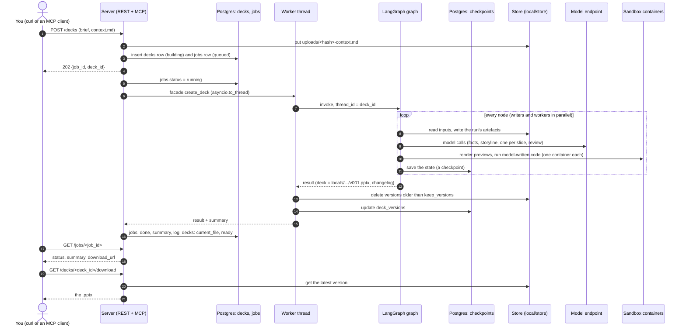
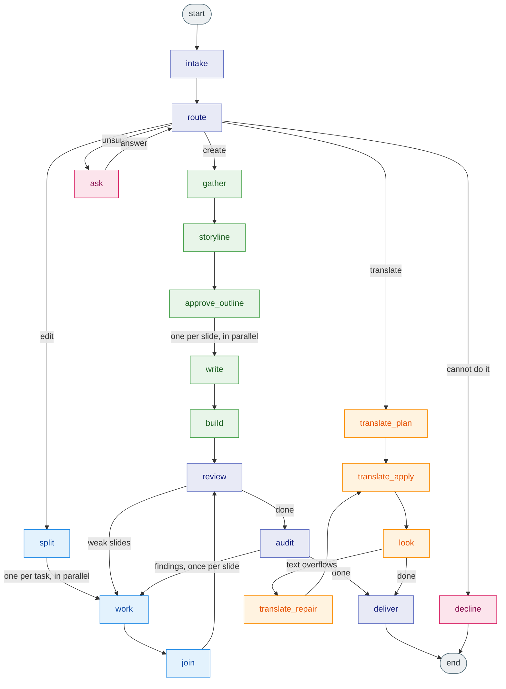
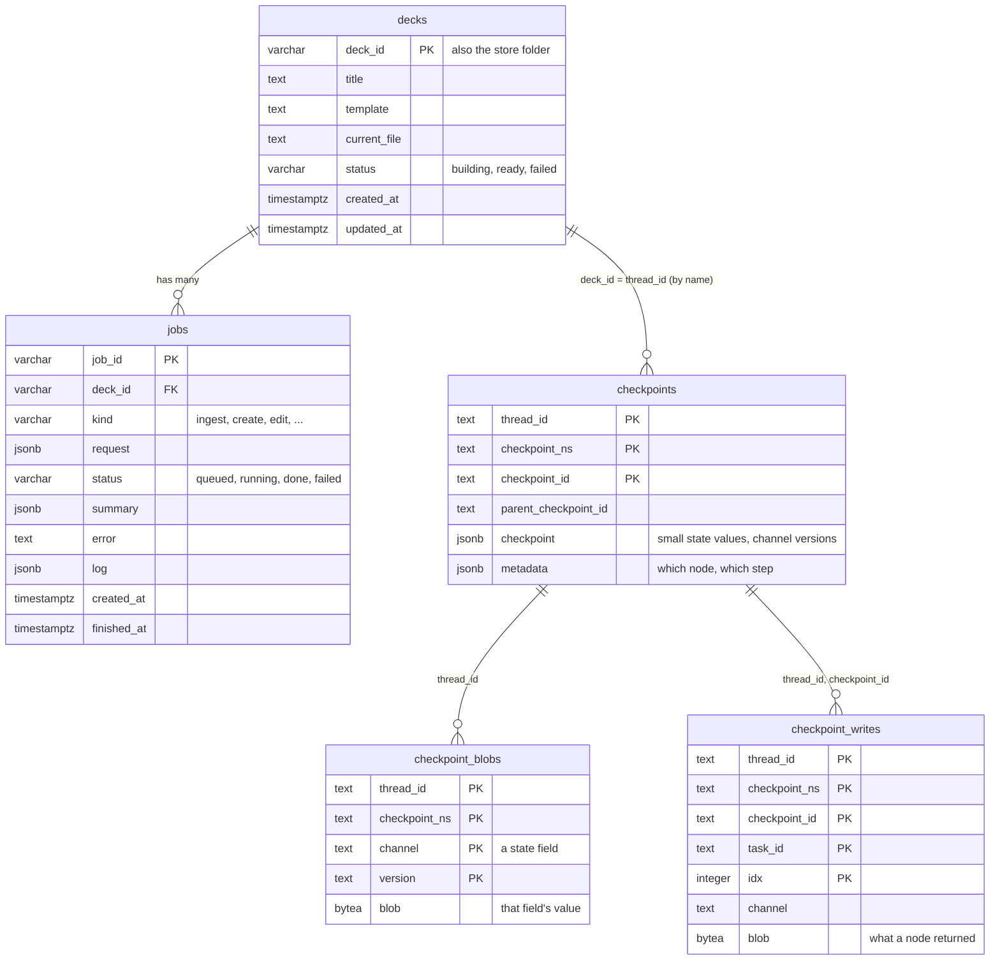
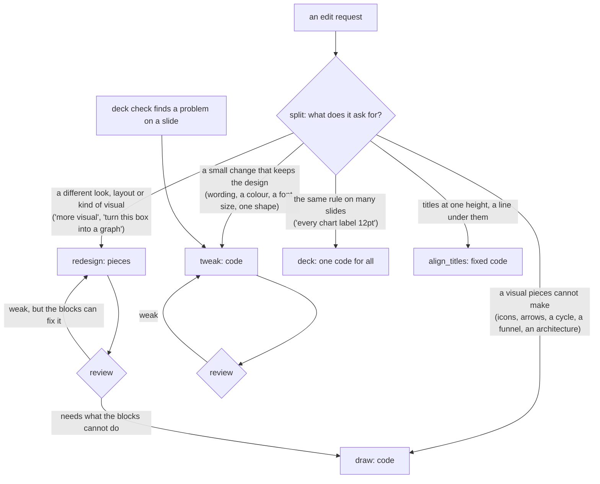

# deckops-agent

Builds and edits PowerPoint decks in your own corporate template, from whatever context you
give it - a document, some notes, a request typed into a chat - and edits any deck, including
one people have already edited by hand.

```
"a deck explaining this, for engineers" + notes.md       → create
"make slide 3 more visual; fix the typo on slide 6"      → edit: one task per slide, in parallel
"turn the right-hand box on slide 8 into a chart"        → edit (redesign of one slide)
"translate it into French"                               → translate
"restyle slide 5" / "rebrand the deck"                   → edit (redesigned in the deck's own template)
```

How it works, in one paragraph. **Create:** the facts the deck may state are gathered from your
context and checked against it; a storyline plans the argument - a full-sentence *action title*
per slide, the visual that makes each point, the facts behind it; then every slide is written
**in parallel** as a *spec* (the words, and which pieces show them - KPI cards, native charts,
steps, comparisons, timelines, tables, ...), and drawn on the template's own layout in its own
colours and fonts by code that measures every word, so nothing overflows. **Edit:** a request is
split into **one task per slide**, done in parallel - a *redesign* rebuilds a slide from its
content, a *draw* redraws it as a custom visual with model-written code, a *tweak* changes it in
place with code - and joined into one new version in which every slide nobody touched keeps its
original bytes. **Both** end with a vision model comparing each new or changed slide (before and
after) with what was asked, and sending weak ones round again (up to three times), and then a
**deck check** across all slides: chart number formats, chart colours and title sizes fixed by
code, units and numbers checked against the facts by a model. Checks are advice, not gates:
problems go back to the model, the best attempt is kept, and what is left is reported as a
warning. Every turn is checkpointed in Postgres; every file lives in the store, a folder (`local/store`).

[Step by step](#step-by-step-what-happens-what-goes-in-what-comes-out) follows one request
through every node, with what goes in and comes out; [Pieces or code](#pieces-or-code-who-draws-a-slide)
says when a slide is drawn from building blocks and when the model writes code for it.

## The pieces

| | What | Why |
|---|---|---|
| **agent** | one Python process: the LangGraph graph, the slide renderer (`src/deck_agent/design`) and the engine (`engine/deckops`, used for translation) | everything deterministic is pure Python |
| **Postgres** | the checkpointer, and the `decks` and `jobs` tables | the conversation's state after every node; a queryable record of every deck and every request |
| **the store** (`local/store/`) | every deck version, template, preview and manifest, as files | the state holds only `local://deckops/<key>` references, never scratch paths, so any process can resume |
| **sandbox image** | LibreOffice, poppler, fonts; started with no network, read-only, no capabilities | rendering slides, and running model-written code |

## Diagrams

### 1. A request, end to end



### 2. The LangGraph flow



Colours: **purple** - shared; **green** - create; **blue** - edit; **orange** - translate;
**pink** - stops (a question, or a refusal). `write` and `work` are each *one node run many
times at once* (LangGraph `Send`): one `write` per content slide, one `work` per edit task;
`build` and `join` wait for all of them. A new deck's weak slides are redone by the edit
route's `work` and `join`, exactly like an edited slide.

**What each node does.** `run/` is the turn's folder in the store, `<deck_id>/<run_id>/`. After every
node LangGraph also saves the state in Postgres (a checkpoint) - not repeated in the table.

| Node | What it does | Model | Writes to the store |
|---|---|---|---|
| `intake` | starts the turn; checks and reads any attached deck | - | - |
| `route` | decides: create, edit, translate, ask or decline | only when the rules are unsure | - |
| `ask` | stops and waits for your answer | - | - |
| `gather` | turns your request and documents into facts, each checked against its source | yes | `run/content_pack.json`, `run/gather_report.json` |
| `storyline` | plans the argument: action titles, sections, a visual and facts per slide | yes | `run/storyline.json` |
| `approve_outline` | optionally waits for your approval of the storyline | - | - |
| `write` ×N | writes one slide's spec; checks it (limits, invented numbers, text that will not fit) and revises | yes, per slide | - |
| `build` | draws every spec on the template, publishes the deck, renders previews | - | `<deck_id>/vNNN.pptx`, `run/specs.json`, `run/previews/` |
| `split` | turns an edit request into one task per slide | yes | - |
| `work` ×N | does one task: redesign (a new spec), draw or tweak (code, tried in the sandbox) | yes, per task | - |
| `join` | applies every task's result in one pass; untouched slides keep their bytes | - | `<deck_id>/vNNN.pptx`, previews |
| `review` | a vision model compares each new or changed slide with what was asked; weak ones go round again (up to `revision_rounds`) | yes | - |
| `audit` | the deck check: the whole deck once more, across slides. Code fixes chart number formats (8 shown as 800%), chart colours (one per category on every slide, distinct within a chart, on the palette) and content title sizes; it finds text too small to read. One text-only model call checks every chart's units, axis titles and numbers, and the slides against the source facts. Slides with findings go back to `work` once; the rest are warnings | yes, once per request | `<deck_id>/vNNN.pptx` when it fixed something |
| `translate_plan` | translates the text, keeping formatting | yes | `run/translate_plan.json` |
| `translate_apply` | applies the translation, checks | - | `<deck_id>/vNNN.pptx`, previews |
| `look` | a vision model looks at a translation (if `vision_review` is on) | yes, if on | - |
| `translate_repair` | shortens translated text that overflows | yes | - |
| `deliver` | writes the run's record and the download link | - | `run/manifest.json` |
| `decline` | says why it will not do it | - | - |

**Around the graph** (the server, or the command line): before it runs, a `jobs` row
(`queued`, then `running`) and, for a create, a `decks` row; after it, the job is marked `done`
or `failed` with its summary, the deck row gets the latest file, and versions older than
`keep_versions` are deleted from the store.

### 3. The tables



## Step by step: what happens, what goes in, what comes out

This section follows one request through the graph, node by node. For each step it says what
the step is given, what it decides, what it hands on, and where its output is kept. The state
(the `DeckState` fields named in `code` below) is saved in Postgres after every node, and every
file goes to the store (`local/store/deckops/`); `run/` means `<deck_id>/<run_id>/`.

### Every request starts the same way

**0. The caller.** `POST /decks` (create) or `POST /decks/<id>/<action>` (`edit`,
`translate`, `attach`, ...; [every endpoint](#every-rest-endpoint)), or the same as MCP tools. The server stores any uploaded file in the store under
`uploads/`, writes a `jobs` row (`queued`), answers `202 {job_id, deck_id}` at once, and runs the
graph in a worker thread. The graph is started with:

```json
{"instruction": "make slide 3 more visual and fix the typo on slide 6",
 "attachments": ["local://deckops/uploads/<hash>-deck.pptx"],
 "context_docs": ["local://deckops/uploads/<hash>-notes.md"],
 "content_pack": null}
```

On an existing deck the request's own fields are reset first (`state.turn_reset`): last
request's tasks, notes and previews are cleared; the deck's versions, its template, its
storyline, its facts and its palette stay.

**1. `intake`** - gives the turn a run id; checks every attached file before anything opens it
(it is untrusted input) and sorts attachments: a deck to work on becomes `source_deck`; a
template becomes `template`.

**2. `route`** - decides what the request is. A model reads every request (the request plus a
short summary of the session - is there a deck, a template - never the conversation), because
people say the same thing in too many ways for word lists: "tidy up the third one", "can you do
this one in German", "make it pop".

| The model says | Route |
|---|---|
| a new deck, or there is no deck yet | create |
| the same deck in another language | translate (with the ISO code: "German" -> `de`) |
| change the deck: text, slides, structure, how it looks ("restyle", "make it pop") | edit - redesigned in the deck's own template |
| not something done to a deck | decline |
| it cannot tell | ask |

Its answer is checked before anything runs: an unknown route becomes a question, slide numbers
must be numbers, there is nothing to edit or translate without a deck, and a translation needs a
language. The same call says whether the request asked for more colour (`palette`). If the model
is unsure (confidence under `router_confidence_floor`, 0.6) the graph stops and asks you (`ask`,
a LangGraph interrupt) - at most twice, then it declines. The old word lists
(`llm.planner.rules_route`) route only offline (the stub planner) or when the model call fails.
Out: `route`, `route_reason`, `route_by` ("model" or "rules"), `slide_scope`, `target_lang`,
`palette`.

### Create: from context to a finished deck

**3. `gather`** - *what the deck may say.*
In: the request and the context documents (Markdown, text, CSV, JSON, .docx), cut into pieces of
at most 20,000 characters and read in parallel. The model returns facts, each with the words in
the source that support it; plain code then looks for those words in the source and **drops
every fact whose quote is not there**. Fewer than 3 facts left: it asks you for more. A caller
that passes `content_pack` skips this step.
Out: `content_pack` (kept for the deck's life; later requests and the deck check use it), and
`run/content_pack.json` and `run/gather_report.json` (what was kept, what was dropped and why,
what the request needed that the context did not say):

```json
{"facts": [{"id": "F7", "text": "Electric vans cost EUR 0.22 per km to run",
            "source": "brief.md", "quote": "running cost per km: electric 0.22"}],
 "datasets": {"D4": {"categories": ["Electric", "Hybrid", "Diesel"], "values": [0.22, 0.33, 0.41]}},
 "gaps": ["no figure for charging-point costs"]}
```

**4. `storyline`** - *the argument, before any slide exists.*
In: the request, the facts (id and text), the datasets, how many slides (`slides_wanted`,
default 8-12). The model plans the deck: its title, its sections, and per content slide an
*action title* (the slide's point as a sentence), its job, the visual that makes the point
(numbers, chart, big number, comparison, sequence, timeline, table, cards, ...), and the facts it
stands on. Plain code checks the plan - titles that only label ("Overview of costs"), titles over
85 characters, a visual that does not exist, facts that do not exist, a slide with no facts - and
the model revises it once if anything is wrong. The palette is decided here from the request's
words: "brand" (the template's colours) or "extended" (more colour was asked for).
Then code frames the deck: a **cover** (title and agenda), and a **section divider** before each
section when there are 8 or more slides in 2 or more sections. Covers and dividers are drawn by
code from the storyline; no model writes them.
Out: `story`, `deck_frame`, `palette`, `run/storyline.json`.

**5. `approve_outline`** - off by default (`approve_outline`). When on, the graph stops with the
list of action titles and waits for "yes"; anything else stops the request. Reading a dozen
titles takes seconds; changing your mind here is free.

**6. `write` ×N** - *one model call per content slide, all at once (LangGraph `Send`).*
In: the deck's title, sections and every slide's title (so slides do not repeat each other);
this slide's plan; **only the facts this slide cites**; its dataset; the colour names it may use.
The model writes a *slide spec* (the words, and which pieces show them - see
[A slide spec](#the-graph)). Three checks, in plain code:

1. *shape and limits* (`design/spec.validate`): 1-3 rows; columns add up to at most 12; at most
   110 words; the title states a point; a big number is a number; one short piece alone on a
   slide is not enough;
2. *numbers* (`unsourced`): every number on the slide must appear in the facts;
3. *a dry run* (`dry_run`): the slide is drawn off-screen with the real fonts measured; text
   that will not fit, or would have to shrink below a comfortable size, is a problem.

Each problem goes back to the model as feedback, up to 3 tries; the try with the fewest problems
is kept and what is left of them becomes a warning. A slide the model could not write at all gets
a plain but correct fallback (its facts as points).
Out: one `slide_specs` entry per slide.

**7. `build`** - *every spec drawn on the template, by code.*
In: the frame and the specs. `design/render.py` builds each slide on the template's own content
layout (so its footer, page number and decoration come from the template), writes the title into
the template's title box - anchored to the top, sized to fit two lines between 22 and 30pt - draws
the rule under it, and lays the pieces out on a 12-column grid in the template's colours and font.
Out: `<deck_id>/v001.pptx`, `run/specs.json`, a preview PNG of every slide, and - so the review
can send weak slides round again - one `redesign` task per content slide (`edit_tasks`,
`changed`). From here on a new deck goes through the same steps as an edit: review (10), and
`work` and `join` (8, 9) for any slide the review sends back.

### Edit: from a request to a new version

**4. `split`** - *one request, many independent tasks.*
In: the request, word for word, and a one-line outline of every slide: number, **role** (cover,
section, agenda, content, closing - read from how the slide is built), title, its first 40 words,
and how many charts, tables and pictures it has. The model sees no pictures here; it only decides
**which slides** and **what kind of work** (next section). Example, for "make slide 3 more visual,
fix the typo on slide 6 and line the titles up":

```json
{"tasks": [{"kind": "redesign", "slide": 3, "instruction": "Make the slide more visual: lead with the 62% figure ..."},
           {"kind": "tweak", "slide": 6, "instruction": "Correct 'recieve' to 'receive' in the second card"},
           {"kind": "align_titles", "slides": [], "instruction": "line the titles up"}],
 "summary": "Slide 3 redesigned, a typo fixed on slide 6, titles aligned on content slides",
 "palette": null, "question": null}
```

Then plain code: tasks naming slides that do not exist are dropped; a deck-wide task with no
slides gets **every content slide, and never the cover, dividers, agenda or closing slide**
unless the request named them; the person's own words (`person_asked`) are attached to every
task, so no worker sees only the planner's paraphrase. Nothing left to do: declined, with the
reason. Out: `edit_tasks`, `work_base` (the version this request starts from), `palette`.

**8. `work` ×N** - *one task, done and checked on its own, all tasks at once.*
What each kind gets and does - the next section says when each is chosen:

| Kind | The model is given | It returns | Checked by code | Tries |
|---|---|---|---|---|
| `redesign` | what the slide says (title, texts, tables, chart data), **a picture of it**, the request, the colour names | a new spec | shape and limits, and the dry run on this deck (checks 1 and 3 of step 6; not the facts check - an edited slide's numbers are its own) | 3 |
| `add` | the deck's titles, where the slide goes, the request | a new spec | the same | 3 |
| `tweak` | **every shape** (id, kind, position, text, font size, fill; charts with data *and* format: labels, colours, axes), a picture, the request | python-pptx code | run in the sandbox: no error, same slide count, no new overflow or overlap | 3 |
| `draw` | the same, plus the slide's content, its content area, the palette and the font | python-pptx code that redraws the content area | the same | 3 |
| `deck` | sample slides (first, middle, last) with their shapes, two pictures, the request | **one** piece of code for every slide | the same, on every slide | 3 |
| `align_titles`, `delete`, `move` | - (no model) | - | - | - |

A redesign's numbers must stay the slide's own; invented numbers are allowed only when the
request asks for made-up or illustrative ones, and the slide then says so in its footnote.
Out: one `task_results` entry each (the spec or the working code, and any problems left).

**9. `join`** - *everything applied in one pass, in a fixed order.*
1. slide surgery (`revise/surgery.py`): redesigned slides replaced, new ones inserted, deleted
   ones removed, moved ones moved - one pass, so slide numbers never shift under a task;
2. `align_titles`, by fixed code: every target title into the template's title box, anchored to
   the top, one rule under it at the standard height;
3. `deck` code, once, on all its slides;
4. each `tweak` and `draw` code, replayed on the slide **at its position now**.

After each code step the slides it did not touch get their original bytes back (`reseal`), so a
hand-edited slide nobody asked about is not even re-saved. A task that failed leaves its slide as
it was and becomes a warning; the request fails only if nothing at all changed.
Out: `<deck_id>/vNNN.pptx`, previews of the changed slides, `changed` (where each changed slide
is now and where it was), `changelog`.

### Both routes end the same way

**10. `review`** - *a vision model looks at every new or changed slide.*
In, per slide, in batches of 4 looked at in parallel: the picture **after**; the picture
**before** (rendered from `work_base`) when the slide existed; what the person asked, in their
words; the task as split wrote it; and whether the slide is made of pieces or of code (so it
asks only for what that can do). Code adds two things of its own: a slide whose before and after
pictures differ by fewer than 50 pixels has **not** been changed, whatever the reviewer thought;
and what the checks in steps 6 and 8 left on a slide goes back with it.
A slide it is unhappy with goes back to `work` (8) with the notes, while `edit_round` is under
`revision_rounds` (3): a redesign is redesigned again - or **drawn by code** when the reviewer
says the building blocks cannot do it; a tweak or a drawing gets another try of the same kind;
a deck-wide task goes round as one task, with the notes from every sample slide. What is still
wrong after the last round is a warning.

**11. `audit`** - *the deck check: the whole deck once more, across slides.*
Review looks at slides one by one; some problems only show across slides, or only in a chart's
numbers. In: the whole current deck, its slide roles, its palette, its facts and the request.

* Fixed by plain code, the same way every time (`revise/audit.py`):
  * a chart whose numbers are already percentages but whose format multiplies them (8 shown as
    800%) gets a literal % sign;
  * chart colours, decided once for the deck: the same thing is the same colour on every slide
    ("Electric" and "Electricity" are one thing), things in one chart are clearly different
    colours, and every colour is on the palette (the brand's and its extended hues, as the
    template and the deck both read it; greys stay);
  * every content slide's title at the size most of them use, where it still fits two lines.
* Found by plain code: text smaller than anything the template itself uses; and, for a
  template with a style guide, every title, text and table cell that breaks its checkable rules
  (US spelling, "$31.5M" where the guide writes "$31.5m", Title Case titles, "€ 5m", ...).
* Found by **one text-only model call** (once per request): every slide's text, tables and charts
  (categories, series, values, axis titles, number formats, colours) next to the facts and the
  datasets the charts were drawn from - a unit or axis title that does not match the data, a
  number that contradicts the sources or another slide, the same thing named two ways.

If code fixed anything, a new version is published. Each slide with findings goes back to `work`
as a `tweak`, **once per request** - a round of its own, whatever review's rounds used up; then
review looks at it again. The rest are warnings (`audit: slide N: ...`). Switch it off with
`audit_deck`.

**12. `deliver`** - writes `run/manifest.json` (route and why, versions, tasks, every warning,
the full trace, the settings that mattered) and returns:

```json
{"ok": true, "deck": "local://deckops/voltline/v017.pptx", "url": "file:///.../local/store/deckops/voltline/v017.pptx",
 "route": "edit", "version": 17, "versions": 2, "errors": [],
 "changelog": [{"slide": 3, "change": "KPI cards and a bar chart instead of a text list",
                "drawn_with": ["kpis", "chart"]},
               {"slide": null, "change": "deck check: slide 8: chart colours Electricity 7A5195->87B049"}],
 "warnings": ["slide 6: ...", "audit: slide 11: ..."],
 "previews": ["local://.../previews/slide-03.png"], "manifest": "local://.../manifest.json"}
```

**After the graph** (`facade`, then the server): the versions this request made in between are deleted, so a
request is **one** version and `undo` goes back exactly one request; versions beyond
`keep_versions` are deleted; the `jobs` row becomes `done` (or `failed`) with this summary; the
`decks` row points at the new file.

## Pieces or code: who draws a slide

There are three ways a slide gets drawn, and the system picks one per task.

| | How | Used for | What it can and cannot do |
|---|---|---|---|
| **pieces** | the model writes a spec; `design/render.py` draws it | every new content slide; `redesign` and `add` in an edit | KPI cards, native charts, steps, points, cards, comparisons, timelines, tables, a big number, a statement, a 2×2, a bottom-line band. Every word is measured, so nothing overflows; only the template's colours and font. **No icons, arrows or free-form shapes.** |
| **model-written code** | the model writes `build(prs, ctx)` in python-pptx; it runs in the sandbox | `tweak`, `draw` and `deck` in an edit; second passes the review or deck check asks for | anything python-pptx can do, on the slide as it is: edit one shape, recolour a chart, draw a diagram with arrows and shapes. Checked by running it, not by measuring a spec. |
| **fixed code** | written once, here | covers and section dividers; `align_titles`; slide surgery; the deck check's fixes | always the same result; no model at all |

**When code is chosen instead of pieces:**



* **split** chooses, from the request's words: prefer `tweak` when the request is small and the
  design should stay; `redesign` when it is about the look, the structure or the kind of visual;
  `draw` when the visual needs icons, arrows or a bespoke diagram; one `deck` or `align_titles`
  task when the same rule must hold on many slides (one task, so every slide gets the *same*
  change rather than each worker's own interpretation).
* **review** escalates: when a pieces slide is weak *because* of what pieces cannot do, it answers
  `redo_with: "custom_drawing"` and the next round is a `draw`.
* **the deck check** always sends its findings back as `tweak` - a precise change to the slide as
  it is (an axis title, a colour, a label).
* **create** always starts with pieces; a new slide reaches code only through review's escalation.

**How model-written code is kept safe and honest:**

1. a static check of the code first: only allowed imports (`sandbox/guard.py`), no files, no
   network, no subprocesses;
2. it runs in a throwaway container: no network, read-only root, 512 MB, 60 seconds, one CPU,
   destroyed afterwards;
3. the result is checked: the slide count must not change, and text that now overflows or
   collides (and did not before) goes back to the model with the error or the clash, up to 3
   tries;
4. `join` replays the working code on the merged deck and gives every other slide its original
   bytes back;
5. code that never works leaves the slide as it was, and the warning says so.

## Setting it up on a new machine

### What the machine needs

| | | |
|---|---|---|
| **Docker** | Desktop 4.x or Engine 24+, running, 4 GB of memory or more | Postgres and the sandbox run in it |
| **Python 3.12** | as `python3.12` on the PATH | `brew install python@3.12`, or `apt install python3.12 python3.12-venv` |
| **git**, **make** | any recent | |

macOS or Linux (Windows under WSL2). Free ports, all bound to 127.0.0.1: **55432** (Postgres)
and **8765** (the server) - change them in `docker/compose.yml` and
`config/agent.json` if taken. LibreOffice and fonts are **not** needed on the machine; they are
in the sandbox image. Network is needed once, for Docker Hub, Debian packages and PyPI.

### 1. Clone and build (about 10 minutes, mostly the image)

```bash
git clone git@github.com:pranaybahuguna/ppt-gen.git
cd ppt-gen
make setup
```

| Step | What it does | Done when |
|---|---|---|
| `make venv` | `.venv`, the pinned dependencies (the agent's and the engine's), and the project itself | `.venv/bin/deckops --help` works |
| `make config` | `config/agent.json` from `config/agent.example.json`, if there is none | prints `wrote config/agent.json` |
| `make image` | builds `deckops/sandbox:0.1.0` | `docker images` lists it |
| `make fonts` | copies the metric-compatible fonts out of the image into `local/fonts/` | prints a font count |
| `make samples` | the sample deck and template the tests and the demo use | lists `local/samples/` |

### 2. Start the services

```bash
make up        # Postgres in Docker, with a named volume
make init      # checkpoint tables and the store's folder
make doctor    # checks engine, fonts, sandbox, Postgres, the store, model - must end with READY
make test      # unit tests, nothing running needed (their database is SQLite, through aiosqlite)
make test-all  # + integration tests against Docker and Postgres (asyncpg)
make lint      # unused imports and undefined names
```

### 3. Give it a model

```bash
cp llm.example.json llm.json
```

```json
{"base_url": "https://api.openai.com", "model": "gpt-6.1-sol", "api_key": "sk-..."}
```

Any OpenAI-compatible `/v1/chat/completions` endpoint. `llm.json` is git-ignored and is the
**only** place a model credential is read from. The vision steps need a model that accepts
images; without one, keep `"vision_review": false`. Without `llm.json` at all, `make demo` still
runs a whole conversation with the offline planner.

### 4. Ingest your template

```bash
.venv/bin/deckops template "path/to/Your Template.pptx" --make-default
```

A few seconds. It checks the file, reads its **design profile** - the layout its slides are
built on, where the title sits, the safe area for content, the real brand colours (counted from
what the slides paint, not from the theme, which is often the Office default), and its fonts -
stores it in `uploads/` in the store, and prints what it found. `--make-default` makes it the
template decks use; a create request can also name any template directly.

**Templates that carry their own guidelines.** Many corporate templates include slides that are
instructions rather than examples: a *colour palette* with the official swatches, a *style
guide* (spelling, number and currency formats, capital letters, punctuation), *graphical
elements*. Ingesting such a template also reads those (`src/deck_agent/design/guide.py`):

| Guideline slide | Read by | Used for |
|---|---|---|
| colour palette | code: each swatch's fill, checked against the "R 000 G 145 B 090" or "#00915A" written on it, grouped by its row's label | the deck's colours: the first main colour is the primary, the darkest its dark shade, the one furthest from it the accent; highlight colours mark what must stand out; greys give muted text, lines and panels. "More colour" picks from the same palette |
| style guide | one model call: the rules, in short, and the ones code can check (`spelling`, `title_case`, `bullet_full_stop`, `currency_symbol`, `space_before_unit`, `thousands_separator`, `scale`, `date_format`) | every model that writes words on a slide gets the rules (`house_rules`); code checks every slide spec, and the deck check every finished slide, against the checkable ones |
| graphical elements | code: each element's name, kind and place | a catalogue, kept with the guide |

The guide is stored beside the template as `<template>.guide.json` and printed by the ingest.
Every deck made on that template - created, edited or checked - is drawn and checked with it.
Guideline slides never count as the template's own text or colours, and are never left in a deck.
A template without such slides works exactly as before.

### 5. Make a deck

```bash
.venv/bin/deckops create my-deck "explain this to engineers: what it is, how it works, where it stands" \
    --context path/to/notes.md
```

or with the context in the request:

```bash
.venv/bin/deckops create pilot "a deck on the support bot pilot: it ran eight weeks across two \
teams; the bot answered 38% of tickets; median first response fell from 11 to 3 hours"
```

About two to three minutes for twelve slides (the slides are written in parallel). The result's
`deck` is the file in the store and `url` a link to it on this machine. Then, in the same conversation, any time later:

```bash
.venv/bin/deckops get <deck uri from the result> my-deck.pptx
.venv/bin/deckops edit my-deck "make slide 4 more visual; on slide 8 turn the right box into a chart"
.venv/bin/deckops translate my-deck fr --slides 1,2
.venv/bin/deckops ask my-deck "anything - the router decides"
.venv/bin/deckops session my-deck
.venv/bin/deckops undo my-deck
.venv/bin/deckops attach my-deck existing.pptx "redesign slide 2"  # any deck, even hand-edited
```

With `source .venv/bin/activate` the command is just `deckops`.

## The server: MCP and REST

```bash
make serve          # or: .venv/bin/deckops serve [--host 0.0.0.0] [--port 8765]
```

One process on http://127.0.0.1:8765 serves both:

- **REST**, for curl, scripts and testing by hand (below);
- **MCP** at `http://127.0.0.1:8765/mcp` (streamable HTTP), for Claude or any MCP client. Its
  tools: `ingest_template`, `create_deck`, `edit_deck`, `translate_deck`, `ask`, `answer`, `undo`,
  `get_deck`, `rename_deck`, `list_decks`, `delete_deck`, `job_status`, `list_jobs`. To add it to Claude Code:
  `claude mcp add --transport http deckops http://127.0.0.1:8765/mcp`.

Long operations (creating, editing, translating) run as **jobs**: the request returns `202` with a
`job_id` at once; poll `GET /jobs/<job_id>` for its status and live log, or add `?wait=true`
to hold the request until it finishes. Every finished result has a **`summary`** - what
changed, one line each - and a **`download_url`** for the `.pptx`, served by this server.

### Every REST endpoint

Bodies are JSON or a multipart form (`-F`); files must be multipart. "Job" means the response is
the job object below - `202` while it runs, `200` when finished (or with `?wait=true`).

| Method and path | Body | Returns |
|---|---|---|
| `GET /health` | - | `{ok, store, default_template, jobs_running}` |
| `POST /templates` | file `file` (the .pptx); `make_default` (default `true`) | job; result: `{ok, template_id, template, default_template, slides, profile: {layout, blank_layout, font, body_pt, colours}}` |
| `POST /decks` | `brief` (required); `title` (the brief if missing); `deck_id` - if missing, made from the title: its first five words, lower-case, joined by underscores, plus a 6-character unique part (`Support bot pilot - ops review` -> `support_bot_pilot_ops_review_7f3a9c`); context as files `context` (repeatable: .md .txt .csv .json .docx), text `context`, or `context_uris` (local:// references or server paths); `template` (a local:// reference) or file `template`; optional `content_pack` (JSON facts, to skip gathering) | job; result: the deck result below |
| `POST /decks/{deck_id}/edit` | `instruction` | job; deck result |
| `POST /decks/{deck_id}/translate` | `lang`; optional `slides` (1-based list) | job; deck result |
| `POST /decks/{deck_id}/ask` | `instruction` - the router decides what it is | job; deck result, or `{question}` |
| `POST /decks/{deck_id}/answer` | `text` - answers the question the last run asked | job; deck result |
| `POST /decks/{deck_id}/attach` | file `file` (a .pptx from elsewhere, or a hand-edited copy of this deck); optional `instruction` | job; deck result. The file becomes the deck's newest version and the instruction runs on it; `undo` can go back past it |
| `POST /decks/{deck_id}/undo` | - | `{ok, deck, dropped, versions}`; recorded as an `undo` job |
| `GET /decks` | - | `{decks: [{deck_id, title, status, template, current_file, jobs, created_at, updated_at, download_url}]}`, latest change first (the `decks` table) |
| `GET /decks/{deck_id}` | - | the deck's row (`title, status, current_file, ...`) and its conversation: `{exists, versions, version_urls, download_url, template, turn, trace, pending_question}` |
| `PATCH /decks/{deck_id}` | `title` | the deck's row; the `deck_id` never changes |
| `GET /decks/{deck_id}/download` | `?version=N` (default: latest) | the `.pptx` file |
| `DELETE /decks/{deck_id}` | - | what was deleted: `{deleted_objects, freed, deleted_sessions, deleted_rows}` - files, conversation, the deck's row and its jobs |
| `GET /jobs/{job_id}` | `?wait=true` to hold until it finishes | the job object |
| `GET /jobs` | `?deck_id=` one deck's; `?limit=` (default 50) | jobs from the `jobs` table, newest first: `{job_id, kind, deck_id, status, request, summary, error, seconds, created_at, finished_at}` |

The job object: `{job_id, kind, deck_id, status: queued|running|done|failed, request, summary,
error, seconds, created_at, finished_at, log, result, status_url}`. The deck result: `{ok, deck,
version, versions, summary, download_url, changelog, warnings, errors, previews, route,
manifest}` - `version` is the deck's version number, `versions` how many are kept; when the run stopped to ask, `{ok: false,
question}`; when it declined, `{ok: false, reason, errors}`.

Errors are `{error}` with `400` (bad input), `404` (no such deck, version, job or action), `409`
(that deck already has a job running) or `500`.

```bash
# ingest a template (multipart upload); it becomes the default
curl -X POST localhost:8765/templates -F file=@"Your Template.pptx"

# create a deck from a document - returns a job
curl -X POST localhost:8765/decks -F deck_id=pilot -F brief="explain this to engineers" \
     -F context=@notes.md
curl localhost:8765/jobs/<job_id>                    # status, log, and the result when done

# or with JSON, notes in the request, held until done
curl -X POST 'localhost:8765/decks?wait=true' -H 'content-type: application/json' \
     -d '{"deck_id": "pilot", "brief": "a deck on the pilot", "context": "it ran eight weeks..."}'

curl -X POST 'localhost:8765/decks/pilot/edit?wait=true' -H 'content-type: application/json' \
     -d '{"instruction": "make slide 4 less wordy"}'
curl -X POST 'localhost:8765/decks/pilot/translate?wait=true' -H 'content-type: application/json' \
     -d '{"lang": "fr", "slides": [1, 2]}'
curl -X POST 'localhost:8765/decks/pilot/attach?wait=true' -F file=@existing.pptx \
     -F instruction="shorten slide 2"
curl -X POST localhost:8765/decks/pilot/undo

curl -OJ localhost:8765/decks/pilot/download          # the latest .pptx (?version=N for others)
curl localhost:8765/decks/pilot                       # versions, with a download link for each
curl localhost:8765/decks                             # every deck
curl -X DELETE localhost:8765/decks/pilot             # files and conversation
curl localhost:8765/health
```

A finished result looks like:

```json
{"status": "done", "seconds": 312.4, "result": {
   "ok": true, "versions": 3, "download_url": "http://127.0.0.1:8765/decks/pilot/download",
   "summary": ["create: version 3 of the deck",
               "built 12 slides from the template's layouts (cover x1, columns x2, text x2, cards x1)",
               "designed slide 3 as a hub and spoke - A central circle ...",
               "warning: ..."],
   "changelog": [...], "warnings": [...], "deck": "local://deckops/pilot/v003.pptx"}}
```

Every job is a row in the `jobs` table (see [Data model](#data-model)), so it outlives the
server; its live log and full result are held in memory while the server runs, and afterwards
the row keeps its summary, error and log. One job runs per deck at a time (a second gets `409`),
and `server_workers` (2) run at once.

## Data model

Postgres holds six tables: four belong to LangGraph's checkpointer, two to this project.
The diagram of all six is under [Diagrams](#3-the-tables).

**LangGraph's checkpointer** stores each conversation's state, so a later turn - or another
process, or the answer to a question the graph asked - carries on from exactly where it stopped.
All four are keyed by `thread_id`, which is the `deck_id`. LangGraph creates and writes them
(`make init` runs its migrations); this project never writes them directly.

| Table | One row is | Written |
|---|---|---|
| `checkpoints` | a snapshot of the state after one step: the small values inline (`checkpoint` jsonb), which version of each large field it uses, and `metadata` (which node, which step) | after every node |
| `checkpoint_blobs` | one large state field (`channel`: `outline`, `plan`, `deck_versions`, ...) at one version, serialised | when that field changes - unchanged fields are not copied again |
| `checkpoint_writes` | what one node returned, before it is folded into the next checkpoint; how an interrupted run resumes (`ask`, `approve_outline`) | as each node finishes |
| `checkpoint_migrations` | the checkpointer's own schema version | by `make init` |

They grow with every step of every turn - around twenty checkpoints for a create - and
are removed with the deck: `DELETE /decks/{id}` and `deckops clean` call the checkpointer's
`delete_thread`. Reading a conversation's state means unpacking these blobs, which is why the
records people query are kept in tables of their own.

**The project's own two tables** (`src/deck_agent/db/`) record what people and programs ask
about: which decks exist, and what was done to each.

**decks** - one row per presentation

| Column | Type | What it holds |
|---|---|---|
| `deck_id` | varchar(64), **primary key** | the permanent name; also the store folder and the LangGraph `thread_id` |
| `title` | text | the human name; can be renamed |
| `template` | text | the template it was built from (local://) |
| `current_file` | text | the latest `.pptx` (local://) |
| `status` | varchar(16) | `building` / `ready` / `failed` |
| `created_at`, `updated_at` | timestamptz | |

**jobs** - one row per request

| Column | Type | What it holds |
|---|---|---|
| `job_id` | varchar(32), **primary key** | random, one per request |
| `deck_id` | varchar(64), **foreign key → decks.deck_id**, indexed | the deck it worked on; empty for a template ingest |
| `kind` | varchar(16) | `ingest` / `create` / `edit` / `translate` / `ask` / `answer` / `attach` / `undo` |
| `request` | jsonb | what was asked, e.g. `{"instruction": "make slide 4 less wordy"}` |
| `status` | varchar(16), indexed | `queued` / `running` / `done` / `failed` |
| `summary` | jsonb | what changed, one line each |
| `error` | text | why it failed |
| `log` | jsonb | the run's log lines (the last 200) |
| `created_at`, `finished_at` | timestamptz | |

One deck has many jobs; deleting a deck deletes its jobs.

```
decks (1) ────────< jobs (many)            deck_id = store folder = LangGraph thread_id
```

**When rows are written** (`src/deck_agent/db/repo.py`):

| Moment | Write |
|---|---|
| a request arrives (server or CLI) | `jobs`: a row, `queued`, with the request. `decks`: a row, `building`, for a create (other requests make one only if the deck has none) |
| the work starts | `jobs.status = running` |
| the work finishes | `jobs`: `done` or `failed`, `summary`, `error`, `log`, `finished_at`. `decks`: `current_file`, `status`, `updated_at` (a failed create leaves the deck `failed`; a failed edit leaves it as it was) |
| a deck is renamed | `decks.title` |
| a deck is deleted (`DELETE /decks/...`, `deckops clean`) | its jobs, then its row - with its files and its conversation |
| the server starts | jobs left `queued`/`running` by a server that stopped are marked `failed` |

The rows are written by the server (every REST route and MCP tool) and by the command line
(`create`, `edit`, `translate`, `ask`, `answer`, `attach`, `undo`, `template`). A program calling
`facade` directly is not recorded. The tables are created by `make init`, and on first use.

**Async.** The tables are read and written with SQLAlchemy 2 (async) through asyncpg. The server
is async throughout - routes, MCP tools, and jobs (asyncio tasks) - and runs the graph itself,
which is synchronous (python-pptx, LibreOffice and model calls), in worker threads
(`asyncio.to_thread`). The command line calls the same async functions with `db.engine.run`.
The checkpointer stays LangGraph's `PostgresSaver` on psycopg: it is used from inside the graph,
which runs in those threads.

**Versions.** Each version is a whole copy of the deck (16-22 MB with a picture-heavy template),
and there is **one version per request**: a request that went round twice (a first pass, then
the pass the review asked for) keeps only its last, so `undo` always goes back exactly one
request. `keep_versions` (2 in the example config) then keeps the newest two - the current deck,
and the one `undo` goes back to - and deletes the rest. Numbering carries on from the newest
(`v007` follows `v006` even when `v001`-`v005` are gone). `0` keeps every request's version.

## Using it from another program

```python
from deck_agent import facade

facade.create_deck(deck_id, "what the deck is for", template=template_uri, context=[doc_uri])
facade.edit_deck(deck_id, "make slide 2 shorter")
facade.translate_deck(deck_id, "fr", slides=[1, 2])
facade.ask_deck(deck_id, "...")        # let the router decide
facade.answer(deck_id, "...")          # answer a question the graph asked
facade.session(deck_id)
facade.undo(deck_id)
```

`deck_id` is the conversation: the LangGraph thread and the folder in the store. Every call
returns one of three shapes:

```json
{"ok": true,  "deck": "local://...", "url": "...", "previews": [...], "warnings": [], "changelog": [...]}
{"ok": false, "question": "Which language should I translate it into?"}
{"ok": false, "reason": "...", "errors": [...]}
```

## How the sandbox runs

Docker Compose runs only the one service that stays up: **Postgres** (`make up`).
The sandbox is not a service. `make image` builds `deckops/sandbox:0.1.0` once, and the agent starts
a fresh container from it **per job**, with `docker run` from `src/deck_agent/sandbox/docker.py`:

- one per **render** (slide previews: LibreOffice to PDF, poppler to PNG) - `runner/render.py`;
- one per **model-written code** attempt - `runner/code_harness.py`;
- one for `make selftest` - `runner/selftest.py`.

Each runs with `--network none --read-only --cap-drop ALL --security-opt no-new-privileges`,
memory, CPU and process limits, the job's scratch folder mounted at `/work`, and as your own
user id. It is removed after its exit code and output have been read.

The image holds LibreOffice (impress), poppler, the metric-compatible fonts (Carlito, Caladea,
Liberation, DejaVu) and, for model-written code, python-pptx, lxml, Pillow and XlsxWriter
(`runner/requirements.txt`). The fonts are also copied out (`make fonts`) because the agent
measures text with them.

## The graph

```bash
make graph     # prints it as mermaid, from the code
```

```
intake → route ─┬─ create:    gather → storyline → approve_outline → write ×N → build → review
                ├─ edit:      split → work ×N → join → review
                │             review → work ×N → join → review   (weak slides) → audit
                │             audit → work ×N → join → review → audit   (findings, once per slide) → deliver
                ├─ translate: translate_plan → translate_apply → look → (translate_repair …) → deliver
                ├─ ask:       stops (interrupt) and waits for `answer`, then routes again
                └─ decline:   says why
```

**A slide spec** is what the model writes for a slide - never coordinates:

```json
{"title": "One worker caps us at 20 scans an hour; we need 200+",
 "subtitle": "Throughput math against the onboarding target",
 "rows": [{"weight": 0.8, "items": [{"span": 12, "piece": "kpis", "items": [
             {"value": "20/hr", "label": "Current ceiling", "tone": "alert"},
             {"value": "200+/hr", "label": "Realistic target", "tone": "accent"}]}]},
          {"weight": 1.4, "items": [{"span": 12, "piece": "chart", "kind": "column",
             "categories": ["1 worker", "Pool of 8", "Target"],
             "series": [{"name": "Scans/hr", "values": [20, 160, 200]}], "highlight": [2]}]}],
 "footnote": "Assumes ~3 min per scan.",
 "notes": "What the presenter says."}
```

Rows run top to bottom; pieces share a row on a 12-column grid. The pieces
(`src/deck_agent/design/pieces.py`): `kpis`, `chart` (native PowerPoint: column, bar, line,
stacked, doughnut), `steps`, `points`, `cards`, `compare`, `timeline`, `table`, `big_number`,
`statement`, `matrix` (2×2), `callout` (the bottom line), plus cover and section slides. Each
measures its text with the real fonts before drawing it, uses only the template's colours, and
gives things of the same kind one size. `src/deck_agent/design/spec.py` says what each piece
takes; the same table is what the model is shown.

**The checks** - all advice, never gates. On a spec: its shape and limits, numbers that are not
in the facts (create), text that had to shrink below a comfortable size, an action title that
only labels the slide. On code: text the change made overflow or collide. On every new or changed
slide: the vision review, with the before picture when there was one. On the whole deck, last:
the deck check (`audit`), for what only shows across slides or in a chart's numbers - see
`src/deck_agent/revise/audit.py`. Each problem goes back to the model; the best attempt is
kept; what is left arrives as a warning. In an edit, numbers may
be made up when the request asks for them - the slide then says they are illustrative.

**Model-written code** (a tweak, or a drawing) runs in a throwaway container with no network,
a read-only root and tight memory and time limits, after a static check of its imports; every
other slide is restored byte for byte afterwards. A task whose code keeps failing leaves its
slide as it was, and says so.

## Settings

`config/agent.json` (git-ignored; `make config` writes it). Any key can be set for one run with
`DECKOPS_<KEY>`, e.g. `DECKOPS_VISION_REVIEW=true`. All of them, with comments, are in
`src/deck_agent/settings.py`.

| Key | Example config | What it does |
|---|---|---|
| `default_template` | set by `template --make-default` | the template a deck uses when none is named |
| `review_changes` | `true` | a vision model looks at every new or changed slide |
| `revision_rounds` | `3` | how many times weak slides go round again after review; what is still wrong after that is a warning |
| `audit_deck` | `true` | the deck check after review: code fixes chart formats, chart colours and title sizes; a model checks units and numbers |
| `vision_review` | `false` | look at every slide of a translation |
| `approve_outline` | `false` | stop after the storyline and wait for an `answer` |
| `keep_versions` | `2` | deck versions kept after each turn; `0` keeps them all |
| `db_url` | empty | the decks and jobs tables; empty means `pg_dsn` with the asyncpg driver |
| `tidy_after_turn` | `false` | after each turn, drop the deck's older run artefacts |
| `render_backend`, `code_runner` | `docker` | `off` to run without the sandbox |
| `store_root`, `pg_dsn` | `local/store`, the local container | where decks and artefacts live; point at any Postgres |
| `llm_client` | `openai-compat` | `langchain`, or `stub` for no model |
| `server_host`, `server_port` | `127.0.0.1`, `8765` | where `deckops serve` listens |
| `server_url` | empty | the address put in download links, when callers reach the server by another name |

## Storage and clean-up

```
<deck_id>/v001.pptx, v002.pptx ...     every version; undo drops the last
<deck_id>/<run>/manifest.json          what that turn did: route, trace, warnings
<deck_id>/<run>/storyline.json, specs.json, content_pack.json, previews/ ...
uploads/<hash>-<name>.pptx             templates and attached decks
kits/<hash>.json                       (legacy) kits from before the designed path - unused
```

```bash
.venv/bin/deckops ls                          # one line per deck
.venv/bin/deckops ls my-deck/ -r              # every file for one deck
.venv/bin/deckops clean                       # what is there, which decks have conversations
.venv/bin/deckops clean --tidy --yes          # drop old runs' bulk, keep every deck usable
.venv/bin/deckops clean --deck my-deck --yes  # one deck: files and conversation together
.venv/bin/deckops clean --all --yes           # everything
make clean-scratch                            # local run output in local/
make destroy-data                             # the Docker volumes: every deck, conversation and row
```

Every `clean` is a dry run until `--yes`; deleting a deck deletes its row and its jobs as well.
Only the newest `keep_versions` versions of each deck are kept anyway (see Data model).

The store is plain files, so you can also just look: `local/store/deckops/<deck_id>/` holds a
deck's versions and runs. A reference `local://deckops/<key>` is the file
`local/store/deckops/<key>`; references from when this was an S3 bucket (`s3://deckops/<key>`)
name the same file. `make clean-scratch` never touches the store; `make destroy-data` deletes it.

Data does not travel with the code: decks are in `local/store` and conversations in this
machine's Postgres volume. On another machine, set up, ingest the template again, and build
there - or copy `local/store` across and point `pg_dsn` at a shared Postgres.

## What is where

```
src/deck_agent/        the agent: graph, state, nodes, model layer, sandbox clients, storage
src/deck_agent/design/ create: design profile, a template's own guidelines, text measuring, pieces, renderer, specs, storyline
src/deck_agent/revise/ edit: reading any slide, slide surgery, split / work / join / review, the deck check
src/deck_agent/server.py   the MCP + REST server (deckops serve)
src/deck_agent/db/     the decks and jobs tables: models, async engine, every read and write
engine/deckops/        the engine: translation, byte-preserving saves, geometry checks
runner/                what runs inside the sandbox image
docker/                compose, the Dockerfiles
config/                agent.example.json
tests/unit/            tests that need nothing running (pytest; async ones with the anyio plugin)
tests/integration/     tests that need Docker and Postgres, and skip with a reason otherwise
tests/demo.py          a whole conversation with no model      -> make demo
tests/data/specs/      hand-written slide specs: every piece drawn once
llm.example.json       copy to llm.json
```

Never committed: `llm.json`, `config/agent.json`, `local/`.

## When something is wrong

| What you see | Fix |
|---|---|
| `python3.12: command not found` | install Python 3.12 |
| `port is already allocated` on `make up` | change the port in `docker/compose.yml` and `config/agent.json` |
| `doctor`: Postgres / object storage not reachable | `make up`, then `make init` |
| `doctor`: image not built / fonts not exact | `make image` / `make fonts` |
| `No module named deck_agent` | use `.venv/bin/deckops`, or run `make venv` again |
| `InvalidAccessKeyId` from `aws` | use the `deckops` profile above, or `deckops ls` |
| a deck with `warnings` | the checks found something repair could not fix; each warning names its slide |
| `slide N: ... not changed` | that slide's task kept failing; the rest of the edit went through |
| `deckops design ... --specs specs.json` | redraws saved specs with no model - handy to see a renderer change |

## Not done yet

- Restyling a whole deck onto a different template.
- Pictures: the pieces draw no images or icons (a *draw* task can make simple icons from shapes).
- In an edit, numbers are not checked against facts (a hand-made deck has none to check against).
- The translate route still uses the engine's text replacement and its own `look`; it has not
  moved onto review.
- An edit takes one to two and a half minutes, mostly the review and its second pass.
- Runs made by a program calling `facade` directly are not recorded in the `jobs` table (the
  server and the command line are).
