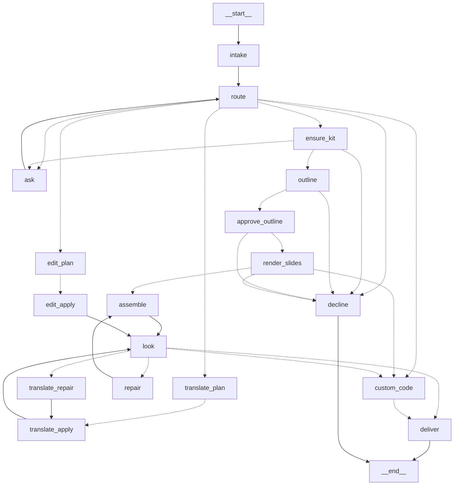

# 4. The graph



`make graph` prints this from the code, so it cannot drift.

## What LangGraph is buying

Worth being precise, because the honest answer is "less than the shape suggests, but the parts
it does buy are the hard ones":

* **Persistence.** State after every node, keyed by `thread_id`. The next turn starts knowing
  which deck, which template, which kit.
* **Interrupts.** `ask` and `approve_outline` call `interrupt()`. The run genuinely stops, the
  process may exit, and `facade.answer()` resumes at that node. Without a checkpointer this is
  not possible at all.
* **Bounded loops.** Repair and the code path are real cycles, with the decision to go round
  again written in one named function.
* **Streaming.** A caller can watch node by node rather than waiting for a deck.

What it is **not** buying: the decisions. Almost all of them are rules - does this layout hold
this content, did the text fit, is there a kit for this template. The router asks a model only
when the rules are unsure, and nothing here is an agent loop with tools. That matches the
engine's first principle: the model writes words and picks from a menu; code does the rest.

## Every fork is a named function

When a deck comes out wrong the question is always "which way did it go, and why". So each fork
is a function you can read and test, and each node adds one `trace` entry.

| Function | In | Decides |
|---|---|---|
| `nodes.after_route` | `router.py` | create / edit / translate / custom / ask / decline |
| `graph.after_ensure_kit` | `graph.py` | got a kit → outline; no template → ask |
| `nodes.after_approval` | `create.py` | approved → build; not → decline |
| `nodes.after_render` | `create.py` | something placed → assemble; nothing → the escape hatch |
| `graph.after_look` | `graph.py` | sends each route to its own decision, after the slides have been looked at |
| `nodes.after_assemble` | `create.py` | clean → deliver; fixable → repair; owed a drawn slide → custom_code |
| `nodes.after_translate` | `translate.py` | clean → deliver; overflow and rounds left → repair |
| `nodes.after_edit` | `edit.py` | deliver, or decline with a reason |

## The routes

### create

```
ensure_kit → outline → approve_outline → render_slides → assemble ⇄ repair → deliver
                                              ↓
                                         custom_code
```

**ensure_kit** - a tested style kit for the template, cached by the template's **content hash**
in `kits/<hash>.json`, shared by every session. A template is learned once by whoever asks
first; the same bytes are never learned twice; a changed template has a different hash, so
there is no invalidation logic to get wrong.

**outline** (stage 1, one call) - what each slide *says*: purpose, kind, title, points, figures,
sources. No layouts, no field names.

**approve_outline** - optional `interrupt()`. Off by default. Reviewing eight lines of content
costs a person seconds; reviewing a finished deck costs minutes, and this is the last point
where changing your mind is free.

**render_slides** (stage 2, one call per slide, four at a time) - each slide's content plus
*only the layouts that can physically hold it*. Two stages rather than one because a single
call planning twelve slides drifts, while a call placing one slide into a short menu of layouts
known to fit has no room to.

Failure is classified here, which the engine's own `plan_slides` does not do: "the model keeps
producing an invalid plan" (a real failure) is not the same as "no layout in this template can
hold this" (not the model's fault, and what the escape hatch is for). A no-fit slide is
remembered with the position it should occupy.

Before anything is drawn by code, `engine/fallback.py` relaxes the rules one named step at a
time. This is not a rare path: in the bundled template, *a cover slide with a title and a
subtitle and no bullets fits nothing at all*, because every pattern either needs items or is
position-locked. The fallback offers a layout without repeated items, then the same with the
first/last-slide convention dropped - a `closing` layout used as a cover is a title slide,
which is exactly what was wanted. It never pads items with invented text to satisfy a minimum.

**Variety.** Stage 2 places each slide knowing only that slide, and in parallel, so no call can
know what another chose - and it converges. On one real deck the model answered `panels` for
four slides out of six, and the first thing a reader said was "this looks repetitive". Two
passes, either side of stage 2 (`engine/variety.py`):

* **before** - the menus are narrowed so one layout cannot take more than half the deck or
  three slides in a row. This *removes* the over-subscribed layout rather than demoting it,
  which is not where it started: reordering was tried first and measured to do nothing. The
  menus were reordered to put `columns` first on four slides and the model answered `panels` on
  three of them anyway. Stage 2 chooses on what the content *is*; a layout off the menu is a
  constraint, a layout moved down the menu is a hint, and that hint is not taken. A slide never
  loses its last option.
* **after** - whatever still slipped through is caught and those slides alone are laid out
  again with the over-used layout excluded. This costs a model call per slide it moves, which
  is why the cheap pass runs first. It never asks for more than a third of the deck.

Measured on the same brief and template: before, `cover · steps · panels · panels · panels ·
panels`; after, `cover · steps · panels · chart · panels · panels · steps` - four distinct
layouts instead of three, no run of three, and no warnings.

**assemble** - compile to ops, apply, re-probe, check against the template's own baseline, scan
for leaked example content, publish the version and the previews.

**repair** - the slides that did not fit go back with a **character budget**, not a percentage.
Text wraps by whole lines, so "10% shorter" does nothing; the box holds *n* lines and the text
needs *m*, so the budget is the current length scaled by *n/m*. That detail is the engine
author's, learned the hard way, and it is kept.

### translate

```
translate_plan → translate_apply ⇄ translate_repair → deliver
```

Paragraphs go as tagged runs - `<r0>Deposit margins </r0><r1>stabilise</r1>` - one tag per
formatted run. The model may reorder, merge or repeat tags, because word order changes between
languages, and each run keeps its own formatting. Translating run by run puts the bold on the
wrong word.

Repair in order: **first ask for shorter phrasing** (what a translator would do), **then shrink
the font** (what a tool does when it has run out of ideas). Doing the second first hides the
problem.

### edit

```
edit_plan → edit_apply → deliver
```

The model sees the deck's text with addresses, no geometry and no ids, and returns typed
actions: `set_text`, `delete_slide`, `delete_shape`, `relayout_cards`, `insert_slide`,
`set_style`, `set_theme_colour`.

They leave through three different doors, because the engine takes them three different ways:
typed ops go to the executor; an inserted slide needs a second pass that copies and moves a
slide; and a **visual change has no op at all**, so it is a deterministic pass of its own.

`relayout_cards` is the engine's numbered-card compiler: "turn these eight steps into six" is
two cards merged and the grid re-laid out, keeping the template's gutters and rows. The deck
view flags which slides have such a grid, so the model knows where it is available.

`insert_slide` uses **the deck as its own template**: the rule-based kit drafting runs over the
deck being edited, so a new slide is a copy of one of that deck's own slides, filled with new
words. A *light* kit (draft and label, no acceptance test, no capacity measurement) - one
inserted slide does not justify building test decks, and the result is checked like anything
else.

The copy lands at the end, because the op language has no way to position a copied slide, so
the node moves it afterwards: a reorder of `p:sldIdLst` and nothing else, saved through the
engine's part comparison, so only `ppt/presentation.xml` changes.

An inserted slide is then **checked and repaired like a built one**. Without that, the first
real run of this path delivered a slide whose headings wrapped over five lines inside 30-point
circles - the checks caught it and nothing acted on the warning. It now retries with the same
character budget, and if the slide still does not fit, the insert is abandoned and the deck is
left as it was. `docs/09-testing.md` tells that story in full.

#### Changing a layout

`change_layout` answers "this slide looks repetitive, lay it out differently" without changing
a word on it. It needs two things from two different places, and getting that wrong is an easy
mistake that fails loudly:

* **the words** come from `deck_plan` - the plan that built the current deck, kept in the state
  because it describes the *deck*, not the turn. It says exactly what each slide holds, so the
  content goes back to the layout chooser without being guessed at from the finished slide.
* **the layouts** come from *this deck*, drafted with `light_kit` - not from the template's kit.
  That is not a shortcut. The template's kit addresses shapes by id on the template's own
  slides, and `add_slide_from_pattern` copies a slide **within one file**; compiling it against
  an edited deck asks it to copy a slide that is not there (`this slide has no shape 14`).

Then one borrowing, which matters more than it sounds: `light_kit` has to take each layout's
item limit from however many items that slide happens to show, so a deck's `steps` slide with
three steps reads as "max 3". But those slides were built from a template whose kit *measured*
the real limit - twelve. So the measured limits are merged in where the names match: structure
from the deck, capacity from the measurement. Without it, a slide with four points can only
move to a layout that already shows four, and the answer is "nothing else fits" on a deck with
five perfectly good layouts.

The slide is rebuilt, not patched: the new slide is added and the old one deleted in the same
batch, then the new one is moved into the old one's place and checked. If it fails, the reason
goes back and it is tried again; if it still fails, the slide is left exactly as it was - a
slide that looks repetitive beats one that is broken. Afterwards `renumber_pages` runs, because
the compiler fills page numbers from the plan it was given and a one-slide plan says "1 / 1".

**Two sources of layouts, tried in order.** The deck only contains the layouts it happened to
use, so "make this a title slide" can be impossible on the deck itself while the template has a
cover sitting right there. So:

1. **Rebuild from the plan**, when the deck is still exactly what its plan says it is. The
   slide is re-planned onto one of the *template's* layouts - the whole kit, with its measured
   capacities - and the deck is built again from the template. Slides drawn by generated code
   are then **replayed** from the code and context that were stored when they were first drawn,
   so they come back unchanged and cost no model call.
2. **The deck's own layouts**, otherwise - and `_can_rebuild` says which in plain words.

A rebuild is only safe while nothing has changed the deck that the plan does not describe, so
every node that edits bytes without updating the plan records what it did in `plan_divergence`:
text edits, colour changes, slides inserted from the deck's own layouts, a translation. If any
of those have happened, rebuilding would throw them away, so it does not - and the reason names
them.

Two limits remain: a deck this session did not build has no plan at all, and a slide that
generated code drew has no plan entry of its own. Both are reported in those words.

#### Visual changes

`set_style` and `set_theme_colour` answer "change the colour of this", which the engine's op
language cannot express - there is no style operation, and adding one means changing the
engine. So `engine/style.py` does it the same way `deck.move_slide` does reordering: a small
deterministic pass with python-pptx, saved through `save_preserving`, so every part it did not
touch keeps its original bytes. The model names a target and a colour; it never writes a colour
value into XML.

| Request | What happens |
|---|---|
| "make the title on slide 1 dark red" | `set_style`, scope `shape` - that shape's runs only |
| "make all the headings on slide 3 grey" | `set_style`, scope `slide` |
| "use a green accent instead of blue" | `set_theme_colour` - rewrites the theme's colour scheme, so charts, tables and shapes that *inherit* that colour all follow |

The theme route has a caveat that is reported rather than hidden: a shape whose colour was
typed in as an explicit RGB value does not inherit, so it does not move. `apply_theme_colours`
counts those shapes and the edit says so.

A colour it cannot resolve is refused, not guessed: `RRGGBB`, or one of a short list of names a
person actually types ("dark red", "grey").

### custom_code - the escape hatch

Reached for one well-defined reason: the deterministic path produced a slide's content but no
layout can hold it, and the relaxed fallback found nothing either.

Four fences, in order:

1. **Off by default** (`allow_custom_code`), and only after the deterministic path has failed.
2. **A static gate** (`sandbox/guard.py`) - a wrong import or a reach for `eval` costs a
   millisecond and a precise sentence back to the model, not a container. Explicitly *not* the
   security boundary; see that module's note.
3. **A throwaway container** - no network, read-only root, no capabilities, 512 MB, seconds of
   CPU. This is the boundary. The same import allowlist is enforced again at runtime inside the
   harness, from a file the host writes, so there is one source of truth for it.
4. **Resealed, then checked** - the deck the code produced is saved through the engine's
   part-by-part comparison, so slides the code did not touch go back to their original bytes.
   Then the new slide faces the same overflow and overlap rules as every other slide. A slide
   that fails goes back to the model with the reason.

`tests/integration/test_sandbox.py` asserts the byte-identity property directly.

### look - the eyeball check, automated

Every build passes through `look` before its own decision. When `vision_review` is off the node
returns immediately, so the graph has one shape either way.

Everything else that checks a deck reasons about geometry: does this text fit, do these boxes
overlap, is the file sound. That is blind to a whole category - slides that are **valid and
wrong**. Both of this project's real visual defects were in it:

* a decorative panel left empty after the text that belonged on it was dropped;
* a heading wedged into a 50-point circle meant for a step number, wrapping over five lines.

Neither is an overflow. Neither is an overlap. Both are obvious the moment you look, which is
why the engine's working notes say to look at the rendered PNGs before every commit. `look`
hands each rendered slide to a vision model and asks what a person in the room would notice.
Asked about those two slides cold, it answered:

> *"A large empty panel is visibly left on the slide."*
> *"The headings are squeezed into small blue circles, breaking words across multiple lines and
> spilling out into the body text below."*

Both exactly right, on the first try, with no hint of what to look for.

Three rules keep it from doing harm:

1. **Appearance only.** The prompt forbids comments on wording, tone, content choice or taste.
   A false alarm costs a rewrite of a slide that was fine.
2. **Only `high` severity acts.** Those become `appearance` findings and reach the repair loop
   like any other finding. Everything else is recorded as a note for the person.
3. **It can never block delivery.** If the call fails, that is said plainly and the deck goes
   out. A model that cannot see straight must not be able to stop work.

It reuses the previews the build already rendered, so it costs model calls and no extra
rendering - one per slide, which is why it is off by default.

Measured: on a four-slide deck that passes every geometric check, **0 to fix, 0 noted** - no
false alarms. On a deck with the broken circles slide, it found it and said so in the person's
words. On the template's own example slides it reports the placeholder text, correctly, which is
a second and independent check on the engine's leak guard.

One limit worth stating: on the **edit** route these findings are advisory, because that route
has no render-and-rewrite loop that could act on them - it reports them instead. On the create
route they feed the repair loop.

### ask and decline

`ask` calls `interrupt()` with one short question and resumes at that node. After two questions
the graph gives up rather than asking forever.

`decline` is for things that are recognised and not done - `restyle` today. It says so plainly
and offers the nearest thing it *can* do, rather than silently doing something else.
