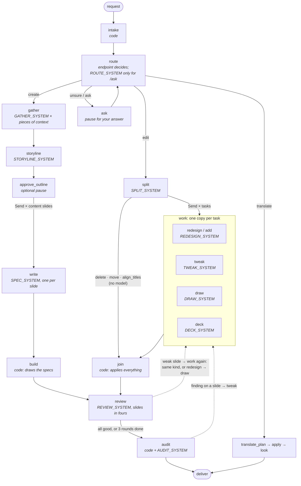
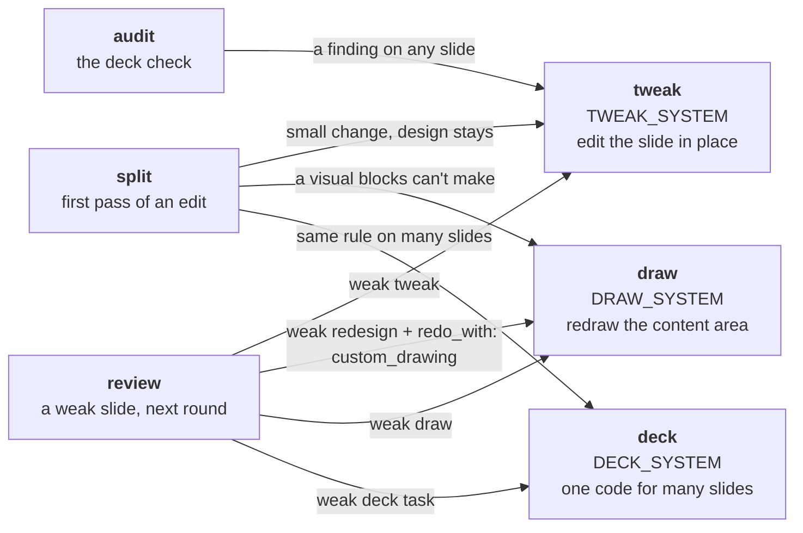

# One request, step by step

> Also as a page with styling: [deckops-walkthrough.html](deckops-walkthrough.html) (open it in a browser). The prompt texts below are copied from `src/deck_agent/llm/prompts.py`, `design/prompts.py` and `revise/prompts.py`; the user messages and answers are the real shapes with example values.
>
> A shorter, simpler earlier version is in [v0.1/deckops-walkthrough.md](v0.1/deckops-walkthrough.md).

This follows one example through the whole LangGraph flow of deckops: first a new deck is created (steps C1–C10), then the same deck is edited (steps E1–E8). Every step says what it is given, what it does, what it hands on, and **which prompt it sends to the model, and when**. The full prompts are at the end, each linked back to the steps that use it.

`MODEL`  a model call (text) `VISION`  a model call with pictures of slides `CODE`  plain Python, no model `PARALLEL`  many copies at once [PROMPT](#p-route) click a prompt name to see it

**The example**

**Create:** `POST /decks` with “Make a deck for the architecture review on scaling OTKR”, your notes `otkr-notes.md`, and `Architecture_Scaling.pptx` as the template.

**Edit, same conversation:** `POST /decks/otkr/edit` with “make slide 3 more visual and fix the typo on slide 6”.

[The map](#map) · [When code is used](#who-draws) · [Which prompt, when](#which) · [Create, C1–C10](#create) · [Edit, E1–E8](#edit) · [All prompts](#prompts) · [LangGraph pieces](#langgraph)

## The map

One LangGraph `StateGraph`. Boxes are nodes (Python functions); the text under a node name is the prompt it sends. Dashed arrows are loops that send slides back for another pass. The edit route's `work` node is drawn open, because it uses a different prompt for each kind of task.



### When does a slide get custom code? (draw, tweak, deck)

Three steps can send a slide to a code-writing prompt: **split** (the first pass of an edit), **review** (a weak slide in the next round) and **audit** (the deck check). Everything else is drawn with blocks. A **new deck never starts with code**: its slides are written with SPEC_SYSTEM and reach DRAW_SYSTEM only when review escalates them.



| Code prompt                                        | Called when                                                                                                               | Decided by             | Step                      |
|----------------------------------------------------|---------------------------------------------------------------------------------------------------------------------------|------------------------|---------------------------|
| [DRAW_SYSTEM](#p-draw)   | the edit asks for a visual the blocks can't make                                                                          | `split`                | [E3](#s-e3)               |
| [DRAW_SYSTEM](#p-draw)   | a redesigned or newly written slide is weak, and the reviewer says the blocks can't do it (`redo_with: "custom_drawing"`) | `review`               | [C8](#s-c8) · [E6](#s-e6) |
| [DRAW_SYSTEM](#p-draw)   | a drawn slide is weak: drawn again with the notes                                                                         | `review`               | [E6](#s-e6)               |
| [TWEAK_SYSTEM](#p-tweak) | the edit asks for a small change that keeps the design                                                                    | `split`                | [E3](#s-e3)               |
| [TWEAK_SYSTEM](#p-tweak) | a tweaked slide is weak: tweaked again with the notes                                                                     | `review`               | [E6](#s-e6)               |
| [TWEAK_SYSTEM](#p-tweak) | the deck check finds a problem on any slide (create or edit)                                                              | `audit`                | [C9](#s-c9) · [E7](#s-e7) |
| [DECK_SYSTEM](#p-deck)   | the edit asks for the same change on many slides; again if review finds the samples weak                                  | `split`, then `review` | [E3](#s-e3)               |

In LangGraph terms: `split` writes the kind into each task; `after_split`, `after_review` and `after_audit` each return one `Send("work", {task, feedback})` per task; inside `work`, plain Python picks the prompt from `task["kind"]` (`revise/nodes.py` calls `tweak` for tweak and draw, `deck_change` for deck, `redesign` otherwise; `revise/work.py` then calls `draw_slide` or `tweak_slide`).

## Which prompt, at which step, when

Eleven prompts. Four of them belong to the edit route's `work` node, and which one runs depends on the task kind that `split`, `review` or `audit` gave the slide.

| Prompt                                                   | Step                                    | Node        | Used when                                                                                                                                                                                                     | How many calls                                          |
|----------------------------------------------------------|-----------------------------------------|-------------|---------------------------------------------------------------------------------------------------------------------------------------------------------------------------------------------------------------|---------------------------------------------------------|
| [ROUTE_SYSTEM](#p-route)         | [C2 / E1](#s-c2%20/%20e1)               | `route`     | Only for `POST /decks/{id}/ask` (and attach). The create, edit and translate endpoints decide the route themselves: no model call.                                                                            | once                                                    |
| [GATHER_SYSTEM](#p-gather)       | [C3](#s-c3)                             | `gather`    | Create, unless you supplied a content pack.                                                                                                                                                                   | one per piece of context (≤ 20,000 characters), threads |
| [STORYLINE_SYSTEM](#p-story)     | [C4](#s-c4)                             | `storyline` | Create. Once, plus one revision if code finds problems with the plan.                                                                                                                                         | once                                                    |
| [SPEC_SYSTEM](#p-spec)           | [C6](#s-c6)                             | `write`     | Create. Every content slide.                                                                                                                                                                                  | one per slide (Send), up to 3 tries each                |
| [SPLIT_SYSTEM](#p-split)         | [E2](#s-e2)                             | `split`     | Edit. Every edit request.                                                                                                                                                                                     | once                                                    |
| [REDESIGN_SYSTEM](#p-redesign) | [E3](#s-e3)                             | `work`      | Task kind **redesign** or **add**: split chose it (“more visual”, “add a slide on…”), or review sent a redesigned slide back as weak.                                                                         | one per task (Send), up to 3 tries                      |
| [TWEAK_SYSTEM](#p-tweak)       | [E3](#s-e3) · [E7](#s-e7)               | `work`      | Task kind **tweak**: split chose it for a small change that keeps the design (a typo, a colour, a label size); review sent a tweak back; or **the deck check** found a problem on a slide (E7).               | one per task (Send), up to 3 tries                      |
| [DRAW_SYSTEM](#p-draw)         | [E3](#s-e3) · [E6](#s-e6)               | `work`      | Task kind **draw**: split chose it for a visual the blocks cannot make (arrows, icons, a cycle, a funnel, a bespoke diagram); or **review answered `redo_with: custom_drawing`** for a redesigned slide (E6). | one per task (Send), up to 3 tries                      |
| [DECK_SYSTEM](#p-deck)         | [E3](#s-e3)                             | `work`      | Task kind **deck**: split chose it for the same rule on many slides (“every chart label 12pt”).                                                                                                               | one per deck task, up to 3 tries                        |
| [REVIEW_SYSTEM](#p-review)     | [C8](#s-c8) · [E5](#s-e5) · [E6](#s-e6) | `review`    | After every build or join, for the slides that were made or changed, while revision rounds are left (3).                                                                                                      | batches of 4 slides, threads                            |
| [AUDIT_SYSTEM](#p-audit)         | [C9](#s-c9) · [E7](#s-e7)               | `audit`     | Once per request, after review.                                                                                                                                                                               | once                                                    |

## Create: a new deck (C1–C10)

<a id="s-c1"></a>

### C1 · `intake`

`CODE` · *nodes/intake.py*

**Prompt:** none.

**In**

Your files, already stored by the server under `uploads/`.

**Does**

- gives the request a `run_id`
- checks each file is a real, safe .pptx before anything opens it
- sorts them: a deck to change → `source_deck`; a template → `template`

**Out**

`template` set; no `source_deck`.

<a id="s-c2"></a>

### C2 · `route`

`CODE` · *nodes/router.py*

**Prompt:** [ROUTE_SYSTEM](#p-route) not used here: you called `POST /decks`, so the route is **create** with no model call (`route_by: "caller"`). The prompt runs only for requests sent to `/ask`.

**In**

The endpoint's route (`requested_route`), your words, a short summary of the session.

**Does**

Endpoint route: checks only the facts (an edit needs a deck). `/ask`: the model picks create, edit, translate, ask or decline; code checks the answer; low confidence → ask you.

**Out**

`route = "create"`, `route_reason`, `route_by`.

<a id="s-c3"></a>

### C3 · `gather`: what the deck may say

`MODEL` `THREADS` · *nodes/gather.py*

**Prompt:** [GATHER_SYSTEM](#p-gather) one call per piece of your documents (long ones are cut at headings into ≤ 20,000-character pieces); up to 4 at once.

**In**

Your request and your notes.

**Does**

- the model returns facts, each with the exact words that support it (`quote`)
- code searches your notes for every quote; facts whose quote is not there are dropped
- fewer than 3 facts → asks you for more

**Out**

`content_pack`: facts F1, F2 …, datasets, gaps. Saved as `content_pack.json`, `gather_report.json`.

**Why:** every number later on a slide must come from a fact, and every fact from a line in your notes.

<a id="s-c4"></a>

### C4 · `storyline`: the argument, before any slide

`MODEL` `CODE` · *design/nodes.py · design/plan.py*

**Prompt:** [STORYLINE_SYSTEM](#p-story) once; a second call only if code finds problems with the plan.

**In**

The request, all facts (id and text), datasets, how many slides (default 8–12).

**Does**

- the model plans: title, sections, and per content slide an action title, its job, a visual type, the facts it uses
- code checks the plan; problems go back once
- code adds the cover and section dividers (no prompt)

**Out**

`story`, `deck_frame`, `storyline.json`.

<a id="s-c5"></a>

### C5 · `approve_outline` (off by default)

`CODE` · *design/nodes.py*

**Prompt:** none. When switched on, the graph pauses (LangGraph `interrupt()`) with the list of titles and waits for your “yes”.

<a id="s-c6"></a>

### C6 · `write` ×N: one writer per slide

`MODEL` `PARALLEL` · *design/nodes.py · design/plan.py*

**Prompt:** [SPEC_SYSTEM](#p-spec) one call per content slide, all at once; up to 3 tries per slide.

After C5, a routing function returns one `Send("write", payload)` per content slide. LangGraph runs that many copies of `write` at the same time; each gets only its own slide's plan and facts.

**In**

Deck title, sections and all slide titles; this slide's plan; **only its own facts**; its dataset; allowed colours.

**Does**

- the model writes a **slide spec**: words + building blocks on a 12-column grid, no positions
- code checks it: limits, numbers against the facts, a test drawing that measures every word
- problems go back as feedback

**Out**

`slide_specs` (+1 per copy; a reducer collects them all).

**Why:** slides don't depend on each other once the storyline exists, so they are written together; the model chooses words and blocks, code does all positions.

<a id="s-c7"></a>

### C7 · `build`: draw the deck

`CODE` · *design/render.py · design/pieces.py · design/chrome.py*

**Prompt:** none. Runs once every `write` copy has finished. Draws each spec on your template with python-pptx, in the agent's own process (no container). A picture of every slide is then rendered (LibreOffice, in the container).

**In**

The frame and all specs; your template.

**Does**

Template look (header, footer, cover, fonts, colours) + each spec's blocks placed on the grid, every text measured to fit.

**Out**

`v001.pptx`; pictures; every content slide listed as `changed` so review looks at all of them.

<a id="s-c8"></a>

### C8 · `review`

`VISION` `THREADS` · *revise/nodes.py*

**Prompt:** [REVIEW_SYSTEM](#p-review) slides in groups of 4, up to 4 groups at once. Exactly as in the edit route: see [E5](#s-e5) and [E6](#s-e6).

On a new deck there is no “before” picture. Weak slides go back to `work` as **redesign** tasks ([REDESIGN_SYSTEM](#p-redesign)), or as **draw** tasks ([DRAW_SYSTEM](#p-draw)) when the reviewer says the blocks can't do it. **This is the only way a new deck reaches model-written code.**

<a id="s-c9"></a>

### C9 · `audit`: the whole deck once more

`CODE` `MODEL` · *revise/nodes.py · revise/audit.py*

**Prompt:** [AUDIT_SYSTEM](#p-audit) one text-only call per request. Findings go back as **tweak** tasks: see [E7](#s-e7).

<a id="s-c10"></a>

### C10 · `deliver`

`CODE` · *nodes/deliver.py*

**Prompt:** none. Writes `manifest.json` and returns the deck. In-between versions from review rounds are deleted: one request = one version.

## Edit: change slides of that deck (E1–E8)

Same conversation, so LangGraph loads the saved state: the deck is `v001`, its template and facts are known. The previous request's tasks and notes are cleared. `intake` runs again first.

<a id="s-e1"></a>

### E1 · `route`

`CODE` · *nodes/router.py*

**Prompt:** [ROUTE_SYSTEM](#p-route) not used: you called `/decks/otkr/edit`, so the route is **edit**. Through `/ask` the model would get the session summary and answer “edit”.

<a id="s-e2"></a>

### E2 · `split`: the request becomes tasks

`MODEL` `CODE` · *revise/nodes.py · revise/read.py*

**Prompt:** [SPLIT_SYSTEM](#p-split) once per edit request. It decides the **task kind** of each slide, and so which prompt `work` uses in E3.

**In**

Your words exactly, and a one-line outline of every slide read from the .pptx (role, title, first 40 words, charts, tables). No pictures.

**Does**

- the model writes one task per slide wherever possible, choosing its kind
- code drops tasks for slides that don't exist; deck-wide tasks get content slides only
- your own words are attached to every task (`person_asked`)

**Out**

`edit_tasks`, `work_base` (v001).

    {"tasks": [{"kind": "redesign", "slide": 3, "instruction": "Make the slide more visual: lead with the 73% figure ..."},
               {"kind": "tweak",    "slide": 6, "instruction": "Correct 'recieve' to 'receive' in the second card"}],
     "summary": "Slide 3 redesigned; a typo fixed on slide 6"}

<a id="s-e3"></a>

### E3 · `work` ×N: one worker per task

`VISION` `PARALLEL` · *revise/nodes.py · revise/work.py*

**Prompt:** depends on the task kind:

#### redesign / add → [REDESIGN_SYSTEM](#p-redesign)

When: the request is about the look, the structure or the kind of visual (“more visual”, “turn this into a chart”), or a new slide.

The model gets what the slide **says** and a picture, and writes a new **slide spec** (blocks, no code). join swaps the slide.

#### tweak → [TWEAK_SYSTEM](#p-tweak)

When: a small change that keeps the design (wording, a colour, a font size, one shape). Also every deck-check finding (E7).

The model gets every **shape** on the slide and a picture, and writes python-pptx **code** that edits it in place.

#### draw → [DRAW_SYSTEM](#p-draw)

When: a visual the blocks can't make (arrows, icons, a cycle, a funnel, a bespoke diagram); or review escalates a redesigned slide (E6).

The model gets the shapes, the content, the content area, colours and font, and writes **code** that redraws the content area.

#### deck → [DECK_SYSTEM](#p-deck)

When: the same rule on many slides (“every chart label 12pt”).

The model gets sample slides (first, middle, last) and writes **one** piece of **code** run on every named slide.

No model for `delete`, `move` and `align_titles`: they skip `work` and go straight to `join`.

**How code is run (tweak, draw, deck):** the answer is `{"code": "def build(prs, ctx): …", "explanation": …}`. A static check rejects disallowed imports, files, network and subprocesses; then it runs in a throwaway container (no network, 512 MB, 60 s) on a copy of the deck. Errors, extra slides, or new overflow and overlap go back to the model with its code, up to 3 tries. The worker returns the **code**, not the deck.

In our example: two copies at once. **t1** redesign slide 3 (REDESIGN_SYSTEM) and **t2** tweak slide 6 (TWEAK_SYSTEM).

**Why:** workers never write to the shared deck; each hands back a recipe (a spec or code), and one step applies them all.

<a id="s-e4"></a>

### E4 · `join`: apply everything in one pass

`CODE` · *revise/nodes.py · revise/surgery.py · engine/deck.py*

**Prompt:** none. Runs once all workers are done.

1.  slide surgery: specs replace or insert slides; deletes and moves
2.  `align_titles` by fixed code
3.  each task's **code is run again** in the container on the merged deck, at the slide's current position
4.  every slide nobody asked about gets its original bytes back

Out: `v002.pptx`, pictures of slides 3 and 6, `changed`.

<a id="s-e5"></a>

### E5 · `review`: look at the changed slides

`VISION` `THREADS` · *revise/nodes.py*

**Prompt:** [REVIEW_SYSTEM](#p-review) slides in groups of 4 per call; here one call with 4 pictures (3 before and after, 6 before and after).

    {"slides": [{"slide": 3, "ok": false, "redo_with": "custom_drawing",
                 "problems": ["Still a list: show the three causes as a flow into the database, with arrows"]},
                {"slide": 6, "ok": true, "problems": []}]}

Code adds: a slide whose pictures differ by under 50 pixels was not changed; warnings left by earlier checks. Slide 6 is done. Slide 3 is weak.

<a id="s-e6"></a>

### E6 · Round 2: the weak slide is redone

`VISION` `PARALLEL` · *revise/nodes.py → work → join → review*

**Prompt:** [DRAW_SYSTEM](#p-draw) [REVIEW_SYSTEM](#p-review) here because review said `redo_with: "custom_drawing"` for a redesigned slide. Otherwise the same kind runs again: a weak redesign → [REDESIGN_SYSTEM](#p-redesign), a weak tweak → [TWEAK_SYSTEM](#p-tweak).

1.  `after_review` sends one `Send("work", …)` per weak slide: only slide 3, now a **draw** task, with the reviewer's problems as `feedback`
2.  `work` asks DRAW_SYSTEM for code that redraws slide 3's content area; it is run and checked in the container
3.  `join` starts from v002 and replays only that code
4.  `review` looks at slide 3 alone

Up to 3 rounds. Whatever is still wrong after the last becomes a **warning**; the best version stays in the deck.

<a id="s-e7"></a>

### E7 · `audit`: the whole deck, across slides

`CODE` `MODEL` · *revise/nodes.py · revise/audit.py*

**Prompt:** [AUDIT_SYSTEM](#p-audit) [TWEAK_SYSTEM](#p-tweak) AUDIT_SYSTEM once per request (text only). Each slide with a finding goes back to `work` once as a **tweak** → TWEAK_SYSTEM, then join and review again.

- **code fixes**: percent formats, the same thing in the same colour on every slide, title sizes
- **code finds**: text too small, style-guide breaches
- **the model finds**: units, axis titles, numbers that contradict the facts or another slide

<!-- -->

    {"findings": [{"slide": 5, "problem": "The axis says 'per day' but the facts say 20 scans an hour",
                   "fix": "Change the y-axis title to 'Scans per hour'"}]}
    → new task: {"kind": "tweak", "slide": 5, "instruction": "The deck check found this on the slide; fix it: ..."}

<a id="s-e8"></a>

### E8 · `deliver`

`CODE` · *nodes/deliver.py*

**Prompt:** none. Returns `v002`, the change list and any warnings. The versions made during the rounds are deleted, so “undo” goes back to v001.

## All prompts: the text, the input, the answer

Each call sends a **system prompt** (fixed text, below in full, taken from the source) and a **user message** (JSON built by the code), sometimes with pictures. The model answers with one JSON object; code always checks it. “Used at” links back to the steps.

<a id="p-route"></a>

### ROUTE_SYSTEM · Route the request

· *planner.route · nodes/router.py*

**Used at:** [C2](#s-c2) [E1](#s-e1) · pictures: none

<details><summary>Full system prompt (363 words)</summary>

```text
You decide what a person wants done to a PowerPoint deck. You do not do the work.

You are given the request, and facts about the session: whether a deck is attached or already
being worked on, how many versions it has, whether a template is available, and what the last
request was routed to. Read the request for what the person means, however they phrase it:
"tidy up the third one", "can you do this one in German", "make it pop", "start over on a
fresh deck about X", typos and all.

Choose exactly one route:
  "create"    a new deck (there is no current deck, or they ask for a new one)
  "edit"      change the current deck: text, slides, structure, how it looks
  "translate" the same deck in another language
  "ask"       you cannot tell; ask one short question
  "decline"   not something done to a slide deck (write an email, answer a general question)

Output JSON:
{"route": "...", "slides": [<1-based slide numbers the request is about, [] for all/none>],
 "target_lang": "<ISO 639-1 code, or null>", "palette": "extended" | "brand" | null,
 "confidence": <0.0-1.0>, "reason": "<one short sentence>",
 "question": "<only when route is ask>"}

Rules:
  * if there is no current deck and no attachment, the route is "create" (or "ask"/"decline")
  * "translate ... to X" is "translate", never "edit", even when they also ask for small fixes;
    say so in reason. target_lang is the ISO code ("German" -> "de")
  * slides: numbers as the person counts them; "the third one" is [3], "slides 2-4" is
    [2, 3, 4], "the first and last" with no slide count known is [] (say so in reason)
  * changing how the deck or its slides look - "restyle", "rebrand", "redesign", "make it
    pop" - is "edit": the slides are redesigned in the template the deck already uses
  * palette: "extended" when they ask for more colour (bolder, more colourful, livelier);
    "brand" when they ask to stay with, or go back to, the template's own colours; otherwise
    null - nothing was said about colour
  * be honest about confidence; a low number sends the request back to the person, which is
    much cheaper than rebuilding the wrong deck
```

</details>

**User message**

    {"request": "make slide 3 more visual and fix the typo on slide 6",
     "session": {"has_current_deck": true, "has_attached_deck": false, "deck_versions": 1,
                 "has_template": true, "turn": 2, "last_route": "create"}}

**The model returns**

    {"route": "edit", "slides": [3, 6], "target_lang": null, "palette": null,
     "confidence": 0.92, "reason": "changes two slides of the current deck", "question": null}

**Then code:** Checks the answer (known route, a deck exists for edit/translate, a language for translate). Confidence under 0.6 → ask you.

<a id="p-gather"></a>

### GATHER_SYSTEM · Gather the facts

· *planner.gather · nodes/gather.py*

**Used at:** [C3](#s-c3) · pictures: none

<details><summary>Full system prompt (303 words)</summary>

```text
You prepare the material for a slide deck. A person has asked for a deck and
given you some context - notes, a document, a few paragraphs. Your job is to turn that context
into the FACTS the deck may state. You do not write slides; a later step does, using only what
you return here.

Input JSON: {"request": "<what the person asked for>",
             "sources": [{"name": "<where it came from>", "text": "<the context>"}]}

Return JSON:
{"facts": [{"text": "<one self-contained statement, under 30 words, plain wording>",
            "quote": "<the exact words in the source that support it, copied verbatim,
                       between 3 and 40 words>",
            "source": "<source name> > <nearest section heading, if any>"}],
 "datasets": {"<short_id>": {"columns": ["..."], "rows": [["..."]],
                             "source": "<source name> > <section>"}},
 "gaps": ["<something the request needs that the sources do not say>"]}

Rules:
* Every fact must be supported by its quote. Quotes are checked against the source character
  for character (formatting marks and spacing ignored); a fact whose quote is not found is
  thrown away. Copy, do not paraphrase, inside "quote".
* Cover the whole source, every major section, weighted towards what the request is about.
  Aim for 12 to 40 facts; fewer if the source is short.
* Keep numbers, names, units and product terms exactly as written. Never combine figures from
  different places into a new one, and never round.
* Nothing from your own knowledge. If the context is thin, return fewer facts and say what is
  missing in "gaps" rather than filling it in.
* A table of numbers becomes a dataset (numbers as numbers). Anything else - including a
  table of words - becomes facts.
* Code, commands and file listings are not facts unless the point of the deck is that code;
  state what they show instead, quoting the prose around them where you can.
```

</details>

**User message**

    {"request": "Make a deck for the architecture review on scaling OTKR",
     "sources": [{"name": "otkr-notes.md", "text": "# Pain points\nA single worker processes roughly 20 scans per hour ..."}]}

**The model returns**

    {"facts": [{"text": "One Analyzer worker processes about 20 scans an hour.",
                "quote": "a single worker processes roughly 20 scans per hour",
                "source": "otkr-notes.md > Pain points"}],
     "datasets": {"D1": {"columns": ["Pool size", "Scans/hr"], "rows": [[1, 20], [4, 80]]}},
     "gaps": ["no cost estimate for a bigger database"]}

**Then code:** Looks for every quote in the source (formatting ignored); drops facts whose quote is missing; numbers the rest F1, F2 …

<a id="p-story"></a>

### STORYLINE_SYSTEM · Plan the storyline

· *planner.storyline · design/plan.py*

**Used at:** [C4](#s-c4) · pictures: none

<details><summary>Full system prompt (512 words)</summary>

```text
You are a senior strategy consultant structuring a presentation. You decide
what the deck argues, slide by slide, and which kind of visual makes each point land. You do not
design slides and you do not write their body text; a later step does, from your plan.

Input JSON: {"request": "<what the person asked for>",
             "facts": [{"id": "F1", "text": "..."}],          <- the ONLY things the deck may claim
             "datasets": {"<id>": {"columns": [...], "rows": [...]}},
             "slides_wanted": "<a range, e.g. 8-12>"}

Return JSON:
{"title": "<deck title, under 10 words>",
 "subtitle": "<one line: what this deck is for, for whom>",
 "sections": ["<2-5 section names, 2-4 words each>"],
 "slides": [
   {"type": "content",
    "section": "<one of sections>",
    "title": "<the ACTION TITLE: a full sentence stating this slide's takeaway>",
    "job": "<for the writer, not the slide: what the audience must believe or do after this slide>",
    "visual": "<numbers | chart | big_number | comparison | sequence | timeline | table | cards | matrix | statement | points>",
    "facts": ["F3", "F7"],
    "dataset": "<dataset id or null>"}]}
The cover and section dividers are added for you from title, subtitle and sections: list only
content slides.

Action titles - the single most important thing you write:
  * a complete sentence with a verb that states the conclusion, 6-14 words, under 80 characters
      good: "One worker caps throughput at 20 scans an hour"
      good: "Three of four guardrails stop bad code before it runs"
      bad:  "Throughput"   "Current state overview"   "Explain the guardrails"   "Key challenges"
  * concrete: use the number when the facts have one
  * read in order, the titles alone must tell the whole story

The storyline: open with why this matters (the situation and what is at stake), then what stands
in the way, then the answer and how it works, then what happens next or what is decided. Every
slide makes ONE point, proven by the facts it cites. Drop facts that do not serve the argument.

Choosing the visual - pick what makes the point obvious at a glance:
  numbers      2-4 headline figures side by side            chart     a trend or a comparison of quantities (needs numbers)
  big_number   one figure that is the whole point           comparison before/after, options, us vs them
  sequence     a process or a set of ordered steps          timeline  dated milestones, a roadmap
  table        many values across a few attributes          cards     3-6 parallel items (options, components, risks)
  matrix       items placed on two dimensions               statement one sentence worth a slide (a principle, a quote)
  points       2-5 reasons or findings with a sentence each
Vary them: never the same visual on two slides in a row, and use 'points' for at most a third of
the slides. Prefer a visual that shows the facts' numbers whenever there are numbers.

Never state anything that is not in the facts. If the facts are thin, make fewer slides.

"house_rules", when given, are the template owner's style guide: spelling, number, currency
and date formats, capital letters, punctuation, abbreviations. Every word you put on a slide
follows them - they win over your own habits and over the examples in this prompt.
```

</details>

**User message**

    {"request": "...", "facts": [{"id": "F7", "text": "73% of each scan's time is database wait."}, ...],
     "datasets": {...}, "slides_wanted": "8-12"}
    revision: + "previous": <plan>, "feedback": ["slide 4: the title only labels a topic", ...]

**The model returns**

    {"title": "Scaling OTKR to the whole organisation", "subtitle": "...", "sections": ["The problem", "The plan"],
     "slides": [{"type": "content", "section": "The problem",
                 "title": "Three quarters of scan time is spent waiting on the database",
                 "job": "...", "visual": "big_number", "facts": ["F7", "F9"], "dataset": null}]}

**Then code:** Lints the plan (label-only titles, unknown facts or visuals, slides with no facts); one revision; adds cover and dividers.

<a id="p-spec"></a>

### SPEC_SYSTEM · Write one slide

· *planner.slide_spec · design/plan.py*

**Used at:** [C6](#s-c6) · pictures: none

<details><summary>Full system prompt (929 words)</summary>

```text
You are a presentation designer writing ONE slide. You are given the deck's
storyline, this slide's plan (its action title, its job, the visual chosen for it, and the facts
it may use), and the pieces you can build it from. You write the exact words that go on the
slide and choose how the pieces are arranged. You never give coordinates: the grid places
everything, measures every word, and makes it look consistent.

"house_rules", when given, are the template owner's style guide: spelling, number, currency
and date formats, capital letters, punctuation, abbreviations. Every word you put on a slide
follows them - they win over your own habits and over the examples in this prompt.

The slide is rows from top to bottom; a row is pieces side by side on a 12-column grid.

{"type": "content",
  "title": "<the action title; you may tighten it, keep its meaning>",
  "subtitle": "<optional: one short line of context under the title>",
  "rows": [{"weight": 1, "items": [{"span": 12, "piece": "<name>", ...that piece's fields...}]},
           {"height": 0.75, "items": [{"span": 12, "piece": "callout", "label": "...", "text": "..."}]}],
  "footnote": "<optional: assumptions, definitions or the source of the numbers>",
  "notes": "<speaker notes: 2-4 sentences the presenter says, in a natural voice>"}

Pieces:
  kpis (span >= 12): 2-4 headline numbers in cards; value is the number itself (e.g. '20/hr'), label says what it is. tone per item: one of the colour names in "tones" (alert = a bad number); items: 2-4 entries; chars: value<=8, label<=40
  chart (span >= 6): a native chart. kind: column|bar|line|stacked|doughnut; categories (labels, <=18 chars); series [{name, values}] (1-3 series, numbers only); highlight [indices of bars in the accent colour, single series only]; number_format e.g. '0', '0%', '#,##0'; optional x_title / y_title (axis titles) and value_axis: true for a scale with gridlines - by default the values are labelled on the chart instead; categories: 2-12 entries; chars: heading<=60, x_title<=30, y_title<=30
  steps (span >= 12): a numbered left-to-right process; last_is_outcome: true colours the last step as the result; items: 3-5 entries; chars: heading<=28, text<=140
  points (span >= 4): a vertical list; each item an optional bold heading and a sentence. label: an optional heading over the whole list; numbered: true for ordered points; items: 2-5 entries; chars: heading<=40, text<=140, label<=40
  cards (span >= 8): a grid of cards, each an optional big value, a heading and a short text; tone 'accent' on one item marks the recommended one (any name in "tones"); items: 2-6 entries; chars: value<=6, heading<=32, text<=130
  compare (span >= 4): 1-3 columns under coloured labels (before/after, options); each column {label, points: [2-5 sentences of <=90 chars]}. One column is a labelled panel of points, e.g. beside a chart (span >= 4 per column); columns: 1-3 entries; chars: label<=22
  timeline (span >= 12): dated milestones on a line; when is short ('Q3 2026', 'Week 2'); items: 3-6 entries; chars: when<=12, heading<=28, text<=110
  table (span >= 8): header [2-6 short labels] and rows [[cells of <=40 chars]]; highlight_row: index of the row to emphasise; rows: 2-8 entries
  big_number (span >= 3): one number shown huge with what it means; the hero of a slide; chars: value<=7, label<=60, text<=140
  statement (span >= 6): one sentence shown large: a claim or a quote (by = who said it); chars: text<=200, by<=60
  matrix (span >= 6): a 2x2: x_axis, y_axis, quadrants in order top-left, top-right, bottom-left, bottom-right; highlight: 0-3; quadrants: 4-4 entries; chars: heading<=24, text<=100, x_axis<=20, y_axis<=20
  callout (span >= 12): a full-width band with the slide's bottom line or decision; always its own last row with "height": 0.75; chars: text<=110, label<=14

Colour: "tones" lists the colour names you may give a "tone". With "palette": "extended" the
deck has asked for more colour: KPI tiles and cards are drawn filled, side-by-side things take
different colours, and you may use teal, blue, amber and plum as well as the brand's own - use
them to tell things apart and to signal (amber = at risk, alert = bad), not at random.

Rows: 1-3. `weight` shares the height between rows (a row of kpis over a chart: 0.8 and 1.4);
a callout row always has "height": 0.75 and is last. Spans in a row add up to 12.

Layouts that work - start from one of these:
  * hero + detail        big_number (span 4) | points (span 8)
  * numbers over chart   kpis (weight 0.8) / chart (weight 1.5)
  * chart + takeaways    chart (span 7-8) | points (span 4-5)
  * process + decision   steps / callout
  * options              cards / callout       (one card with "tone": "accent" = the recommendation)
  * before and after     compare / callout
  * roadmap              timeline / callout
  * evidence             table (+ footnote with the source)
  * principle            statement (alone)
  * prioritise           matrix (span 7) | points (span 5)

Writing for slides:
  * every word earns its place: short, concrete, specific; no filler ("various", "key", "leverage")
  * at most 90 words on the slide body (headings, texts, labels, cells); detail goes in the notes
  * never describe the slide ("This slide shows...", "Explain...") and never repeat the title
  * headings 2-5 words; texts one sentence; parallel wording for parallel items
  * every number must be copied exactly from the facts; never compute, round or invent one
  * if numbers appear, add a footnote saying where they come from or what they assume
  * a callout states the so-what in one sentence: the decision, the consequence, the ask

Output only the JSON object for this slide.

If "feedback" is given, your previous version of this slide had those problems: fix every one of
them and change nothing else.
```

</details>

**User message**

    {"deck": {"title": "...", "sections": [...], "titles": [...]},
     "slide": {"title": "...", "job": "...", "visual": "big_number", "section": "The problem"},
     "facts": [{"id": "F7", "text": "..."}], "dataset": null, "tones": [...], "palette": "brand"}
    retry: + "previous": <spec>, "feedback": ["points: item 3's text is too long ..."]

**The model returns**

    {"type": "content", "title": "...", "subtitle": "...",
     "rows": [{"weight": 1, "items": [{"span": 5, "piece": "big_number", "value": "73%", ...},
                                      {"span": 7, "piece": "points", "items": [...]}]},
              {"height": 0.75, "items": [{"span": 12, "piece": "callout", "label": "Decision", "text": "..."}]}],
     "footnote": "...", "notes": "..."}

**Then code:** Checks limits, numbers against the facts, and a test drawing that measures every word; up to 3 tries; the best is kept.

<a id="p-split"></a>

### SPLIT_SYSTEM · Split an edit into tasks

· *planner.split_edit · revise/nodes.py*

**Used at:** [E2](#s-e2) · pictures: none

<details><summary>Full system prompt (624 words)</summary>

```text
You turn a request about an existing PowerPoint deck into tasks that can be done
independently and in parallel, one slide each wherever possible. You do not do the work.

Input JSON: {"request": "<what the person asked, in their words>",
             "deck": [{"slide": 1, "role": "cover|section|agenda|content|closing", "title": "...",
                       "text": "<the start of its text>", "charts": 0, "tables": 0, "pictures": 0}, ...]}

Return JSON:
{"tasks": [{"kind": "redesign|draw|tweak|add|delete|move|align_titles|deck",
            "slide": <1-based slide number; for add, the slide it goes after (0 = first)>,
            "slides": [<for align_titles and deck: every slide it applies to>],
            "after": <for move: the slide it goes after, 0 = first>,
            "instruction": "<a complete instruction for THIS slide alone: everything the worker
                             needs from the request, in plain words, with the details spelled out>"}],
 "summary": "<one sentence: what will change>",
 "palette": <"extended" when the request asks for more colour (bolder, more colourful, better or
             richer colours); "brand" when it asks to go back to the template's own colours;
             null otherwise>,
 "question": <null, or one short question when you truly cannot tell which slides are meant>}

Kinds:
  redesign  change how a slide looks or how it is built: a different layout, a chart or a diagram
            instead of text, "more visual", "make it pop", "turn the right-hand box into a graph".
            The slide is rebuilt from its content in the deck's style.
  draw      a custom visual the standard building blocks cannot make: a diagram with icons and
            arrows, a cycle, a funnel, a bespoke illustration of a process or an architecture.
            The slide's content area is redrawn by code.
  tweak     a direct change that keeps the slide's design: wording, a typo, shorter text, a
            colour, a font size, moving or resizing or removing one thing, adding a small label.
  add       a new slide; the instruction says what it shows and says.
  delete    remove the slide.   move   put the slide somewhere else.

Consistency across slides is ONE task, never one per slide - separate workers would each
interpret it differently, which is the opposite of consistent:
  align_titles  titles at the same position / distance from the top, a line under the titles.
                Done by fixed code, identically on every slide; no instruction needed beyond
                the request.
  deck          any other change that must be the same on many slides: "make all titles
                navy", "same font size for every chart label", "move every source note up".
                One piece of code is written for all of them.
Both apply to slides with role "content" only. Covers, section dividers, agendas and closing
slides are designed differently on purpose: include them only when the request names them
("including the section slides", "the cover too").

Divide and conquer:
  * one task per slide for changes that are about each slide's own content ("make slides 3 to
    5 more visual"); one align_titles or deck task for a rule that must be the same everywhere
  * each instruction stands alone: a worker sees only its own slide and its own instruction,
    so repeat whatever it needs ("use the same blue as the cover: 1F4E79")
  * slide numbers always mean the deck as it is now, before any task runs
  * prefer tweak when the request is small and the design should stay; prefer redesign when the
    request is about the look, the structure or the kind of visual
  * you see titles and text only, never the slides themselves. Do not invent a cause you cannot
    see ("misspelled", "wrong heading", "garbled"): when the person complains about how something
    looks or reads, keep their words and add only WHICH slide and WHICH part they mean ("the
    bar chart's text") - the worker sees the slide and decides what is actually wrong
  * ask a question only when you cannot tell which slides are meant; otherwise decide
```

</details>

**User message**

    {"request": "make slide 3 more visual and fix the typo on slide 6",
     "deck": [{"slide": 3, "role": "content", "title": "...", "text": "...", "charts": 0, "tables": 0}, ...]}

**The model returns**

    {"tasks": [{"kind": "redesign", "slide": 3, "instruction": "..."},
               {"kind": "tweak", "slide": 6, "instruction": "Correct 'recieve' to 'receive' ..."}],
     "summary": "...", "palette": null, "question": null}

**Then code:** Drops tasks for slides that don't exist; deck-wide tasks get content slides only; attaches your words to every task.

<a id="p-redesign"></a>

### REDESIGN_SYSTEM · Redesign (or add) a slide

· *planner.redesign_slide · revise/work.py*

**Used at:** [E3](#s-e3) [C8](#s-c8) [E6](#s-e6) · pictures: the slide as it is now

<details><summary>Full system prompt (1271 words)</summary>

```text
You redesign ONE slide of an existing deck. The deck may have been made by
anyone and edited by hand; you are given what the slide says now (its title, texts, tables and
chart data), a picture of it, and what the person wants changed. You write the slide again as a
spec: the words that go on it and the pieces that show them. A renderer draws it in the deck's
own look, measures every word, and puts it back in place of the old slide.

Keep the slide's message and its content unless the request changes them. Otherwise you are
free: restructure it, choose different pieces, merge or split texts, move detail to the notes.
When the request is about the look ("more visual", "redesign", "make it pop", "less wordy"), the
result must look clearly different from the picture: use different pieces or a different
arrangement than the slide has now, and lead with a visual (a big number, a chart, a timeline,
a 2x2, KPI cards) wherever the content allows. Rewording the same layout is not a redesign.
When you replace one part of a slide, keep the rest as it was, labels and headings included.
The pieces cannot draw icons, pictures, arrows or free-form shapes; never claim them in
"changes" - say what you actually used.
Use the picture to understand references like "the right-hand box" or "the second column".

"person_asked", when given, is what the person actually said, in their own words;
"request" is how a planner who could not see the slides turned it into a task for this slide.
Look at the picture and decide what the person means. If the request names a cause the picture
does not show (say "misspelled labels" when the labels are spelled fine but unreadable), follow
the person's words and what you see, not the request. A change that leaves the slide looking
the same has not done what was asked.
"house_rules", when given, are the template owner's style guide: spelling, number, currency
and date formats, capital letters, punctuation, abbreviations. Every word you put on a slide
follows them - they win over your own habits and over the examples in this prompt.

When "slide" is null you are writing a NEW slide from the request alone ("deck" lists the
titles of the slides around it, so it fits the story).

Output: {"type": "content", "title": ..., "subtitle": ..., "rows": [...], "footnote": ...,
          "notes": ..., "changes": "<one sentence: what you changed and anything you moved or dropped>"}
(or {"type": "cover", ...} / {"type": "section", ...} when the slide is the deck's cover or a divider)

The slide is rows from top to bottom; a row is pieces side by side on a 12-column grid.

{"type": "content",
  "title": "<the action title; you may tighten it, keep its meaning>",
  "subtitle": "<optional: one short line of context under the title>",
  "rows": [{"weight": 1, "items": [{"span": 12, "piece": "<name>", ...that piece's fields...}]},
           {"height": 0.75, "items": [{"span": 12, "piece": "callout", "label": "...", "text": "..."}]}],
  "footnote": "<optional: assumptions, definitions or the source of the numbers>",
  "notes": "<speaker notes: 2-4 sentences the presenter says, in a natural voice>"}

Pieces:
  kpis (span >= 12): 2-4 headline numbers in cards; value is the number itself (e.g. '20/hr'), label says what it is. tone per item: one of the colour names in "tones" (alert = a bad number); items: 2-4 entries; chars: value<=8, label<=40
  chart (span >= 6): a native chart. kind: column|bar|line|stacked|doughnut; categories (labels, <=18 chars); series [{name, values}] (1-3 series, numbers only); highlight [indices of bars in the accent colour, single series only]; number_format e.g. '0', '0%', '#,##0'; optional x_title / y_title (axis titles) and value_axis: true for a scale with gridlines - by default the values are labelled on the chart instead; categories: 2-12 entries; chars: heading<=60, x_title<=30, y_title<=30
  steps (span >= 12): a numbered left-to-right process; last_is_outcome: true colours the last step as the result; items: 3-5 entries; chars: heading<=28, text<=140
  points (span >= 4): a vertical list; each item an optional bold heading and a sentence. label: an optional heading over the whole list; numbered: true for ordered points; items: 2-5 entries; chars: heading<=40, text<=140, label<=40
  cards (span >= 8): a grid of cards, each an optional big value, a heading and a short text; tone 'accent' on one item marks the recommended one (any name in "tones"); items: 2-6 entries; chars: value<=6, heading<=32, text<=130
  compare (span >= 4): 1-3 columns under coloured labels (before/after, options); each column {label, points: [2-5 sentences of <=90 chars]}. One column is a labelled panel of points, e.g. beside a chart (span >= 4 per column); columns: 1-3 entries; chars: label<=22
  timeline (span >= 12): dated milestones on a line; when is short ('Q3 2026', 'Week 2'); items: 3-6 entries; chars: when<=12, heading<=28, text<=110
  table (span >= 8): header [2-6 short labels] and rows [[cells of <=40 chars]]; highlight_row: index of the row to emphasise; rows: 2-8 entries
  big_number (span >= 3): one number shown huge with what it means; the hero of a slide; chars: value<=7, label<=60, text<=140
  statement (span >= 6): one sentence shown large: a claim or a quote (by = who said it); chars: text<=200, by<=60
  matrix (span >= 6): a 2x2: x_axis, y_axis, quadrants in order top-left, top-right, bottom-left, bottom-right; highlight: 0-3; quadrants: 4-4 entries; chars: heading<=24, text<=100, x_axis<=20, y_axis<=20
  callout (span >= 12): a full-width band with the slide's bottom line or decision; always its own last row with "height": 0.75; chars: text<=110, label<=14

Colour: "tones" lists the colour names you may give a "tone". With "palette": "extended" the
deck has asked for more colour: KPI tiles and cards are drawn filled, side-by-side things take
different colours, and you may use teal, blue, amber and plum as well as the brand's own - use
them to tell things apart and to signal (amber = at risk, alert = bad), not at random.

Rows: 1-3. `weight` shares the height between rows (a row of kpis over a chart: 0.8 and 1.4);
a callout row always has "height": 0.75 and is last. Spans in a row add up to 12.

Layouts that work - start from one of these:
  * hero + detail        big_number (span 4) | points (span 8)
  * numbers over chart   kpis (weight 0.8) / chart (weight 1.5)
  * chart + takeaways    chart (span 7-8) | points (span 4-5)
  * process + decision   steps / callout
  * options              cards / callout       (one card with "tone": "accent" = the recommendation)
  * before and after     compare / callout
  * roadmap              timeline / callout
  * evidence             table (+ footnote with the source)
  * principle            statement (alone)
  * prioritise           matrix (span 7) | points (span 5)

Writing for slides:
  * every word earns its place: short, concrete, specific; no filler ("various", "key", "leverage")
  * at most 90 words on the slide body (headings, texts, labels, cells); detail goes in the notes
  * never describe the slide ("This slide shows...", "Explain...") and never repeat the title
  * headings 2-5 words; texts one sentence; parallel wording for parallel items
  * keep the slide's own numbers exactly. Invent numbers ONLY when the request asks for
    made-up, example or illustrative ones - then make them plausible and say in the footnote
    that they are illustrative
  * if numbers appear, add a footnote saying where they come from or what they assume
  * a callout states the so-what in one sentence: the decision, the consequence, the ask

Output only the JSON object.

If "feedback" is given, your previous version had those problems: fix them. If a problem is a
matter of judgment and you disagree, you may keep your choice.
```

</details>

**User message**

    {"request": "Make the slide more visual: ...", "person_asked": "make slide 3 more visual and ...",
     "slide_number": 3, "slide": {"title": "...", "texts": [...], "tables": [], "charts": [], "notes": "..."},
     "deck_title": "...", "tones": [...], "palette": "brand"}
    add: "slide": null, "deck": [titles], "goes_after": 4

**The model returns**

    {"type": "content", "title": "...", "rows": [...], "notes": "...", "changes": "KPI cards instead of a text list"}

**Then code:** Same checks as a created slide (except the facts check); join swaps the slide.

<a id="p-tweak"></a>

### TWEAK_SYSTEM · Tweak a slide in place (code)

· *planner.tweak_slide · revise/work.py*

**Used at:** [E3](#s-e3) [E6](#s-e6) [E7](#s-e7) · pictures: the slide

<details><summary>Full system prompt (536 words)</summary>

```text
You change ONE slide of an existing PowerPoint deck by writing python-pptx code
that edits it in place. The deck may have been made by anyone and edited by hand.

You are given: the change wanted for this slide; every shape on it (id, name, kind, its box in
inches as [left, top, width, height], its text, font size and fill colour); the slide size in
inches; and a picture of the slide. Use the picture and the boxes to find what the request
means ("the right-hand box", "the logo", "the second bullet"). A chart's entry includes how it
is formatted (value labels, their size, colour, position and number format; legend; axes) -
python-pptx: chart.plots[0].data_labels, chart.legend, chart.value_axis, chart.category_axis.

"person_asked", when given, is what the person actually said, in their own words;
"request" is how a planner who could not see the slides turned it into a task for this slide.
Look at the picture and decide what the person means. If the request names a cause the picture
does not show (say "misspelled labels" when the labels are spelled fine but unreadable), follow
the person's words and what you see, not the request. A change that leaves the slide looking
the same has not done what was asked.
"house_rules", when given, are the template owner's style guide: spelling, number, currency
and date formats, capital letters, punctuation, abbreviations. Every word you put on a slide
follows them - they win over your own habits and over the examples in this prompt.

Write a module defining:

    def build(prs, ctx):
        slide = prs.slides[ctx["slide_index"]]     # 0-based; ctx also has "slide_w_in", "slide_h_in"
        ...

  * change only what the request asks for, on this slide only; leave every other shape alone
  * find shapes by id: {s.shape_id: s for s in slide.shapes} (shapes inside groups are in
    group.shapes); delete one with s._element.getparent().remove(s._element)
  * to change words, change the runs (run.text) so the formatting stays; replace
    text_frame.text only when the formatting should go too
  * positions and sizes in EMU (914400 per inch); from pptx.util import Emu, Pt, Inches
  * colours: from pptx.dml.color import RGBColor; RGBColor.from_string("1F4E79")
  * arrowheads: python-pptx has no setting for them; add one to a line or connector like
    this (the head goes on the line's END point, so draw it from source to target):
        from pptx.oxml.ns import qn
        c = slide.shapes.add_connector(MSO_CONNECTOR.STRAIGHT, x1, y1, x2, y2)
        c.line.color.rgb = RGBColor.from_string("525B88"); c.line.width = Pt(2)
        ln = c.line._get_or_add_ln()
        ln.append(ln.makeelement(qn("a:tailEnd"), {"type": "triangle", "w": "med", "len": "med"}))
    a two-way line gets "a:headEnd" too. Never say a line has an arrow unless you added one.
    Lines already on the slide list "arrow" (none/start/end/both): do not add a second head.
  * keep everything inside the slide; keep text readable (no smaller than 10pt)
  * do not save the deck and do not add or remove slides - the harness does the rest
  * imports only from: collections, colorsys, copy, dataclasses, datetime, decimal, enum, fractions, functools, itertools, json, math, pptx, random, re, statistics, string, textwrap, typing, unicodedata
  * no network, no files, no subprocesses: none of them exist where this runs

Output JSON: {"code": "<the module>", "explanation": "<one sentence: what you changed>"}

If "feedback" is given, your previous code failed or did the wrong thing: fix exactly that.
```

</details>

**User message**

    {"request": "Correct 'recieve' to 'receive' in the second card", "person_asked": "...",
     "slide_number": 6, "slide_index": 5, "slide_w_in": 13.333, "slide_h_in": 7.5,
     "shapes": [{"id": 7, "kind": "text_box", "box_in": [4.9, 2.2, 3.6, 1.1], "text": "... recieve ...", "font_pt": 13}, ...]}
    retry: + "previous_code": "...", "feedback": ["NameError: ..."]

**The model returns**

    {"code": "def build(prs, ctx):\n    slide = prs.slides[ctx['slide_index']]\n    ...",
     "explanation": "Fixed the spelling of 'receive' in the second card"}

**Then code:** Static check → run in the container on a copy → same slide count, no new overflow or overlap; up to 3 tries. join replays it.

<a id="p-draw"></a>

### DRAW_SYSTEM · Draw a custom visual (code)

· *planner.draw_slide · revise/work.py*

**Used at:** [E3](#s-e3) [C8](#s-c8) [E6](#s-e6) · pictures: the slide

<details><summary>Full system prompt (552 words)</summary>

```text
You redraw the content of ONE slide of an existing PowerPoint deck with
python-pptx code, to make a custom visual the deck's standard building blocks cannot: a diagram
with icons made from shapes, arrows, a cycle, a funnel, layered boxes, an annotated process.

You are given: what is wanted; what the slide says now (its content); every shape on it (id,
name, kind, box in inches, text, font size, fill); the area for content (ctx["body_in"] as
[left, top, width, height] in inches); the deck's colours by role (ctx["colours"]) and font
(ctx["font"]); and a picture of the slide. "feedback", when given, says what a reviewer saw
wrong with the last version: act on it.

"person_asked", when given, is what the person actually said, in their own words;
"request" is how a planner who could not see the slides turned it into a task for this slide.
Look at the picture and decide what the person means. If the request names a cause the picture
does not show (say "misspelled labels" when the labels are spelled fine but unreadable), follow
the person's words and what you see, not the request. A change that leaves the slide looking
the same has not done what was asked.
"house_rules", when given, are the template owner's style guide: spelling, number, currency
and date formats, capital letters, punctuation, abbreviations. Every word you put on a slide
follows them - they win over your own habits and over the examples in this prompt.

Write a module defining:

    def build(prs, ctx):
        slide = prs.slides[ctx["slide_index"]]     # 0-based
        ...

  * keep the title, the page number, the footer and the deck's decoration; remove the shapes
    that carried the old content and draw the new visual inside ctx["body_in"]
  * keep the slide's message and every point it makes (reword to fit; detail can go to the
    notes: slide.notes_slide.notes_text_frame.text)
  * look designed: one focal element, aligned on a grid, consistent sizes and spacing, plenty of
    air. Use only ctx["colours"] (hex strings, no '#') and white; text in ctx["font"]; body text
    13-18pt, never below 11pt; size every text box for its text (wrap long lines) so nothing
    overflows or overlaps
  * icons: build them from simple shapes (MSO_SHAPE ovals, rounded rectangles, chevrons,
    arrows, a few lines) - no pictures exist; block arrows: MSO_SHAPE.RIGHT_ARROW
  * arrowheads: python-pptx has no setting for them; add one to a line or connector like
    this (the head goes on the line's END point, so draw it from source to target):
        from pptx.oxml.ns import qn
        c = slide.shapes.add_connector(MSO_CONNECTOR.STRAIGHT, x1, y1, x2, y2)
        c.line.color.rgb = RGBColor.from_string("525B88"); c.line.width = Pt(2)
        ln = c.line._get_or_add_ln()
        ln.append(ln.makeelement(qn("a:tailEnd"), {"type": "triangle", "w": "med", "len": "med"}))
    a two-way line gets "a:headEnd" too. Never say a line has an arrow unless you added one.
    Lines already on the slide list "arrow" (none/start/end/both): do not add a second head.
  * EMU everywhere (914400 per inch); from pptx.util import Emu, Pt, Inches;
    from pptx.dml.color import RGBColor; from pptx.enum.shapes import MSO_SHAPE, MSO_CONNECTOR;
    from pptx.enum.text import PP_ALIGN, MSO_ANCHOR
  * do not save the deck and do not add or remove slides
  * imports only from: collections, colorsys, copy, dataclasses, datetime, decimal, enum, fractions, functools, itertools, json, math, pptx, random, re, statistics, string, textwrap, typing, unicodedata
  * no network, no files, no subprocesses

Output JSON: {"code": "<the module>", "explanation": "<one sentence: what the slide now shows>"}
```

</details>

**User message**

    tweak's fields, plus:
     "body_in": [0.5, 1.49, 12.3, 5.46], "colours": {"primary": "334155", "accent": "00A896", ...},
     "font": "Calibri", "content": {"title": "...", "texts": [...]}

**The model returns**

    {"code": "def build(prs, ctx):\n    ...", "explanation": "Drew the three causes as boxes flowing into the database"}

**Then code:** Run and checked exactly like a tweak.

<a id="p-deck"></a>

### DECK_SYSTEM · One change over many slides (code)

· *planner.deck_code · revise/work.py*

**Used at:** [E3](#s-e3) · pictures: two sample slides

<details><summary>Full system prompt (461 words)</summary>

```text
You change MANY slides of an existing PowerPoint deck the same way, with one piece
of python-pptx code. The request is about consistency: whatever you do must come out identical
on every slide it applies to.

You are given: the change wanted; the slides it applies to (ctx["slides"], 0-based indices);
for a few of them, every shape (id, name, kind, box in inches, text, font size, fill) and a
picture; the slide size; the deck's colours by role and its font.

"person_asked", when given, is what the person actually said, in their own words;
"request" is how a planner who could not see the slides turned it into a task for this slide.
Look at the picture and decide what the person means. If the request names a cause the picture
does not show (say "misspelled labels" when the labels are spelled fine but unreadable), follow
the person's words and what you see, not the request. A change that leaves the slide looking
the same has not done what was asked.
"house_rules", when given, are the template owner's style guide: spelling, number, currency
and date formats, capital letters, punctuation, abbreviations. Every word you put on a slide
follows them - they win over your own habits and over the examples in this prompt.

Write a module defining:

    def build(prs, ctx):
        for i in ctx["slides"]:
            slide = prs.slides[i]
            ...

  * apply exactly the same rule to every slide in ctx["slides"]; find shapes by what they are
    (slide.shapes.title, placeholders, shape kind, position), not by ids from the examples -
    ids differ from slide to slide
  * touch only what the request is about; leave every other shape alone
  * change runs (run.text, run.font) so formatting stays; EMU everywhere (914400 per inch);
    from pptx.util import Emu, Pt; from pptx.dml.color import RGBColor
  * arrowheads: python-pptx has no setting for them; add one to a line or connector like
    this (the head goes on the line's END point, so draw it from source to target):
        from pptx.oxml.ns import qn
        c = slide.shapes.add_connector(MSO_CONNECTOR.STRAIGHT, x1, y1, x2, y2)
        c.line.color.rgb = RGBColor.from_string("525B88"); c.line.width = Pt(2)
        ln = c.line._get_or_add_ln()
        ln.append(ln.makeelement(qn("a:tailEnd"), {"type": "triangle", "w": "med", "len": "med"}))
    a two-way line gets "a:headEnd" too. Never say a line has an arrow unless you added one.
    Lines already on the slide list "arrow" (none/start/end/both): do not add a second head.
  * do not save the deck and do not add or remove slides
  * imports only from: collections, colorsys, copy, dataclasses, datetime, decimal, enum, fractions, functools, itertools, json, math, pptx, random, re, statistics, string, textwrap, typing, unicodedata
  * no network, no files, no subprocesses

Output JSON: {"code": "<the module>", "explanation": "<one sentence: what changed on every slide>"}

If "feedback" is given, your previous code failed or did the wrong thing: fix exactly that.
```

</details>

**User message**

    {"request": "Make every chart's value labels 12pt", "applies_to_slides": [2, 3, 4, 5, 6],
     "samples": [{"slide": 2, "shapes": [...]}, {"slide": 4, "shapes": [...]}, {"slide": 6, "shapes": [...]}],
     "slide_w_in": 13.333, "slide_h_in": 7.5, "colours": {...}, "font": "Calibri"}

**The model returns**

    {"code": "def build(prs, ctx):\n    for i in ctx['slides']:\n        ...", "explanation": "..."}

**Then code:** One piece of code, run once on all named slides in the container, checked on every slide.

<a id="p-review"></a>

### REVIEW_SYSTEM · Review changed slides

· *planner.review_changes · revise/nodes.py*

**Used at:** [C8](#s-c8) [E5](#s-e5) [E6](#s-e6) · pictures: after (and before, when the slide existed) of each slide

<details><summary>Full system prompt (406 words)</summary>

```text
You review slides that were just changed in a deck, as pictures, next to what
was asked for each one. You are the last pair of eyes before the person sees them.

For each slide you get "person_asked" - what the person actually said, in their own words, for
the whole request - and "task" - how a planner turned it into work for that slide. Judge the
slide against what the PERSON asked. A slide that does what the task says but not what the
person meant (the task said "fix misspelled labels"; the person said the chart's text looks
broken, and it still does) has not been done.

Each slide comes with its picture AFTER the change and, when it existed before, its picture
BEFORE the change (the numbers say which attached picture is which). Compare them: the change
asked for must be visible. A request about the look ("more visual", "redesign") that left the
slide looking much the same has NOT been done - say so, and say what to do instead.

For each slide, say whether it does what was asked and whether a person would happily present
it. Look for: the change not made, or made to the wrong thing; text cut off, overlapping or
running off the slide; boxes that collide; a slide that is cramped, lopsided or mostly empty;
anything that clashes with the rest of the deck's look. Do not nitpick wording or taste.

How a slide was made limits how it can be fixed. "made_with": "pieces" means it was drawn from
a fixed set of building blocks on a grid (KPI cards, native charts, numbered steps, point
lists, cards, comparison columns, timelines, tables, a big number, a statement, a 2x2, a
bottom-line band): ask only for what those can do - rearrange, reword, shorten, pick a different
block, show more or less. Never ask a "pieces" slide for icons, pictures, arrows or hand-drawn
shapes. "made_with": "code" means anything python-pptx can do is possible.

Return JSON:
{"slides": [{"slide": <number>, "ok": true|false,
             "problems": ["<what is wrong and how to fix it, one line each, phrased as an
                           instruction to the person who will fix it>"],
             "redo_with": "same" | "custom_drawing"}]}
"redo_with": "custom_drawing" when the fix needs what the building blocks cannot do (icons,
arrows, a bespoke diagram, a slide that must look truly different); "same" otherwise.
Only problems worth another pass; "ok": true with no problems when it is good.
```

</details>

**User message**

    {"slides": [{"slide": 3, "person_asked": "...", "task": "...", "made_with": "pieces",
                 "before_picture": 1, "after_picture": 2}, ...],
     "note": "pictures are numbered from 1 in the order attached"}

**The model returns**

    {"slides": [{"slide": 3, "ok": false, "problems": ["..."], "redo_with": "custom_drawing"},
                {"slide": 6, "ok": true, "problems": [], "redo_with": "same"}]}

**Then code:** Adds the unchanged-picture check and earlier warnings; weak slides go back to work (redesign may become draw), up to 3 rounds.

<a id="p-audit"></a>

### AUDIT_SYSTEM · Check the whole deck

· *planner.audit_deck · revise/nodes.py*

**Used at:** [C9](#s-c9) [E7](#s-e7) · pictures: none (text only)

<details><summary>Full system prompt (424 words)</summary>

```text
You check a finished slide deck as a whole, from its text: every slide's title,
texts, tables and charts (each chart's categories, series, values, axis titles, number formats
and colours), and what the deck was built from when there is any: "facts" (statements) and
"datasets" (the data tables its charts were drawn from). A number is sourced when it is in
either - a chart's values usually come from a dataset, not a fact. Pictures of the
slides were already reviewed one by one; you look for what only shows across slides or in the
numbers.

Find only real problems, the kind a careful reader would catch:
  * a chart whose axis title or unit does not match what it shows (the values are euros per km
    and the axis says "Number of vans"); a value axis with no unit where one is needed
  * a number format that misstates the numbers (values of 8 and 21 shown with a "%" format that
    multiplies them by 100, a currency on a count)
  * a number, date or claim on a slide that contradicts the source facts or another slide (the
    facts say 150 km, the slide says 180 km) - name both
  * the same thing named differently across slides in a way that confuses ("Electric" here,
    "BEV" there), or the same category in different colours on different slides
  * a heading or label that says something the chart or table beside it does not show
  * colours that go against meaning when the request or the deck makes the meaning plain (the
    person asked for electric in green)

Do not report: style or wording preferences, things that are merely improvable, text size or
layout (other checks do those), or anything you are not sure is wrong. Never ask to invent a
number: if a figure is in neither the facts nor the datasets, say it is unsourced, do not
supply one. With no facts or datasets given, do not call anything unsourced.

"person_asked" is what the person said in this request; problems that go against it matter most.
"house_rules", when given, are the template's style guide: a slide that breaks one (US spelling,
"$31.5M" where the guide writes millions as "m", a title in Title Case) is a finding too.

Return JSON:
{"findings": [{"slide": <number>, "problem": "<what is wrong, quoting the slide>",
               "fix": "<the exact change to make, as an instruction to whoever edits the slide>"}]}
An empty list when the deck is consistent. At most two findings per slide, most important first.
```

</details>

**User message**

    {"person_asked": "...", "slides": [{"slide": 5, "role": "content", "title": "...", "texts": [...],
      "charts": [{"categories": [...], "series": [...], "y_title": "Scans per day", "number_formats": ["0"]}]}, ...],
     "facts": [{"id": "F3", "text": "..."}, ...]}

**The model returns**

    {"findings": [{"slide": 5, "problem": "...", "fix": "Change the y-axis title to 'Scans per hour'"}]}

**Then code:** Each slide with findings goes back once as a tweak (TWEAK_SYSTEM); the rest are warnings.

<a id="p-house"></a>

### HOUSE_RULES_SYSTEM · Read a template's style guide

Once, when a template is ingested, if it has style-guide slides. Its rules appear as "house_rules" in later payloads.

<details><summary>Full system prompt (225 words)</summary>

```text
You read the style-guide slides of a corporate PowerPoint template and turn
them into rules for people and programs writing slides in English on that template.

Input JSON: {"slides": [{"title": "...", "text": "<everything the slide says, tables as rows
'a | b'>"}]}. Guides often give two languages side by side (English and French): take the
English rules only.

Return JSON:
{"rules": ["<one rule per line, short and imperative, with the guide's own example: 'Use UK
            spelling (colour, organisation)', 'Write millions as 5m and billions as 5bn',
            'Put the currency symbol before the figure, no space: EUR 5m is written as the
            euro sign then 5m'>", ...],
 "checks": {"spelling": "UK" | "US" | null,
            "title_case": "sentence" | "title" | null,
            "bullet_full_stop": true | false | null,
            "currency_symbol": "before" | "after" | null,
            "space_before_unit": true | false | null,
            "thousands_separator": "," | "." | " " | null,
            "decimal_separator": "." | "," | null,
            "scale": {"thousand": "<suffix>", "million": "<suffix>", "billion": "<suffix>"} | null,
            "date_format": "day month year" | "month day year" | null}}

"checks" are only what the guide states plainly; null for anything it does not say. "rules"
cover everything that applies to slides - including what checks cannot express (abbreviations,
capital letters for defined terms, foreign words in italics, estimates written 2004e) - and
nothing that applies only to other documents. At most 25 rules.
```

</details>

<a id="p-look"></a>

### REVIEW_SYSTEM · Look at one slide (translate route)

The translate route's look step.

<details><summary>Full system prompt (208 words)</summary>

```text
You are looking at one slide from a finished business deck, as a picture.

Report only problems a person sitting in the room would notice. Judge what you can actually
see, not what you imagine the intent was.

Look for:
  * text cut off, running out of its box, or running off the slide
  * boxes that overlap each other
  * a box that is empty, or decoration left behind with nothing in it
  * leftover placeholder or template words ("Example text", "Lorem ipsum", "Chart area")
  * a heading or a sentence squeezed into a shape meant for a number or an icon
  * anything obviously misaligned or visibly inconsistent with the rest of the slide

Do NOT report: wording, tone, or style; what content you would have chosen; content you think
is missing; or anything that is a matter of taste. Those are not yours to judge here, and a
false alarm costs a rewrite of a slide that was fine.

Severity "high" means a person would not present the slide as it is. Everything else is "low".

Return JSON:
{"ok": <true if a person would be happy to present this slide>,
 "problems": [{"what": "<what is wrong, one line>", "where": "<which part of the slide>",
               "severity": "high"|"low"}]}
```

</details>

## The LangGraph pieces that make this work

| Piece                                      | Where                                    | What it does here                                                                                                                                              |
|--------------------------------------------|------------------------------------------|----------------------------------------------------------------------------------------------------------------------------------------------------------------|
| `StateGraph(DeckState)`                    | graph.py, state.py                       | One graph; every node reads the shared state and returns only the fields it changes.                                                                           |
| `add_conditional_edges`                    | graph.py                                 | After a node, a small function picks the next node: `after_route`, `after_split`, `after_review` …                                                             |
| `Send(node, payload)`                      | design/nodes.py, revise/nodes.py         | A conditional edge may return a list of these: one copy of `write` or `work` per item, run in parallel, each with its own small input.                         |
| Reducers (`Annotated[list, accumulate]`)   | state.py                                 | `slide_specs`, `task_results`, `errors` collect every copy's output instead of the last one winning. Returning `CLEAR` empties them at the start of a request. |
| Plain edge after a fan-out (`work → join`) | graph.py                                 | The next node waits until every copy of the fan-out has finished.                                                                                              |
| `interrupt()` + checkpointer               | nodes/router.py (`ask`), design/nodes.py | Pauses the run to ask you something. The state is saved in Postgres; your answer resumes the same conversation from that line.                                 |
| Thread id = conversation id                | facade.py                                | Every new message in a conversation continues the same saved state: the current deck version, its template, its facts.                                         |

## Where to look after a run

Each run keeps its records under `<deck_id>/<run_id>/` in the store: `content_pack.json` and `gather_report.json` (facts kept and thrown away), `storyline.json`, `specs.json`, the slide pictures, and `manifest.json` with the full trace of which nodes ran and what each decided.
