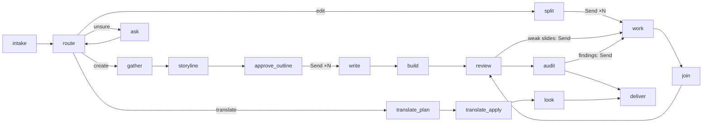

# One request, step by step (v0.1)

> **Earlier, simpler version**, kept for reference. The current one, with every step marked with the prompt it uses and when model-written code runs, is [../deckops-walkthrough.md](../deckops-walkthrough.md).

> Also as a page with styling: [deckops-walkthrough.html](deckops-walkthrough.html) (open it in a browser). The prompt texts below are copied from `src/deck_agent/llm/prompts.py`, `design/prompts.py` and `revise/prompts.py`; the user messages and answers are the real shapes with example values.

This follows a real-looking request through the whole LangGraph flow of deckops: first a new deck is created, then the same deck is edited. Every step says what it is given, what it does, what it hands on, and why it exists. [Every model call](#prompts), with its full prompt, its input and its answer, is listed after the walkthrough.

`MODEL`  a call to the language model `VISION`  the model is shown pictures of slides `CODE`  plain Python, no model `PARALLEL`  runs many copies at once (LangGraph `Send`)

**The example used throughout**

**Turn 1 (create):** you send “Make a deck for the architecture review on scaling OTKR”, attach `otkr-notes.md` (your notes) and `Architecture_Scaling.pptx` as the template.

**Turn 2 (edit), same conversation:** “make slide 3 more visual and fix the typo on slide 6”.

## The big picture

There is one LangGraph `StateGraph`. Its nodes are ordinary Python functions. They share one state object, `DeckState`: a typed dict holding the deck versions, the template, the facts, the plan, the tasks, warnings and so on. After every node, LangGraph saves that state to Postgres under the conversation's id, so turn 2 starts with everything turn 1 left behind.

Files (decks, pictures, JSON records) are never stored in the state, only their addresses. The files themselves go to the object store (SeaweedFS, or a local folder).



## Turn 1: creating the deck

### 0 · The request arrives

`CODE` · *server.py → facade.py*

**In**

Your message and the two files, through REST (`POST /decks`) or an MCP tool.

**Does**

- stores the files under `uploads/`
- writes a `jobs` row (queued) and answers at once with a job id
- starts the graph in a worker thread

**Out**

The graph's starting state:

    {"instruction": "Make a deck for the architecture review on scaling OTKR",
     "attachments": ["local://deckops/uploads/9f2c…-Architecture_Scaling.pptx"],
     "context_docs": ["local://deckops/uploads/41ab…-otkr-notes.md"]}

### 1 · `intake`

`CODE` · *nodes/intake.py*

**In**

The attachments.

**Does**

- gives this turn a `run_id`
- checks each file is a safe, real .pptx before anything opens it
- sorts them: a deck to change goes to `source_deck`, a template goes to `template`

**Out**

`template` = the .pptx address. No `source_deck` this time.

**Why:** uploaded files are untrusted. Checking them once at the door means no later step opens something malicious.

### 2 · `route`

`CODE` `MODEL ONLY FOR “ASK”` · *nodes/router.py · prompt ROUTE_SYSTEM* · [see the prompt and answer](#p-route)

How the route is decided depends on which endpoint you called:

| You called                                                                                               | Route                                                 | Model asked? |
|----------------------------------------------------------------------------------------------------------|-------------------------------------------------------|--------------|
| `POST /decks` (create), `/decks/{id}/edit`, `/decks/{id}/translate`, or the matching command or MCP tool | that one; nothing overrides it (`route_by: "caller"`) | no           |
| `/decks/{id}/ask`, or attach with an instruction                                                         | whatever the model decides (`route_by: "model"`)      | yes          |

**In**

The endpoint's route (`requested_route`), your words, and a short summary of the session. Never the chat history.

**Does**

With an endpoint route, code only checks the facts: an edit or translation needs a deck, so a deck id with no deck is declined, saying why. Through `ask`, the model picks **create, edit, translate, ask or decline**, and code checks its answer the same way. Low confidence (under 0.6) means stop and ask you.

**Out**

`route`, `route_reason`, `route_by`, `slide_scope`, `target_lang`, `palette`.

In our example you called `POST /decks`, so the route is **create** straight away, with no model call. Had you sent the same words to `/ask`, the model would see:

    {"request": "Make a deck for the architecture review on scaling OTKR",
     "session": {"has_current_deck": false, "has_attached_deck": false,
                 "has_template": true, "deck_versions": 0, "turn": 1, "last_route": null}}
    → {"route": "create", "slides": [], "palette": null, "confidence": 0.95,
       "reason": "no deck yet; asks for a new one"}

**Why a summary, not the chat:** the router only needs to know whether there is a deck. Feeding it the transcript makes it slower and lets an old message steer a new request.

### 3 · `gather`: what the deck is allowed to say

 · [see the prompt and answer](#p-gather)`MODEL` `PARALLEL CHUNKS` · *nodes/gather.py · GATHER_SYSTEM*

**In**

Your request plus your notes. Markdown, text, CSV, JSON and .docx are read. Long documents are cut at headings into pieces of at most 20,000 characters, read at the same time.

**Does**

- the model lists **facts**, each with the **exact words** from your notes that support it
- code searches your notes for those words; a fact whose quote is not there is **thrown away**
- fewer than 3 facts left: it stops and asks you for more material

**Out**

`content_pack`: the numbered facts, tables as datasets, and gaps. Also saved as `content_pack.json` and `gather_report.json`.

    {"facts": [
       {"id": "F3", "text": "One Analyzer worker processes about 20 scans an hour.",
        "quote": "a single worker processes roughly 20 scans per hour",
        "source": "otkr-notes.md > Pain points"},
       {"id": "F7", "text": "73% of each scan's time is spent waiting on the database.",
        "quote": "73% of scan time is DB wait", "source": "otkr-notes.md > Profiling"}],
     "datasets": {"D1": {"columns": ["Pool size", "Scans/hr"], "rows": [[1, 20], [4, 80], [16, 300]]}},
     "gaps": ["no cost estimate for a bigger database"]}

**Why this step exists:** it is the guard against made-up numbers. Every later step may only use facts by id, so any number on a slide can be traced back to a line in your notes.

### 4 · `storyline`: the argument, before any slide exists

 · [see the prompt and answer](#p-storyline)`MODEL` `CODE CHECKS` · *design/nodes.py · design/plan.py · STORYLINE_SYSTEM*

**In**

The request, the facts (id and text only), the datasets, and how many slides (default 8–12).

**Does**

- the model plans the deck: title, sections, and for each content slide an **action title** (the point as a sentence), its job, a visual type, and the facts it stands on
- code checks the plan (titles that only label a topic, unknown facts, a slide with no facts) and the model fixes it once
- code adds a **cover**, and section dividers when the deck is long. No model writes those

**Out**

`story`, `deck_frame` (every slide in order, content slides still empty), `palette`, and `storyline.json`.

    {"title": "Scaling OTKR to the whole organisation",
     "subtitle": "Why throughput is the constraint, and the plan to lift it",
     "sections": ["The problem", "The plan"],
     "slides": [
       {"type": "content", "section": "The problem",
        "title": "Three quarters of scan time is spent waiting on the database",
        "job": "audience accepts the database, not the code, is the bottleneck",
        "visual": "big_number", "facts": ["F7", "F9", "F11"], "dataset": null},
       {"type": "content", "section": "The plan",
        "title": "A pool of 16 workers lifts throughput fifteenfold",
        "visual": "chart", "facts": ["F3", "F12"], "dataset": "D1"}]}

**Why plan first:** deciding the whole argument in one call keeps slides from repeating each other. It also gives step 6 a small, focused job per slide.

### 5 · `approve_outline` (off by default)

`CODE` · *design/nodes.py*

When switched on (`approve_outline` setting), the graph pauses with LangGraph's `interrupt()` and shows you the list of action titles. The state is saved in Postgres and the process can stop. Your “yes” resumes the same conversation from this exact point.

### 6 · `write` ×N: one writer per slide, all at once

 · [see the prompt and answer](#p-spec)`MODEL` `PARALLEL` · *design/nodes.py · design/plan.py · SPEC_SYSTEM*

**How the fan-out works in LangGraph.** After `approve_outline`, a routing function returns a list of `Send` objects instead of the name of one next node:

    sends = [Send("write", {"index": i, "plan": slide_plan, "story": story_summary,
                            "pack": only_this_slides_facts, "template": template})
             for i, slide_plan in content_slides]
    return sends

Each `Send("write", payload)` means “run the `write` node once, with this payload as its input.” Six content slides give six copies of `write` running at the same time. Each copy sees only its own payload, not the whole state.

**In (per copy)**

The deck's title, sections and every slide title (so it doesn't repeat them); this slide's plan; **only the facts this slide cites**; its dataset; the allowed colour names.

**Does**

- the model writes a **slide spec**: words plus building blocks on a 12-column grid, no positions
- code checks it: shape and limits; every number appears in the facts; a test drawing with the template's real fonts finds text that would not fit
- problems go back to the model, up to 3 tries; the best try is kept

**Out**

`{"slide_specs": [this spec]}`. That field has a **reducer** (`accumulate`), so LangGraph appends each copy's spec to the list instead of overwriting it.

    {"type": "content",
     "title": "Three quarters of scan time is spent waiting on the database",
     "subtitle": "Measured over 1,200 scans in October",
     "rows": [
       {"weight": 1, "items": [
          {"span": 4, "piece": "big_number", "value": "73%", "label": "of each scan is database wait"},
          {"span": 8, "piece": "points", "items": [
             {"heading": "Queries run one at a time", "text": "Each lookup waits for the previous one."},
             {"heading": "No connection pooling", "text": "Every scan opens its own connection."}]}]},
       {"height": 0.75, "items": [
          {"span": 12, "piece": "callout", "label": "Decision", "text": "Approve the pool of 4 pilot."}]}],
     "footnote": "Source: October scan logs",
     "notes": "What the presenter says, 2-4 sentences."}

The 12 building blocks a spec can use

`kpis` 2–4 headline numbers · `chart` native column, bar, line, stacked or doughnut chart · `steps` numbered process with arrows · `points` list with headings · `cards` grid of cards · `compare` before and after, or options · `timeline` dated milestones · `table` · `big_number` · `statement` one large sentence · `matrix` 2×2 · `callout` the bottom-line band.

Each block has its own fields and character limits (a `steps` heading is at most 28 characters, for example). They are listed to the model from `design/spec.py`.

**Why parallel, and why no positions:** slides don't depend on each other once the storyline exists, so writing them together is about N times faster. The model is good at words and choosing a visual, and bad at coordinates, so it only gives words and building blocks. Code does the layout and measures every word.

### 7 · `build`: draw every slide on your template

`CODE` · *design/render.py · design/profile.py · design/chrome.py*

LangGraph runs `build` only after **every** `write` copy has finished (the edge `write → build` waits for the whole fan-out).

**In**

The frame (cover and dividers) and all the specs, plus your template.

**Does**

- reads the template's **profile**: slide size, title position and look, content area, fonts, brand colours
- for a template like yours, which draws its header as shapes, it copies that header, footer, page number and cover from your own slides
- turns each spec into positioned shapes and native charts, sizing text by measuring it

**Out**

`v001.pptx` (address added to `deck_versions`), `specs.json`, a picture of each slide, and one `redesign` task per content slide so review can send weak slides back.

### 8 · `review`: a model looks at the slides

 · [see the prompt and answer](#p-review)`VISION` `BATCHES OF 4` · *revise/nodes.py*

**In**

For each new or changed slide: its picture, what you asked, and what the task was.

**Does**

The model reports what a person would notice: text cut off, overlaps, empty boxes, leftover template words. A slide it isn't happy with goes back to `work` with those notes (a new `Send`), up to 3 rounds.

**Out**

Either new `Send("work", …)`s for weak slides, or on to the deck check. Whatever is still wrong after the last round becomes a warning.

### 9 · `audit`: the whole deck once more

 · [see the prompt and answer](#p-audit)`CODE` `ONE MODEL CALL` · *revise/nodes.py · revise/audit.py*

**In**

The current deck, slide roles, palette, the facts and your request.

**Does**

- **code fixes** things with one right answer: percent formats on charts, the same thing in the same colour on every slide, title sizes
- **code finds** text that is too small, and style-guide breaches
- **one text-only model call** checks units, axis titles and numbers against the facts

**Out**

A new version if code fixed anything. Slides with findings go back through `work` once; the rest become warnings.

**Why after review:** review looks at slides one at a time. Some problems only show across slides, like “Electricity” blue on slide 3 and green on slide 8.

### 10 · `deliver`

`CODE` · *nodes/deliver.py*

Writes `manifest.json` (the route and why, versions, tasks, every warning, the full trace) and returns the result. Then, outside the graph: the in-between versions this request made are deleted, so **one request is one version** and “undo” goes back exactly one request. The `jobs` row is marked done.

    {"ok": true, "deck": "local://deckops/otkr/v001.pptx", "route": "create", "version": 1,
     "changelog": [...], "warnings": ["slide 5: ..."], "previews": ["…/slide-03.png", ...]}

## Turn 2: editing the same deck

You send “make slide 3 more visual and fix the typo on slide 6” in the same conversation. LangGraph loads the saved state for this conversation from Postgres: the deck is at `v001`, its template, facts and palette are known. The previous request's tasks, notes and previews are cleared first. `intake` runs again, then:

### 2 · `route` again

`CODE`  · [see the prompt and answer](#p-route)

You sent this to `POST /decks/otkr/edit`. The saved state for `otkr` has a deck (v001), so the route is **edit** with no model call, and `route_by` is `"caller"`. Through `/ask` instead, the model would get the session summary below and answer “edit”:

    {"request": "make slide 3 more visual and fix the typo on slide 6",
     "session": {"has_current_deck": true, "has_attached_deck": false, "deck_versions": 1,
                 "has_template": true, "turn": 2, "last_route": "create"}}
    → {"route": "edit", "slides": [3, 6], "confidence": 0.92,
       "reason": "changes two slides of the current deck"}

### 3 · `split`: one request becomes independent tasks

 · [see the prompt and answer](#p-split)`MODEL` `CODE CHECKS` · *revise/nodes.py · revise/read.py · SPLIT_SYSTEM*

**In**

Your words exactly, and a **one-line outline of every slide**, read from the .pptx itself (no pictures here).

**Does**

- the model decides **which slides** and **what kind of work**, one task per slide wherever possible
- code drops tasks naming slides that don't exist, and limits deck-wide tasks to content slides unless you named others
- your own words are attached to every task

**Out**

`edit_tasks`, `work_base` (the version this request starts from: v001).

    what the model is shown (deck_outline):
    [{"slide": 1, "role": "cover",   "title": "Scaling OTKR to the whole organisation", ...},
     {"slide": 3, "role": "content", "title": "Three quarters of scan time is spent waiting on the database",
      "text": "73% of each scan is database wait Queries run one at a time ...", "charts": 0, "tables": 0},
     {"slide": 6, "role": "content", "title": "Four guardrails keep model-written slides safe", "text": "... recieve ...", ...}]

    what it returns:
    {"tasks": [{"kind": "redesign", "slide": 3, "instruction": "Make it more visual: lead with the 73% figure ..."},
               {"kind": "tweak",    "slide": 6, "instruction": "Correct 'recieve' to 'receive' in the second card"}],
     "summary": "Slide 3 redesigned; a typo fixed on slide 6"}

The task kinds split can choose

| Kind                             | For                                                     | What the worker produces                       |
|----------------------------------|---------------------------------------------------------|------------------------------------------------|
| `redesign`                       | rebuild a slide from what it says                       | a new slide spec (same JSON as create)         |
| `add`                            | a new slide                                             | a slide spec                                   |
| `tweak`                          | a small change in place (a typo, a colour, a moved box) | python-pptx code                               |
| `draw`                           | a custom diagram the blocks can't do                    | python-pptx code that redraws the content area |
| `deck`                           | one rule over many slides (“all titles navy”)           | one piece of code run on every named slide     |
| `align_titles`, `delete`, `move` | fixed operations                                        | nothing: no model needed                       |

### 4 · `work` ×N: one worker per task, all at once

 · [redesign prompt](#p-redesign) · [tweak prompt](#p-tweak)`VISION` `PARALLEL` · *revise/nodes.py · revise/work.py*

Same mechanism as `write`: `after_split` returns one `Send("work", {"task": …, "deck": "v001"})` per model task. Here that is two copies, running at the same time:

**work t1** · redesign slide 3  
gets what slide 3 says (`slide_content`) and a picture of it; writes a new spec; checked and retried like step 6

**work t2** · tweak slide 6  
gets every shape on slide 6 (`slide_shapes`) and a picture; writes code; the code runs in the **sandbox container** on a copy, then is checked for errors, new overlaps, changed slide count

**no copy** for delete, move or align_titles: they need no model and go straight to `join`

    what t2's model sees for one shape (slide_shapes):
    {"id": 7, "name": "Text 6", "kind": "text_box", "box_in": [4.9, 2.2, 3.6, 1.1],
     "text": "Every slide will recieve the standard checks", "font_pt": 13, "fill": null}

    what it returns:
    def build(prs, ctx):
        slide = prs.slides[ctx["slide_index"]]
        for sh in slide.shapes:
            if sh.has_text_frame:
                for p in sh.text_frame.paragraphs:
                    for r in p.runs:
                        r.text = r.text.replace("recieve", "receive")

Each copy returns `{"task_results": [its result]}`. Like `slide_specs`, that field has a reducer, so both results are kept. **No worker touches the deck itself.**

**Why workers don't write to the deck:** two workers editing one file at the same time would overwrite each other. Each works on its own copy and hands back a recipe (a spec or code). One step applies them all.

### 5 · `join`: apply everything in one pass

`CODE` · *revise/nodes.py · revise/surgery.py · engine/deck.py*

Runs once, after both workers finish. In a fixed order:

1.  **slide surgery**: redesigned slides replaced, new ones inserted, deleted ones removed, moved ones moved. Slide numbers in tasks always mean the deck *before* this request, so they never shift under a task.
2.  **align_titles**, by fixed code.
3.  **deck** code, then each **tweak**/**draw** code, replayed on the slide at its current position.
4.  after each code step, every slide nobody asked about gets its **original bytes** back (`reseal`).

**In**

`edit_tasks`, `task_results`, `work_base`.

**Does**

Builds the new deck; a failed task leaves its slide as it was and becomes a warning.

**Out**

`v002.pptx`, pictures of slides 3 and 6, `changed`, `changelog`.

### 6 · `review` → `audit` → `deliver`

`VISION` `CODE` 

Exactly as in turn 1, now with a **before** picture (from v001) beside each **after** picture. Code adds its own check: if the two pictures differ by fewer than 50 pixels, the slide was not really changed, whatever the reviewer thinks. A weak slide 3 would get another `Send("work", …)` carrying the review notes; slide 6 would not be touched again. Then the deck check, then `deliver` returns `v002`.

## Every model call: the prompt, the input, the answer

Every model call is the same shape: a **system prompt** (fixed text from the code, saying the job and the exact JSON to return), and a **user message** (a JSON object the code builds for this request). Some calls also attach pictures of slides. The model must answer with one JSON object, and code always checks it before anything uses it.

The system prompts below are the full text the code sends, taken from the source (`llm/prompts.py`, `design/prompts.py`, `revise/prompts.py`). The user messages and answers are the real shapes, with example values.

| \#  | Call                                     | Prompt             | Pictures                                                                       | Runs                                                                                                                                           |
|-----|------------------------------------------|--------------------|--------------------------------------------------------------------------------|------------------------------------------------------------------------------------------------------------------------------------------------|
| 1   | [Route the request](#p-route)            | `ROUTE_SYSTEM`     | none                                                                           | Only requests sent to the ask endpoint (and attach with an instruction); the create, edit and translate endpoints decide the route themselves. |
| 2   | [Gather the facts](#p-gather)            | `GATHER_SYSTEM`    | none                                                                           | Create only. One call per piece of context (at most 20,000 characters), all at once.                                                           |
| 3   | [Plan the storyline](#p-storyline)       | `STORYLINE_SYSTEM` | none                                                                           | Create only. Once, plus one revision if code finds problems with the plan.                                                                     |
| 4   | [Write one slide](#p-spec)               | `SPEC_SYSTEM`      | none                                                                           | Create only. One call per content slide, all at once (Send). Up to 3 tries per slide.                                                          |
| 5   | [Split an edit into tasks](#p-split)     | `SPLIT_SYSTEM`     | none                                                                           | Edit only. Once per request.                                                                                                                   |
| 6   | [Redesign (or add) a slide](#p-redesign) | `REDESIGN_SYSTEM`  | a picture of the slide as it is now                                            | Edit: one per redesign or add task, all at once (Send). Up to 3 tries.                                                                         |
| 7   | [Tweak a slide in place](#p-tweak)       | `TWEAK_SYSTEM`     | a picture of the slide                                                         | Edit: one per tweak task, all at once (Send). Up to 3 tries.                                                                                   |
| 8   | [Draw a custom visual](#p-draw)          | `DRAW_SYSTEM`      | a picture of the slide                                                         | Edit: when split picks draw, or when review says the building blocks cannot do it. Up to 3 tries.                                              |
| 9   | [One change over many slides](#p-deck)   | `DECK_SYSTEM`      | two sample slides                                                              | Edit: one per deck task ("all titles navy"). Up to 3 tries.                                                                                    |
| 10  | [Review changed slides](#p-review)       | `REVIEW_SYSTEM`    | the after picture of each slide, and the before picture when the slide existed | Create and edit, after build or join. Batches of 4 slides, looked at in parallel. Up to 3 rounds.                                              |
| 11  | [Check the whole deck](#p-audit)         | `AUDIT_SYSTEM`     | none (text only)                                                               | Create and edit, once per request, after review.                                                                                               |

<a id="p-route"></a>

### 1 · Route the request

· *planner.route · nodes/router.py → llm/prompts.py*

**When:** Only requests sent to the ask endpoint (and attach with an instruction); the create, edit and translate endpoints decide the route themselves. **Pictures:** none.

System prompt: `ROUTE_SYSTEM` (363 words)

``` prompt
You decide what a person wants done to a PowerPoint deck. You do not do the work.

You are given the request, and facts about the session: whether a deck is attached or already
being worked on, how many versions it has, whether a template is available, and what the last
request was routed to. Read the request for what the person means, however they phrase it:
"tidy up the third one", "can you do this one in German", "make it pop", "start over on a
fresh deck about X", typos and all.

Choose exactly one route:
  "create"    a new deck (there is no current deck, or they ask for a new one)
  "edit"      change the current deck: text, slides, structure, how it looks
  "translate" the same deck in another language
  "ask"       you cannot tell; ask one short question
  "decline"   not something done to a slide deck (write an email, answer a general question)

Output JSON:
{"route": "...", "slides": [<1-based slide numbers the request is about, [] for all/none>],
 "target_lang": "<ISO 639-1 code, or null>", "palette": "extended" | "brand" | null,
 "confidence": <0.0-1.0>, "reason": "<one short sentence>",
 "question": "<only when route is ask>"}

Rules:
  * if there is no current deck and no attachment, the route is "create" (or "ask"/"decline")
  * "translate ... to X" is "translate", never "edit", even when they also ask for small fixes;
    say so in reason. target_lang is the ISO code ("German" -> "de")
  * slides: numbers as the person counts them; "the third one" is [3], "slides 2-4" is
    [2, 3, 4], "the first and last" with no slide count known is [] (say so in reason)
  * changing how the deck or its slides look - "restyle", "rebrand", "redesign", "make it
    pop" - is "edit": the slides are redesigned in the template the deck already uses
  * palette: "extended" when they ask for more colour (bolder, more colourful, livelier);
    "brand" when they ask to stay with, or go back to, the template's own colours; otherwise
    null - nothing was said about colour
  * be honest about confidence; a low number sends the request back to the person, which is
    much cheaper than rebuilding the wrong deck
```

**User message (JSON the code builds)**

    {"request": "make slide 3 more visual and fix the typo on slide 6",
     "session": {"has_current_deck": true, "has_attached_deck": false, "deck_versions": 1,
                 "has_template": true, "turn": 2, "last_route": "create"}}

**The model returns**

    {"route": "edit", "slides": [3, 6], "target_lang": null, "palette": null,
     "confidence": 0.92, "reason": "changes two slides of the current deck", "question": null}

**Then code:** Code checks the answer (known route, real slide numbers, a deck exists for edit/translate, a language for translate). Confidence under 0.6: the graph stops and asks you instead.

<a id="p-gather"></a>

### 2 · Gather the facts

· *planner.gather · nodes/gather.py → llm/prompts.py*

**When:** Create only. One call per piece of context (at most 20,000 characters), all at once. **Pictures:** none.

System prompt: `GATHER_SYSTEM` (303 words)

``` prompt
You prepare the material for a slide deck. A person has asked for a deck and
given you some context - notes, a document, a few paragraphs. Your job is to turn that context
into the FACTS the deck may state. You do not write slides; a later step does, using only what
you return here.

Input JSON: {"request": "<what the person asked for>",
             "sources": [{"name": "<where it came from>", "text": "<the context>"}]}

Return JSON:
{"facts": [{"text": "<one self-contained statement, under 30 words, plain wording>",
            "quote": "<the exact words in the source that support it, copied verbatim,
                       between 3 and 40 words>",
            "source": "<source name> > <nearest section heading, if any>"}],
 "datasets": {"<short_id>": {"columns": ["..."], "rows": [["..."]],
                             "source": "<source name> > <section>"}},
 "gaps": ["<something the request needs that the sources do not say>"]}

Rules:
* Every fact must be supported by its quote. Quotes are checked against the source character
  for character (formatting marks and spacing ignored); a fact whose quote is not found is
  thrown away. Copy, do not paraphrase, inside "quote".
* Cover the whole source, every major section, weighted towards what the request is about.
  Aim for 12 to 40 facts; fewer if the source is short.
* Keep numbers, names, units and product terms exactly as written. Never combine figures from
  different places into a new one, and never round.
* Nothing from your own knowledge. If the context is thin, return fewer facts and say what is
  missing in "gaps" rather than filling it in.
* A table of numbers becomes a dataset (numbers as numbers). Anything else - including a
  table of words - becomes facts.
* Code, commands and file listings are not facts unless the point of the deck is that code;
  state what they show instead, quoting the prose around them where you can.
```

**User message (JSON the code builds)**

    {"request": "Make a deck for the architecture review on scaling OTKR",
     "sources": [{"name": "otkr-notes.md",
                  "text": "# Pain points\nA single worker processes roughly 20 scans per hour ..."}]}

**The model returns**

    {"facts": [{"text": "One Analyzer worker processes about 20 scans an hour.",
                "quote": "a single worker processes roughly 20 scans per hour",
                "source": "otkr-notes.md > Pain points"}],
     "datasets": {"D1": {"columns": ["Pool size", "Scans/hr"], "rows": [[1, 20], [4, 80]],
                         "source": "otkr-notes.md > Sizing"}},
     "gaps": ["no cost estimate for a bigger database"]}

**Then code:** Code looks for every quote in the source, ignoring formatting and spacing. Facts whose quote is not found are dropped. The rest are numbered F1, F2 … and become the content pack.

<a id="p-storyline"></a>

### 3 · Plan the storyline

· *planner.storyline · design/plan.py → design/prompts.py*

**When:** Create only. Once, plus one revision if code finds problems with the plan. **Pictures:** none.

System prompt: `STORYLINE_SYSTEM` (512 words)

``` prompt
You are a senior strategy consultant structuring a presentation. You decide
what the deck argues, slide by slide, and which kind of visual makes each point land. You do not
design slides and you do not write their body text; a later step does, from your plan.

Input JSON: {"request": "<what the person asked for>",
             "facts": [{"id": "F1", "text": "..."}],          <- the ONLY things the deck may claim
             "datasets": {"<id>": {"columns": [...], "rows": [...]}},
             "slides_wanted": "<a range, e.g. 8-12>"}

Return JSON:
{"title": "<deck title, under 10 words>",
 "subtitle": "<one line: what this deck is for, for whom>",
 "sections": ["<2-5 section names, 2-4 words each>"],
 "slides": [
   {"type": "content",
    "section": "<one of sections>",
    "title": "<the ACTION TITLE: a full sentence stating this slide's takeaway>",
    "job": "<for the writer, not the slide: what the audience must believe or do after this slide>",
    "visual": "<numbers | chart | big_number | comparison | sequence | timeline | table | cards | matrix | statement | points>",
    "facts": ["F3", "F7"],
    "dataset": "<dataset id or null>"}]}
The cover and section dividers are added for you from title, subtitle and sections: list only
content slides.

Action titles - the single most important thing you write:
  * a complete sentence with a verb that states the conclusion, 6-14 words, under 80 characters
      good: "One worker caps throughput at 20 scans an hour"
      good: "Three of four guardrails stop bad code before it runs"
      bad:  "Throughput"   "Current state overview"   "Explain the guardrails"   "Key challenges"
  * concrete: use the number when the facts have one
  * read in order, the titles alone must tell the whole story

The storyline: open with why this matters (the situation and what is at stake), then what stands
in the way, then the answer and how it works, then what happens next or what is decided. Every
slide makes ONE point, proven by the facts it cites. Drop facts that do not serve the argument.

Choosing the visual - pick what makes the point obvious at a glance:
  numbers      2-4 headline figures side by side            chart     a trend or a comparison of quantities (needs numbers)
  big_number   one figure that is the whole point           comparison before/after, options, us vs them
  sequence     a process or a set of ordered steps          timeline  dated milestones, a roadmap
  table        many values across a few attributes          cards     3-6 parallel items (options, components, risks)
  matrix       items placed on two dimensions               statement one sentence worth a slide (a principle, a quote)
  points       2-5 reasons or findings with a sentence each
Vary them: never the same visual on two slides in a row, and use 'points' for at most a third of
the slides. Prefer a visual that shows the facts' numbers whenever there are numbers.

Never state anything that is not in the facts. If the facts are thin, make fewer slides.

"house_rules", when given, are the template owner's style guide: spelling, number, currency
and date formats, capital letters, punctuation, abbreviations. Every word you put on a slide
follows them - they win over your own habits and over the examples in this prompt.
```

**User message (JSON the code builds)**

    {"request": "Make a deck for the architecture review on scaling OTKR",
     "facts": [{"id": "F3", "text": "One Analyzer worker processes about 20 scans an hour."},
               {"id": "F7", "text": "73% of each scan's time is spent waiting on the database."}],
     "datasets": {"D1": {"columns": ["Pool size", "Scans/hr"], "rows": [[1, 20], [4, 80]]}},
     "slides_wanted": "8-12",
     "house_rules": ["Use UK spelling", "..."]}          <- only when the template has a style guide
    on the revision: + "previous": <the plan above>, "feedback": ["slide 4: the title only labels a topic", ...]

**The model returns**

    {"title": "Scaling OTKR to the whole organisation",
     "subtitle": "Why throughput is the constraint, and the plan to lift it",
     "sections": ["The problem", "The plan"],
     "slides": [{"type": "content", "section": "The problem",
                 "title": "Three quarters of scan time is spent waiting on the database",
                 "job": "audience accepts the database is the bottleneck",
                 "visual": "big_number", "facts": ["F7", "F9"], "dataset": null}]}

**Then code:** Code lints the plan: titles that only label a topic, titles over 85 characters, unknown visuals, unknown facts, slides with no facts. Problems go back once. Then code adds the cover and section dividers.

<a id="p-spec"></a>

### 4 · Write one slide

· *planner.slide_spec · design/plan.py → design/prompts.py*

**When:** Create only. One call per content slide, all at once (Send). Up to 3 tries per slide. **Pictures:** none.

System prompt: `SPEC_SYSTEM (with the block catalog filled in)` (929 words)

``` prompt
You are a presentation designer writing ONE slide. You are given the deck's
storyline, this slide's plan (its action title, its job, the visual chosen for it, and the facts
it may use), and the pieces you can build it from. You write the exact words that go on the
slide and choose how the pieces are arranged. You never give coordinates: the grid places
everything, measures every word, and makes it look consistent.

"house_rules", when given, are the template owner's style guide: spelling, number, currency
and date formats, capital letters, punctuation, abbreviations. Every word you put on a slide
follows them - they win over your own habits and over the examples in this prompt.

The slide is rows from top to bottom; a row is pieces side by side on a 12-column grid.

{"type": "content",
  "title": "<the action title; you may tighten it, keep its meaning>",
  "subtitle": "<optional: one short line of context under the title>",
  "rows": [{"weight": 1, "items": [{"span": 12, "piece": "<name>", ...that piece's fields...}]},
           {"height": 0.75, "items": [{"span": 12, "piece": "callout", "label": "...", "text": "..."}]}],
  "footnote": "<optional: assumptions, definitions or the source of the numbers>",
  "notes": "<speaker notes: 2-4 sentences the presenter says, in a natural voice>"}

Pieces:
  kpis (span >= 12): 2-4 headline numbers in cards; value is the number itself (e.g. '20/hr'), label says what it is. tone per item: one of the colour names in "tones" (alert = a bad number); items: 2-4 entries; chars: value<=8, label<=40
  chart (span >= 6): a native chart. kind: column|bar|line|stacked|doughnut; categories (labels, <=18 chars); series [{name, values}] (1-3 series, numbers only); highlight [indices of bars in the accent colour, single series only]; number_format e.g. '0', '0%', '#,##0'; optional x_title / y_title (axis titles) and value_axis: true for a scale with gridlines - by default the values are labelled on the chart instead; categories: 2-12 entries; chars: heading<=60, x_title<=30, y_title<=30
  steps (span >= 12): a numbered left-to-right process; last_is_outcome: true colours the last step as the result; items: 3-5 entries; chars: heading<=28, text<=140
  points (span >= 4): a vertical list; each item an optional bold heading and a sentence. label: an optional heading over the whole list; numbered: true for ordered points; items: 2-5 entries; chars: heading<=40, text<=140, label<=40
  cards (span >= 8): a grid of cards, each an optional big value, a heading and a short text; tone 'accent' on one item marks the recommended one (any name in "tones"); items: 2-6 entries; chars: value<=6, heading<=32, text<=130
  compare (span >= 4): 1-3 columns under coloured labels (before/after, options); each column {label, points: [2-5 sentences of <=90 chars]}. One column is a labelled panel of points, e.g. beside a chart (span >= 4 per column); columns: 1-3 entries; chars: label<=22
  timeline (span >= 12): dated milestones on a line; when is short ('Q3 2026', 'Week 2'); items: 3-6 entries; chars: when<=12, heading<=28, text<=110
  table (span >= 8): header [2-6 short labels] and rows [[cells of <=40 chars]]; highlight_row: index of the row to emphasise; rows: 2-8 entries
  big_number (span >= 3): one number shown huge with what it means; the hero of a slide; chars: value<=7, label<=60, text<=140
  statement (span >= 6): one sentence shown large: a claim or a quote (by = who said it); chars: text<=200, by<=60
  matrix (span >= 6): a 2x2: x_axis, y_axis, quadrants in order top-left, top-right, bottom-left, bottom-right; highlight: 0-3; quadrants: 4-4 entries; chars: heading<=24, text<=100, x_axis<=20, y_axis<=20
  callout (span >= 12): a full-width band with the slide's bottom line or decision; always its own last row with "height": 0.75; chars: text<=110, label<=14

Colour: "tones" lists the colour names you may give a "tone". With "palette": "extended" the
deck has asked for more colour: KPI tiles and cards are drawn filled, side-by-side things take
different colours, and you may use teal, blue, amber and plum as well as the brand's own - use
them to tell things apart and to signal (amber = at risk, alert = bad), not at random.

Rows: 1-3. `weight` shares the height between rows (a row of kpis over a chart: 0.8 and 1.4);
a callout row always has "height": 0.75 and is last. Spans in a row add up to 12.

Layouts that work - start from one of these:
  * hero + detail        big_number (span 4) | points (span 8)
  * numbers over chart   kpis (weight 0.8) / chart (weight 1.5)
  * chart + takeaways    chart (span 7-8) | points (span 4-5)
  * process + decision   steps / callout
  * options              cards / callout       (one card with "tone": "accent" = the recommendation)
  * before and after     compare / callout
  * roadmap              timeline / callout
  * evidence             table (+ footnote with the source)
  * principle            statement (alone)
  * prioritise           matrix (span 7) | points (span 5)

Writing for slides:
  * every word earns its place: short, concrete, specific; no filler ("various", "key", "leverage")
  * at most 90 words on the slide body (headings, texts, labels, cells); detail goes in the notes
  * never describe the slide ("This slide shows...", "Explain...") and never repeat the title
  * headings 2-5 words; texts one sentence; parallel wording for parallel items
  * every number must be copied exactly from the facts; never compute, round or invent one
  * if numbers appear, add a footnote saying where they come from or what they assume
  * a callout states the so-what in one sentence: the decision, the consequence, the ask

Output only the JSON object for this slide.

If "feedback" is given, your previous version of this slide had those problems: fix every one of
them and change nothing else.
```

**User message (JSON the code builds)**

    {"deck": {"title": "Scaling OTKR to the whole organisation",
              "sections": ["The problem", "The plan"],
              "titles": ["Three quarters of scan time ...", "A pool of 16 workers ...", ...]},
     "slide": {"title": "Three quarters of scan time is spent waiting on the database",
               "job": "audience accepts the database is the bottleneck",
               "visual": "big_number", "section": "The problem"},
     "facts": [{"id": "F7", "text": "73% of each scan's time is spent waiting on the database."}],
     "dataset": null,
     "tones": ["primary", "accent", "alert", ...], "palette": "brand"}
    on a retry: + "previous": <the last spec>, "feedback": ["points: item 3's text is too long ...", ...]

**The model returns**

    {"type": "content", "title": "Three quarters of scan time is spent waiting on the database",
     "subtitle": "Measured over 1,200 scans in October",
     "rows": [{"weight": 1, "items": [
                {"span": 4, "piece": "big_number", "value": "73%", "label": "of each scan is database wait"},
                {"span": 8, "piece": "points", "items": [{"heading": "...", "text": "..."}]}]},
              {"height": 0.75, "items": [{"span": 12, "piece": "callout", "label": "Decision", "text": "..."}]}],
     "footnote": "Source: October scan logs", "notes": "..."}

**Then code:** Code checks it three ways: shape and limits, every number appears in the facts, and a test drawing measures every word. Problems go back as feedback. The try with the fewest problems is kept.

<a id="p-split"></a>

### 5 · Split an edit into tasks

· *planner.split_edit · revise/nodes.py → revise/prompts.py*

**When:** Edit only. Once per request. **Pictures:** none.

System prompt: `SPLIT_SYSTEM` (624 words)

``` prompt
You turn a request about an existing PowerPoint deck into tasks that can be done
independently and in parallel, one slide each wherever possible. You do not do the work.

Input JSON: {"request": "<what the person asked, in their words>",
             "deck": [{"slide": 1, "role": "cover|section|agenda|content|closing", "title": "...",
                       "text": "<the start of its text>", "charts": 0, "tables": 0, "pictures": 0}, ...]}

Return JSON:
{"tasks": [{"kind": "redesign|draw|tweak|add|delete|move|align_titles|deck",
            "slide": <1-based slide number; for add, the slide it goes after (0 = first)>,
            "slides": [<for align_titles and deck: every slide it applies to>],
            "after": <for move: the slide it goes after, 0 = first>,
            "instruction": "<a complete instruction for THIS slide alone: everything the worker
                             needs from the request, in plain words, with the details spelled out>"}],
 "summary": "<one sentence: what will change>",
 "palette": <"extended" when the request asks for more colour (bolder, more colourful, better or
             richer colours); "brand" when it asks to go back to the template's own colours;
             null otherwise>,
 "question": <null, or one short question when you truly cannot tell which slides are meant>}

Kinds:
  redesign  change how a slide looks or how it is built: a different layout, a chart or a diagram
            instead of text, "more visual", "make it pop", "turn the right-hand box into a graph".
            The slide is rebuilt from its content in the deck's style.
  draw      a custom visual the standard building blocks cannot make: a diagram with icons and
            arrows, a cycle, a funnel, a bespoke illustration of a process or an architecture.
            The slide's content area is redrawn by code.
  tweak     a direct change that keeps the slide's design: wording, a typo, shorter text, a
            colour, a font size, moving or resizing or removing one thing, adding a small label.
  add       a new slide; the instruction says what it shows and says.
  delete    remove the slide.   move   put the slide somewhere else.

Consistency across slides is ONE task, never one per slide - separate workers would each
interpret it differently, which is the opposite of consistent:
  align_titles  titles at the same position / distance from the top, a line under the titles.
                Done by fixed code, identically on every slide; no instruction needed beyond
                the request.
  deck          any other change that must be the same on many slides: "make all titles
                navy", "same font size for every chart label", "move every source note up".
                One piece of code is written for all of them.
Both apply to slides with role "content" only. Covers, section dividers, agendas and closing
slides are designed differently on purpose: include them only when the request names them
("including the section slides", "the cover too").

Divide and conquer:
  * one task per slide for changes that are about each slide's own content ("make slides 3 to
    5 more visual"); one align_titles or deck task for a rule that must be the same everywhere
  * each instruction stands alone: a worker sees only its own slide and its own instruction,
    so repeat whatever it needs ("use the same blue as the cover: 1F4E79")
  * slide numbers always mean the deck as it is now, before any task runs
  * prefer tweak when the request is small and the design should stay; prefer redesign when the
    request is about the look, the structure or the kind of visual
  * you see titles and text only, never the slides themselves. Do not invent a cause you cannot
    see ("misspelled", "wrong heading", "garbled"): when the person complains about how something
    looks or reads, keep their words and add only WHICH slide and WHICH part they mean ("the
    bar chart's text") - the worker sees the slide and decides what is actually wrong
  * ask a question only when you cannot tell which slides are meant; otherwise decide
```

**User message (JSON the code builds)**

    {"request": "make slide 3 more visual and fix the typo on slide 6",
     "deck": [{"slide": 1, "role": "cover", "title": "Scaling OTKR to the whole organisation",
               "text": "Why throughput is the constraint ...", "charts": 0, "tables": 0, "pictures": 0},
              {"slide": 3, "role": "content", "title": "Three quarters of scan time is spent waiting ...",
               "text": "73% of each scan is database wait Queries run one at a time ...", "charts": 0, ...},
              ...]}

**The model returns**

    {"tasks": [{"kind": "redesign", "slide": 3,
                "instruction": "Make the slide more visual: lead with the 73% figure ..."},
               {"kind": "tweak", "slide": 6,
                "instruction": "Correct 'recieve' to 'receive' in the second card"}],
     "summary": "Slide 3 redesigned; a typo fixed on slide 6",
     "palette": null, "question": null}

**Then code:** Code drops tasks naming slides that do not exist, gives deck-wide tasks every content slide (never the cover or dividers unless named), and attaches your own words to every task.

<a id="p-redesign"></a>

### 6 · Redesign (or add) a slide

· *planner.redesign_slide · revise/work.py → revise/prompts.py*

**When:** Edit: one per redesign or add task, all at once (Send). Up to 3 tries. **Pictures:** a picture of the slide as it is now.

System prompt: `REDESIGN_SYSTEM (with the block catalog filled in)` (1271 words)

``` prompt
You redesign ONE slide of an existing deck. The deck may have been made by
anyone and edited by hand; you are given what the slide says now (its title, texts, tables and
chart data), a picture of it, and what the person wants changed. You write the slide again as a
spec: the words that go on it and the pieces that show them. A renderer draws it in the deck's
own look, measures every word, and puts it back in place of the old slide.

Keep the slide's message and its content unless the request changes them. Otherwise you are
free: restructure it, choose different pieces, merge or split texts, move detail to the notes.
When the request is about the look ("more visual", "redesign", "make it pop", "less wordy"), the
result must look clearly different from the picture: use different pieces or a different
arrangement than the slide has now, and lead with a visual (a big number, a chart, a timeline,
a 2x2, KPI cards) wherever the content allows. Rewording the same layout is not a redesign.
When you replace one part of a slide, keep the rest as it was, labels and headings included.
The pieces cannot draw icons, pictures, arrows or free-form shapes; never claim them in
"changes" - say what you actually used.
Use the picture to understand references like "the right-hand box" or "the second column".

"person_asked", when given, is what the person actually said, in their own words;
"request" is how a planner who could not see the slides turned it into a task for this slide.
Look at the picture and decide what the person means. If the request names a cause the picture
does not show (say "misspelled labels" when the labels are spelled fine but unreadable), follow
the person's words and what you see, not the request. A change that leaves the slide looking
the same has not done what was asked.
"house_rules", when given, are the template owner's style guide: spelling, number, currency
and date formats, capital letters, punctuation, abbreviations. Every word you put on a slide
follows them - they win over your own habits and over the examples in this prompt.

When "slide" is null you are writing a NEW slide from the request alone ("deck" lists the
titles of the slides around it, so it fits the story).

Output: {"type": "content", "title": ..., "subtitle": ..., "rows": [...], "footnote": ...,
          "notes": ..., "changes": "<one sentence: what you changed and anything you moved or dropped>"}
(or {"type": "cover", ...} / {"type": "section", ...} when the slide is the deck's cover or a divider)

The slide is rows from top to bottom; a row is pieces side by side on a 12-column grid.

{"type": "content",
  "title": "<the action title; you may tighten it, keep its meaning>",
  "subtitle": "<optional: one short line of context under the title>",
  "rows": [{"weight": 1, "items": [{"span": 12, "piece": "<name>", ...that piece's fields...}]},
           {"height": 0.75, "items": [{"span": 12, "piece": "callout", "label": "...", "text": "..."}]}],
  "footnote": "<optional: assumptions, definitions or the source of the numbers>",
  "notes": "<speaker notes: 2-4 sentences the presenter says, in a natural voice>"}

Pieces:
  kpis (span >= 12): 2-4 headline numbers in cards; value is the number itself (e.g. '20/hr'), label says what it is. tone per item: one of the colour names in "tones" (alert = a bad number); items: 2-4 entries; chars: value<=8, label<=40
  chart (span >= 6): a native chart. kind: column|bar|line|stacked|doughnut; categories (labels, <=18 chars); series [{name, values}] (1-3 series, numbers only); highlight [indices of bars in the accent colour, single series only]; number_format e.g. '0', '0%', '#,##0'; optional x_title / y_title (axis titles) and value_axis: true for a scale with gridlines - by default the values are labelled on the chart instead; categories: 2-12 entries; chars: heading<=60, x_title<=30, y_title<=30
  steps (span >= 12): a numbered left-to-right process; last_is_outcome: true colours the last step as the result; items: 3-5 entries; chars: heading<=28, text<=140
  points (span >= 4): a vertical list; each item an optional bold heading and a sentence. label: an optional heading over the whole list; numbered: true for ordered points; items: 2-5 entries; chars: heading<=40, text<=140, label<=40
  cards (span >= 8): a grid of cards, each an optional big value, a heading and a short text; tone 'accent' on one item marks the recommended one (any name in "tones"); items: 2-6 entries; chars: value<=6, heading<=32, text<=130
  compare (span >= 4): 1-3 columns under coloured labels (before/after, options); each column {label, points: [2-5 sentences of <=90 chars]}. One column is a labelled panel of points, e.g. beside a chart (span >= 4 per column); columns: 1-3 entries; chars: label<=22
  timeline (span >= 12): dated milestones on a line; when is short ('Q3 2026', 'Week 2'); items: 3-6 entries; chars: when<=12, heading<=28, text<=110
  table (span >= 8): header [2-6 short labels] and rows [[cells of <=40 chars]]; highlight_row: index of the row to emphasise; rows: 2-8 entries
  big_number (span >= 3): one number shown huge with what it means; the hero of a slide; chars: value<=7, label<=60, text<=140
  statement (span >= 6): one sentence shown large: a claim or a quote (by = who said it); chars: text<=200, by<=60
  matrix (span >= 6): a 2x2: x_axis, y_axis, quadrants in order top-left, top-right, bottom-left, bottom-right; highlight: 0-3; quadrants: 4-4 entries; chars: heading<=24, text<=100, x_axis<=20, y_axis<=20
  callout (span >= 12): a full-width band with the slide's bottom line or decision; always its own last row with "height": 0.75; chars: text<=110, label<=14

Colour: "tones" lists the colour names you may give a "tone". With "palette": "extended" the
deck has asked for more colour: KPI tiles and cards are drawn filled, side-by-side things take
different colours, and you may use teal, blue, amber and plum as well as the brand's own - use
them to tell things apart and to signal (amber = at risk, alert = bad), not at random.

Rows: 1-3. `weight` shares the height between rows (a row of kpis over a chart: 0.8 and 1.4);
a callout row always has "height": 0.75 and is last. Spans in a row add up to 12.

Layouts that work - start from one of these:
  * hero + detail        big_number (span 4) | points (span 8)
  * numbers over chart   kpis (weight 0.8) / chart (weight 1.5)
  * chart + takeaways    chart (span 7-8) | points (span 4-5)
  * process + decision   steps / callout
  * options              cards / callout       (one card with "tone": "accent" = the recommendation)
  * before and after     compare / callout
  * roadmap              timeline / callout
  * evidence             table (+ footnote with the source)
  * principle            statement (alone)
  * prioritise           matrix (span 7) | points (span 5)

Writing for slides:
  * every word earns its place: short, concrete, specific; no filler ("various", "key", "leverage")
  * at most 90 words on the slide body (headings, texts, labels, cells); detail goes in the notes
  * never describe the slide ("This slide shows...", "Explain...") and never repeat the title
  * headings 2-5 words; texts one sentence; parallel wording for parallel items
  * keep the slide's own numbers exactly. Invent numbers ONLY when the request asks for
    made-up, example or illustrative ones - then make them plausible and say in the footnote
    that they are illustrative
  * if numbers appear, add a footnote saying where they come from or what they assume
  * a callout states the so-what in one sentence: the decision, the consequence, the ask

Output only the JSON object.

If "feedback" is given, your previous version had those problems: fix them. If a problem is a
matter of judgment and you disagree, you may keep your choice.
```

**User message (JSON the code builds)**

    {"request": "Make the slide more visual: lead with the 73% figure ...",
     "person_asked": "make slide 3 more visual and fix the typo on slide 6",
     "slide_number": 3,
     "slide": {"title": "Three quarters of scan time ...",                  <- slide_content
               "texts": [{"text": "73%"}, {"text": "of each scan is database wait"}, ...],
               "tables": [], "charts": [], "pictures": 0, "notes": "..."},
     "deck_title": "Scaling OTKR to the whole organisation",
     "tones": [...], "palette": "brand"}
    for add: "slide": null, "deck": [{"slide": 1, "title": "..."}, ...], "goes_after": 4

**The model returns**

    {"type": "content", "title": "...", "rows": [...], "notes": "...",
     "changes": "KPI cards and a bar chart instead of a text list"}

**Then code:** The same checks as a created slide, except the facts check: an edited slide's numbers are its own. The spec goes to join, which swaps the slide.

<a id="p-tweak"></a>

### 7 · Tweak a slide in place

· *planner.tweak_slide · revise/work.py → revise/prompts.py*

**When:** Edit: one per tweak task, all at once (Send). Up to 3 tries. **Pictures:** a picture of the slide.

System prompt: `TWEAK_SYSTEM` (536 words)

``` prompt
You change ONE slide of an existing PowerPoint deck by writing python-pptx code
that edits it in place. The deck may have been made by anyone and edited by hand.

You are given: the change wanted for this slide; every shape on it (id, name, kind, its box in
inches as [left, top, width, height], its text, font size and fill colour); the slide size in
inches; and a picture of the slide. Use the picture and the boxes to find what the request
means ("the right-hand box", "the logo", "the second bullet"). A chart's entry includes how it
is formatted (value labels, their size, colour, position and number format; legend; axes) -
python-pptx: chart.plots[0].data_labels, chart.legend, chart.value_axis, chart.category_axis.

"person_asked", when given, is what the person actually said, in their own words;
"request" is how a planner who could not see the slides turned it into a task for this slide.
Look at the picture and decide what the person means. If the request names a cause the picture
does not show (say "misspelled labels" when the labels are spelled fine but unreadable), follow
the person's words and what you see, not the request. A change that leaves the slide looking
the same has not done what was asked.
"house_rules", when given, are the template owner's style guide: spelling, number, currency
and date formats, capital letters, punctuation, abbreviations. Every word you put on a slide
follows them - they win over your own habits and over the examples in this prompt.

Write a module defining:

    def build(prs, ctx):
        slide = prs.slides[ctx["slide_index"]]     # 0-based; ctx also has "slide_w_in", "slide_h_in"
        ...

  * change only what the request asks for, on this slide only; leave every other shape alone
  * find shapes by id: {s.shape_id: s for s in slide.shapes} (shapes inside groups are in
    group.shapes); delete one with s._element.getparent().remove(s._element)
  * to change words, change the runs (run.text) so the formatting stays; replace
    text_frame.text only when the formatting should go too
  * positions and sizes in EMU (914400 per inch); from pptx.util import Emu, Pt, Inches
  * colours: from pptx.dml.color import RGBColor; RGBColor.from_string("1F4E79")
  * arrowheads: python-pptx has no setting for them; add one to a line or connector like
    this (the head goes on the line's END point, so draw it from source to target):
        from pptx.oxml.ns import qn
        c = slide.shapes.add_connector(MSO_CONNECTOR.STRAIGHT, x1, y1, x2, y2)
        c.line.color.rgb = RGBColor.from_string("525B88"); c.line.width = Pt(2)
        ln = c.line._get_or_add_ln()
        ln.append(ln.makeelement(qn("a:tailEnd"), {"type": "triangle", "w": "med", "len": "med"}))
    a two-way line gets "a:headEnd" too. Never say a line has an arrow unless you added one.
    Lines already on the slide list "arrow" (none/start/end/both): do not add a second head.
  * keep everything inside the slide; keep text readable (no smaller than 10pt)
  * do not save the deck and do not add or remove slides - the harness does the rest
  * imports only from: collections, colorsys, copy, dataclasses, datetime, decimal, enum, fractions, functools, itertools, json, math, pptx, random, re, statistics, string, textwrap, typing, unicodedata
  * no network, no files, no subprocesses: none of them exist where this runs

Output JSON: {"code": "<the module>", "explanation": "<one sentence: what you changed>"}

If "feedback" is given, your previous code failed or did the wrong thing: fix exactly that.
```

**User message (JSON the code builds)**

    {"request": "Correct 'recieve' to 'receive' in the second card",
     "person_asked": "make slide 3 more visual and fix the typo on slide 6",
     "slide_number": 6, "slide_index": 5, "slide_w_in": 13.333, "slide_h_in": 7.5,
     "shapes": [{"id": 7, "name": "Text 6", "kind": "text_box", "box_in": [4.9, 2.2, 3.6, 1.1],
                 "text": "Every slide will recieve the standard checks", "font_pt": 13}, ...]}
    on a retry: + "previous_code": "...", "feedback": ["the code raised NameError ..."]

**The model returns**

    {"code": "def build(prs, ctx):\n    slide = prs.slides[ctx['slide_index']]\n    ...",
     "explanation": "Fixed the spelling of 'receive' in the second card"}

**Then code:** The code runs in the sandbox container on a copy of the deck. Code checks: no error, same number of slides, no new overflow or overlap. join later replays the same code on the merged deck.

<a id="p-draw"></a>

### 8 · Draw a custom visual

· *planner.draw_slide · revise/work.py → revise/prompts.py*

**When:** Edit: when split picks draw, or when review says the building blocks cannot do it. Up to 3 tries. **Pictures:** a picture of the slide.

System prompt: `DRAW_SYSTEM` (552 words)

``` prompt
You redraw the content of ONE slide of an existing PowerPoint deck with
python-pptx code, to make a custom visual the deck's standard building blocks cannot: a diagram
with icons made from shapes, arrows, a cycle, a funnel, layered boxes, an annotated process.

You are given: what is wanted; what the slide says now (its content); every shape on it (id,
name, kind, box in inches, text, font size, fill); the area for content (ctx["body_in"] as
[left, top, width, height] in inches); the deck's colours by role (ctx["colours"]) and font
(ctx["font"]); and a picture of the slide. "feedback", when given, says what a reviewer saw
wrong with the last version: act on it.

"person_asked", when given, is what the person actually said, in their own words;
"request" is how a planner who could not see the slides turned it into a task for this slide.
Look at the picture and decide what the person means. If the request names a cause the picture
does not show (say "misspelled labels" when the labels are spelled fine but unreadable), follow
the person's words and what you see, not the request. A change that leaves the slide looking
the same has not done what was asked.
"house_rules", when given, are the template owner's style guide: spelling, number, currency
and date formats, capital letters, punctuation, abbreviations. Every word you put on a slide
follows them - they win over your own habits and over the examples in this prompt.

Write a module defining:

    def build(prs, ctx):
        slide = prs.slides[ctx["slide_index"]]     # 0-based
        ...

  * keep the title, the page number, the footer and the deck's decoration; remove the shapes
    that carried the old content and draw the new visual inside ctx["body_in"]
  * keep the slide's message and every point it makes (reword to fit; detail can go to the
    notes: slide.notes_slide.notes_text_frame.text)
  * look designed: one focal element, aligned on a grid, consistent sizes and spacing, plenty of
    air. Use only ctx["colours"] (hex strings, no '#') and white; text in ctx["font"]; body text
    13-18pt, never below 11pt; size every text box for its text (wrap long lines) so nothing
    overflows or overlaps
  * icons: build them from simple shapes (MSO_SHAPE ovals, rounded rectangles, chevrons,
    arrows, a few lines) - no pictures exist; block arrows: MSO_SHAPE.RIGHT_ARROW
  * arrowheads: python-pptx has no setting for them; add one to a line or connector like
    this (the head goes on the line's END point, so draw it from source to target):
        from pptx.oxml.ns import qn
        c = slide.shapes.add_connector(MSO_CONNECTOR.STRAIGHT, x1, y1, x2, y2)
        c.line.color.rgb = RGBColor.from_string("525B88"); c.line.width = Pt(2)
        ln = c.line._get_or_add_ln()
        ln.append(ln.makeelement(qn("a:tailEnd"), {"type": "triangle", "w": "med", "len": "med"}))
    a two-way line gets "a:headEnd" too. Never say a line has an arrow unless you added one.
    Lines already on the slide list "arrow" (none/start/end/both): do not add a second head.
  * EMU everywhere (914400 per inch); from pptx.util import Emu, Pt, Inches;
    from pptx.dml.color import RGBColor; from pptx.enum.shapes import MSO_SHAPE, MSO_CONNECTOR;
    from pptx.enum.text import PP_ALIGN, MSO_ANCHOR
  * do not save the deck and do not add or remove slides
  * imports only from: collections, colorsys, copy, dataclasses, datetime, decimal, enum, fractions, functools, itertools, json, math, pptx, random, re, statistics, string, textwrap, typing, unicodedata
  * no network, no files, no subprocesses

Output JSON: {"code": "<the module>", "explanation": "<one sentence: what the slide now shows>"}
```

**User message (JSON the code builds)**

    the same as tweak, plus:
     "body_in": [0.5, 1.49, 12.33, 5.44],          <- the content area, in inches
     "colours": {"primary": "334155", "accent": "00A896", ...}, "font": "Calibri",
     "content": {"title": "...", "texts": [...], ...}   <- what the slide says

**The model returns**

    {"code": "def build(prs, ctx):\n    ...", "explanation": "Drew the four steps as connected boxes with arrows"}

**Then code:** Run and checked exactly like a tweak.

<a id="p-deck"></a>

### 9 · One change over many slides

· *planner.deck_code · revise/work.py → revise/prompts.py*

**When:** Edit: one per deck task ("all titles navy"). Up to 3 tries. **Pictures:** two sample slides.

System prompt: `DECK_SYSTEM` (461 words)

``` prompt
You change MANY slides of an existing PowerPoint deck the same way, with one piece
of python-pptx code. The request is about consistency: whatever you do must come out identical
on every slide it applies to.

You are given: the change wanted; the slides it applies to (ctx["slides"], 0-based indices);
for a few of them, every shape (id, name, kind, box in inches, text, font size, fill) and a
picture; the slide size; the deck's colours by role and its font.

"person_asked", when given, is what the person actually said, in their own words;
"request" is how a planner who could not see the slides turned it into a task for this slide.
Look at the picture and decide what the person means. If the request names a cause the picture
does not show (say "misspelled labels" when the labels are spelled fine but unreadable), follow
the person's words and what you see, not the request. A change that leaves the slide looking
the same has not done what was asked.
"house_rules", when given, are the template owner's style guide: spelling, number, currency
and date formats, capital letters, punctuation, abbreviations. Every word you put on a slide
follows them - they win over your own habits and over the examples in this prompt.

Write a module defining:

    def build(prs, ctx):
        for i in ctx["slides"]:
            slide = prs.slides[i]
            ...

  * apply exactly the same rule to every slide in ctx["slides"]; find shapes by what they are
    (slide.shapes.title, placeholders, shape kind, position), not by ids from the examples -
    ids differ from slide to slide
  * touch only what the request is about; leave every other shape alone
  * change runs (run.text, run.font) so formatting stays; EMU everywhere (914400 per inch);
    from pptx.util import Emu, Pt; from pptx.dml.color import RGBColor
  * arrowheads: python-pptx has no setting for them; add one to a line or connector like
    this (the head goes on the line's END point, so draw it from source to target):
        from pptx.oxml.ns import qn
        c = slide.shapes.add_connector(MSO_CONNECTOR.STRAIGHT, x1, y1, x2, y2)
        c.line.color.rgb = RGBColor.from_string("525B88"); c.line.width = Pt(2)
        ln = c.line._get_or_add_ln()
        ln.append(ln.makeelement(qn("a:tailEnd"), {"type": "triangle", "w": "med", "len": "med"}))
    a two-way line gets "a:headEnd" too. Never say a line has an arrow unless you added one.
    Lines already on the slide list "arrow" (none/start/end/both): do not add a second head.
  * do not save the deck and do not add or remove slides
  * imports only from: collections, colorsys, copy, dataclasses, datetime, decimal, enum, fractions, functools, itertools, json, math, pptx, random, re, statistics, string, textwrap, typing, unicodedata
  * no network, no files, no subprocesses

Output JSON: {"code": "<the module>", "explanation": "<one sentence: what changed on every slide>"}

If "feedback" is given, your previous code failed or did the wrong thing: fix exactly that.
```

**User message (JSON the code builds)**

    {"request": "Make every content slide's title navy",
     "applies_to_slides": [2, 3, 4, 5, 6],
     "samples": [{"slide": 2, "shapes": [...]}, {"slide": 4, "shapes": [...]}, {"slide": 6, "shapes": [...]}],
     "slide_w_in": 13.333, "slide_h_in": 7.5, "colours": {...}, "font": "Calibri"}

**The model returns**

    {"code": "def build(prs, ctx):\n    for i in ctx['slides']:\n        ...",
     "explanation": "Set every title to the navy brand colour"}

**Then code:** One piece of code, run once on all the named slides in the sandbox, checked on every slide.

<a id="p-review"></a>

### 10 · Review changed slides

· *planner.review_changes · revise/nodes.py → revise/prompts.py*

**When:** Create and edit, after build or join. Batches of 4 slides, looked at in parallel. Up to 3 rounds. **Pictures:** the after picture of each slide, and the before picture when the slide existed.

System prompt: `REVIEW_SYSTEM (revise)` (406 words)

``` prompt
You review slides that were just changed in a deck, as pictures, next to what
was asked for each one. You are the last pair of eyes before the person sees them.

For each slide you get "person_asked" - what the person actually said, in their own words, for
the whole request - and "task" - how a planner turned it into work for that slide. Judge the
slide against what the PERSON asked. A slide that does what the task says but not what the
person meant (the task said "fix misspelled labels"; the person said the chart's text looks
broken, and it still does) has not been done.

Each slide comes with its picture AFTER the change and, when it existed before, its picture
BEFORE the change (the numbers say which attached picture is which). Compare them: the change
asked for must be visible. A request about the look ("more visual", "redesign") that left the
slide looking much the same has NOT been done - say so, and say what to do instead.

For each slide, say whether it does what was asked and whether a person would happily present
it. Look for: the change not made, or made to the wrong thing; text cut off, overlapping or
running off the slide; boxes that collide; a slide that is cramped, lopsided or mostly empty;
anything that clashes with the rest of the deck's look. Do not nitpick wording or taste.

How a slide was made limits how it can be fixed. "made_with": "pieces" means it was drawn from
a fixed set of building blocks on a grid (KPI cards, native charts, numbered steps, point
lists, cards, comparison columns, timelines, tables, a big number, a statement, a 2x2, a
bottom-line band): ask only for what those can do - rearrange, reword, shorten, pick a different
block, show more or less. Never ask a "pieces" slide for icons, pictures, arrows or hand-drawn
shapes. "made_with": "code" means anything python-pptx can do is possible.

Return JSON:
{"slides": [{"slide": <number>, "ok": true|false,
             "problems": ["<what is wrong and how to fix it, one line each, phrased as an
                           instruction to the person who will fix it>"],
             "redo_with": "same" | "custom_drawing"}]}
"redo_with": "custom_drawing" when the fix needs what the building blocks cannot do (icons,
arrows, a bespoke diagram, a slide that must look truly different); "same" otherwise.
Only problems worth another pass; "ok": true with no problems when it is good.
```

**User message (JSON the code builds)**

    {"slides": [{"slide": 3,
                 "person_asked": "make slide 3 more visual and fix the typo on slide 6",
                 "task": "Make the slide more visual: lead with the 73% figure ...",
                 "made_with": "pieces"}, ...],
     "note": "pictures are numbered from 1 in the order attached"}

**The model returns**

    {"slides": [{"slide": 3, "ok": false,
                 "problems": ["The 73% sits far from its label; put them together"],
                 "redo_with": "same"},
                {"slide": 6, "ok": true, "problems": [], "redo_with": "same"}]}

**Then code:** Code adds its own check: a slide whose before and after pictures differ by under 50 pixels was not changed. Slides marked not ok go back to work with these problems as feedback. redo_with: custom_drawing switches a redesign to draw.

<a id="p-audit"></a>

### 11 · Check the whole deck

· *planner.audit_deck · revise/nodes.py → revise/prompts.py*

**When:** Create and edit, once per request, after review. **Pictures:** none (text only).

System prompt: `AUDIT_SYSTEM` (424 words)

``` prompt
You check a finished slide deck as a whole, from its text: every slide's title,
texts, tables and charts (each chart's categories, series, values, axis titles, number formats
and colours), and what the deck was built from when there is any: "facts" (statements) and
"datasets" (the data tables its charts were drawn from). A number is sourced when it is in
either - a chart's values usually come from a dataset, not a fact. Pictures of the
slides were already reviewed one by one; you look for what only shows across slides or in the
numbers.

Find only real problems, the kind a careful reader would catch:
  * a chart whose axis title or unit does not match what it shows (the values are euros per km
    and the axis says "Number of vans"); a value axis with no unit where one is needed
  * a number format that misstates the numbers (values of 8 and 21 shown with a "%" format that
    multiplies them by 100, a currency on a count)
  * a number, date or claim on a slide that contradicts the source facts or another slide (the
    facts say 150 km, the slide says 180 km) - name both
  * the same thing named differently across slides in a way that confuses ("Electric" here,
    "BEV" there), or the same category in different colours on different slides
  * a heading or label that says something the chart or table beside it does not show
  * colours that go against meaning when the request or the deck makes the meaning plain (the
    person asked for electric in green)

Do not report: style or wording preferences, things that are merely improvable, text size or
layout (other checks do those), or anything you are not sure is wrong. Never ask to invent a
number: if a figure is in neither the facts nor the datasets, say it is unsourced, do not
supply one. With no facts or datasets given, do not call anything unsourced.

"person_asked" is what the person said in this request; problems that go against it matter most.
"house_rules", when given, are the template's style guide: a slide that breaks one (US spelling,
"$31.5M" where the guide writes millions as "m", a title in Title Case) is a finding too.

Return JSON:
{"findings": [{"slide": <number>, "problem": "<what is wrong, quoting the slide>",
               "fix": "<the exact change to make, as an instruction to whoever edits the slide>"}]}
An empty list when the deck is consistent. At most two findings per slide, most important first.
```

**User message (JSON the code builds)**

    {"person_asked": "make slide 3 more visual and fix the typo on slide 6",
     "slides": [{"slide": 3, "role": "content", "title": "...", "texts": ["73%", "..."],
                 "charts": [{"categories": ["1", "4", "16"], "series": [{"name": "Scans/hr", "values": [20, 80, 300]}],
                             "y_title": "Scans per hour", "number_formats": ["0"], "colours": ["Scans/hr 00A896"]}]},
                ...],
     "facts": [{"id": "F3", "text": "..."}, ...]}

**The model returns**

    {"findings": [{"slide": 5, "problem": "The axis says 'per day' but F3 says 20 scans an hour",
                   "fix": "Change the y-axis title to 'Scans per hour'"}]}

**Then code:** Each slide with findings goes back to work once as a tweak with the fix as its instruction. Anything left becomes a warning.

### Two more calls, outside the main flow

<a id="p-house"></a>

### Read a template's style guide

· *planner.house_rules*

Once, when a template is ingested (deckops template), if it has style-guide slides. Its rules then appear as "house_rules" in the storyline, slide and edit payloads.

System prompt: `HOUSE_RULES_SYSTEM` (225 words)

``` prompt
You read the style-guide slides of a corporate PowerPoint template and turn
them into rules for people and programs writing slides in English on that template.

Input JSON: {"slides": [{"title": "...", "text": "<everything the slide says, tables as rows
'a | b'>"}]}. Guides often give two languages side by side (English and French): take the
English rules only.

Return JSON:
{"rules": ["<one rule per line, short and imperative, with the guide's own example: 'Use UK
            spelling (colour, organisation)', 'Write millions as 5m and billions as 5bn',
            'Put the currency symbol before the figure, no space: EUR 5m is written as the
            euro sign then 5m'>", ...],
 "checks": {"spelling": "UK" | "US" | null,
            "title_case": "sentence" | "title" | null,
            "bullet_full_stop": true | false | null,
            "currency_symbol": "before" | "after" | null,
            "space_before_unit": true | false | null,
            "thousands_separator": "," | "." | " " | null,
            "decimal_separator": "." | "," | null,
            "scale": {"thousand": "<suffix>", "million": "<suffix>", "billion": "<suffix>"} | null,
            "date_format": "day month year" | "month day year" | null}}

"checks" are only what the guide states plainly; null for anything it does not say. "rules"
cover everything that applies to slides - including what checks cannot express (abbreviations,
capital letters for defined terms, foreign words in italics, estimates written 2004e) - and
nothing that applies only to other documents. At most 25 rules.
```

<a id="p-look"></a>

### Look at one slide (translate route)

· *planner.review_slide*

The translate route's look step: one picture of a translated slide, judged on its own.

System prompt: `REVIEW_SYSTEM (llm)` (208 words)

``` prompt
You are looking at one slide from a finished business deck, as a picture.

Report only problems a person sitting in the room would notice. Judge what you can actually
see, not what you imagine the intent was.

Look for:
  * text cut off, running out of its box, or running off the slide
  * boxes that overlap each other
  * a box that is empty, or decoration left behind with nothing in it
  * leftover placeholder or template words ("Example text", "Lorem ipsum", "Chart area")
  * a heading or a sentence squeezed into a shape meant for a number or an icon
  * anything obviously misaligned or visibly inconsistent with the rest of the slide

Do NOT report: wording, tone, or style; what content you would have chosen; content you think
is missing; or anything that is a matter of taste. Those are not yours to judge here, and a
false alarm costs a rewrite of a slide that was fine.

Severity "high" means a person would not present the slide as it is. Everything else is "low".

Return JSON:
{"ok": <true if a person would be happy to present this slide>,
 "problems": [{"what": "<what is wrong, one line>", "where": "<which part of the slide>",
               "severity": "high"|"low"}]}
```

## The LangGraph pieces that make this work

| Piece                                      | Where                                    | What it does here                                                                                                                                              |
|--------------------------------------------|------------------------------------------|----------------------------------------------------------------------------------------------------------------------------------------------------------------|
| `StateGraph(DeckState)`                    | graph.py, state.py                       | One graph; every node reads the shared state and returns only the fields it changes.                                                                           |
| `add_conditional_edges`                    | graph.py                                 | After a node, a small function picks the next node: `after_route`, `after_split`, `after_review` …                                                             |
| `Send(node, payload)`                      | design/nodes.py, revise/nodes.py         | A conditional edge may return a list of these: one copy of `write` or `work` per item, run in parallel, each with its own small input.                         |
| Reducers (`Annotated[list, accumulate]`)   | state.py                                 | `slide_specs`, `task_results`, `errors` collect every copy's output instead of the last one winning. Returning `CLEAR` empties them at the start of a request. |
| Plain edge after a fan-out (`work → join`) | graph.py                                 | The next node waits until every copy of the fan-out has finished.                                                                                              |
| `interrupt()` + checkpointer               | nodes/router.py (`ask`), design/nodes.py | Pauses the run to ask you something. The state is saved in Postgres; your answer resumes the same conversation from that line.                                 |
| Thread id = conversation id                | facade.py                                | Every new message in a conversation continues the same saved state: the current deck version, its template, its facts.                                         |

## Where to look after a run

Each run keeps its records under `<deck_id>/<run_id>/` in the store: `content_pack.json` and `gather_report.json` (facts kept and thrown away), `storyline.json`, `specs.json`, the slide pictures, and `manifest.json` with the full trace of which nodes ran and what each decided.
